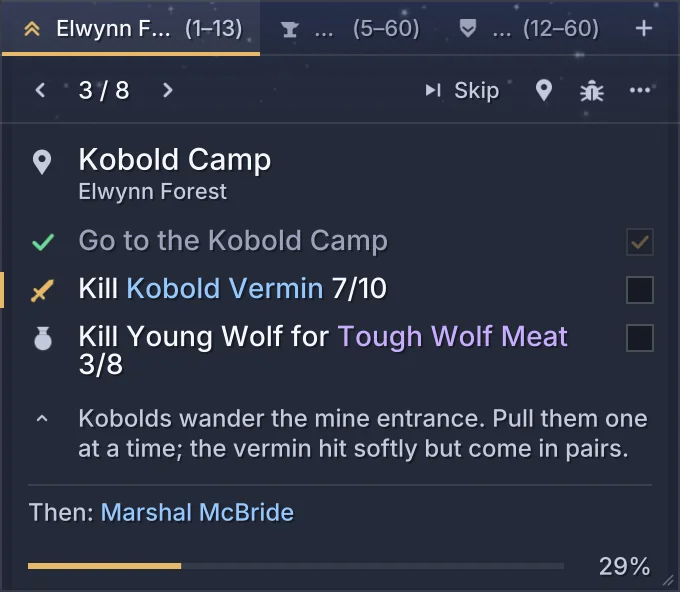
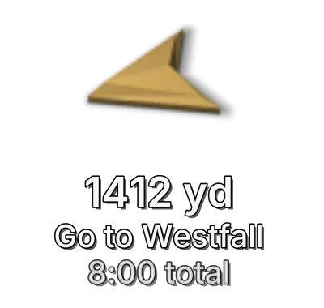
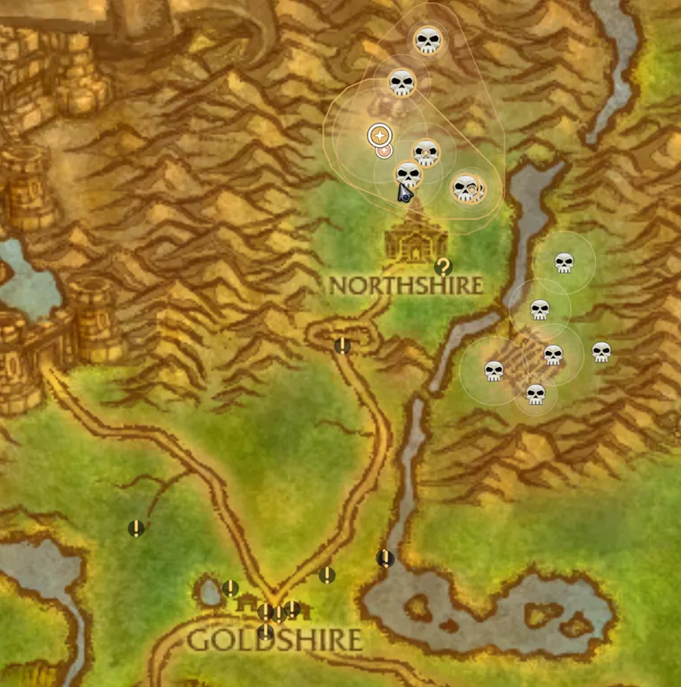
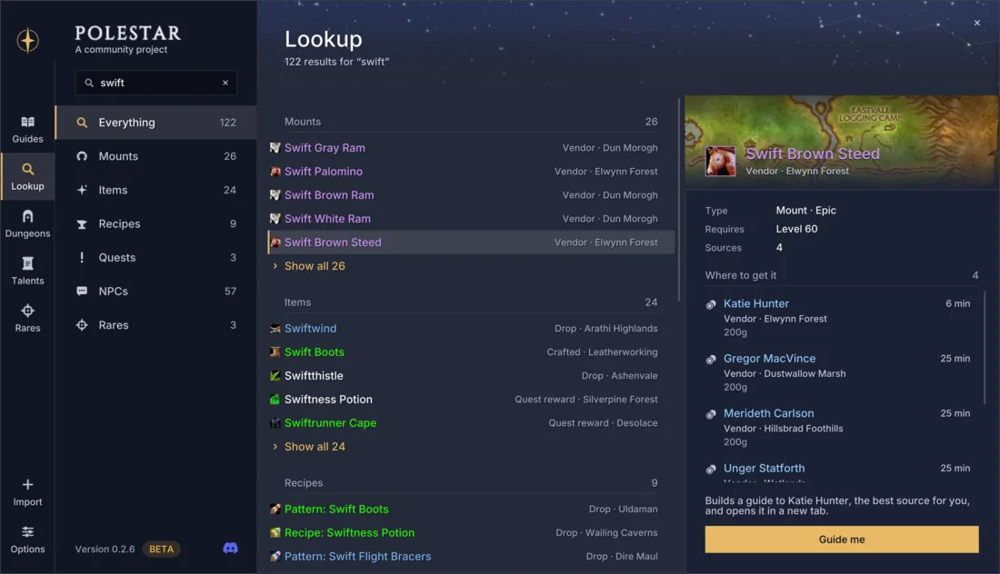
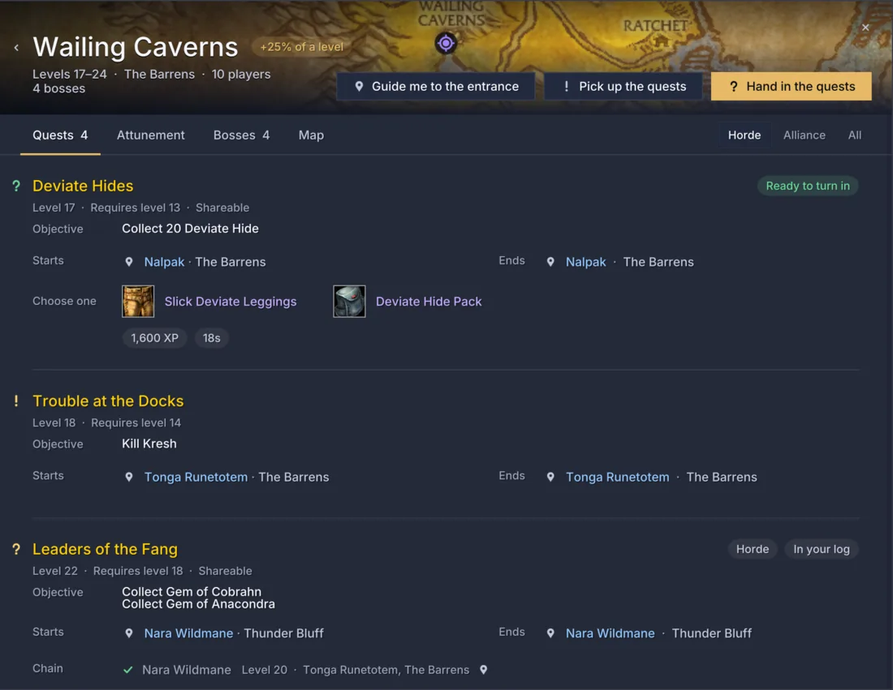
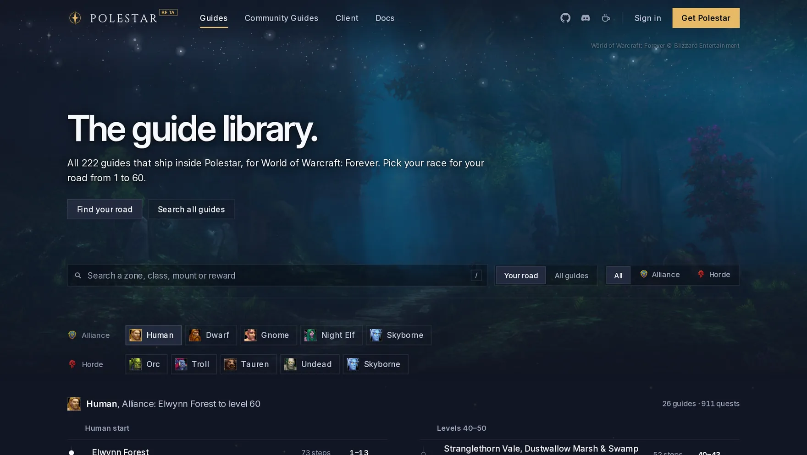
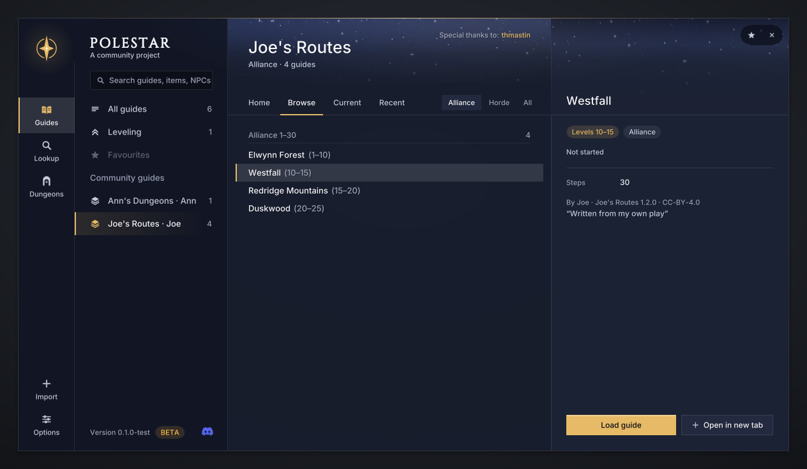
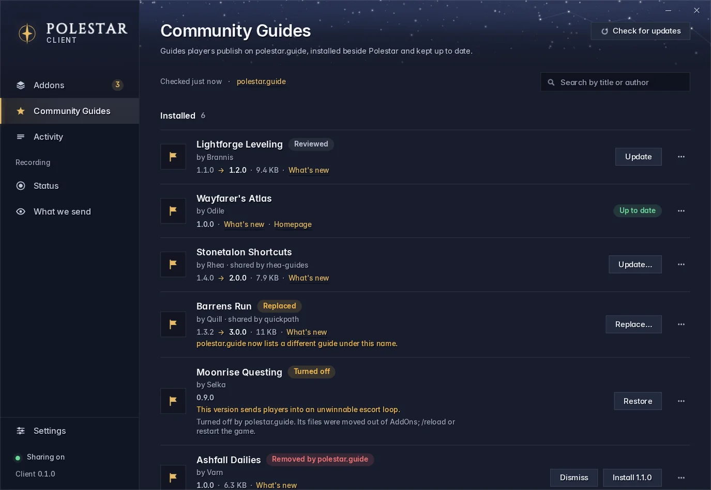
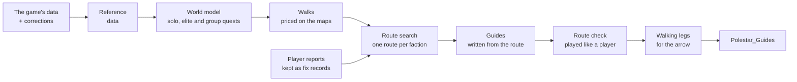

<p align="center">
  <picture>
    <source media="(prefers-color-scheme: dark)" srcset="docs/assets/banner-dark.svg">
    <source media="(prefers-color-scheme: light)" srcset="docs/assets/banner-light.svg">
    
  </picture>
</p>

<p align="center">
  A free, open-source guide addon for <b>World of Warcraft: Forever</b>: step-by-step leveling routes for every race from 1 to 60, a waypoint arrow that walks real paths, and guides for class quests, professions, reputations, mounts and pets.
</p>

<p align="center">
  <a href="https://www.curseforge.com/wow/addons/polestar"></a>
  <a href="https://polestar.guide/client"></a>
  <a href="https://github.com/fitzforge/polestar/releases/latest"></a>
</p>

<p align="center">
  <a href="https://polestar.guide"><b>polestar.guide</b></a>: every guide, community guides and the docs ·
  <a href="https://discord.gg/polestar"><b>Polestar Discord</b></a>: questions, feedback and bug reports ·
  Polestar is free; if it saves you a few hours, you can <a href="https://ko-fi.com/0xfitz"><b>buy me a coffee</b></a>.
</p>

<p align="center">
  <a href="https://www.curseforge.com/wow/addons/polestar"></a>
  <a href="https://github.com/fitzforge/polestar/releases/latest"></a>
  <a href="https://github.com/fitzforge/polestar/actions/workflows/ci.yml"></a>
  <a href="https://discord.gg/polestar"></a>
  <a href="LICENSE"></a>
  <a href="https://ko-fi.com/0xfitz"></a>
</p>

<p align="center">
  <a href="#quick-start">Quick start</a> ·
  <a href="#what-it-is">What it is</a> ·
  <a href="#a-look-inside">A look inside</a> ·
  <a href="#polestarguide">polestar.guide</a> ·
  <a href="#community-guides">Community guides</a> ·
  <a href="#polestar-client">Polestar Client</a> ·
  <a href="#features">Features</a> ·
  <a href="#help-and-feedback">Help</a> ·
  <a href="#how-the-routes-are-made">How the routes are made</a> ·
  <a href="#building-from-source">Building from source</a> ·
  <a href="#contributing">Contributing</a> ·
  <a href="#data-and-licensing">Data and licensing</a>
</p>

<table align="center">
  <tr>
    <td align="center" width="220"><a href="#quick-start"><b>Play</b></a><br>Install the addon and follow the arrow.</td>
    <td align="center" width="220"><a href="https://polestar.guide/guides"><b>Browse the guides</b></a><br>Every guide, step by step, on polestar.guide.</td>
    <td align="center" width="220"><a href="#writing-a-community-addon"><b>Write guides</b></a><br>Publish your own routes as a community guide.</td>
    <td align="center" width="220"><a href="#building-from-source"><b>Work on Polestar</b></a><br>Fix a guide, build the addon, run the tests.</td>
  </tr>
</table>

## Quick start

1. **Install it** one of three ways:
   - **The CurseForge app:** search for
     [Polestar Guides](https://www.curseforge.com/wow/addons/polestar) and
     install it, then skip to step 3.
   - **The [Polestar Client](https://polestar.guide/client):** a small app for
     Windows, macOS and Linux that finds the game, installs Polestar and keeps
     it up to date, community guides included. Skip to step 3.
   - **By hand:** download `Polestar-<version>.zip` from the
     [newest release](https://github.com/fitzforge/polestar/releases/latest),
     under *Assets* (not "Source code").
2. **Unzip it into the game's AddOns folder**, so the Polestar folders
   (`Polestar`, `Polestar_Guides`, `Polestar_Codex`, `Polestar_Nav` and the
   others, with one `Polestar_<language>` folder per client language such as
   `Polestar_deDE`) sit directly inside it:
   `World of Warcraft/_classic_beta_/Interface/AddOns/` on the beta client,
   `_forever_/Interface/AddOns/` on the `_forever_` client. The same zip
   works for both; if you have both clients installed, unzip into each one.
   In the game's AddOns list they all sit under one "Polestar" heading,
   which its arrow folds away.
3. **Restart the game completely** (a `/reload` does not load new addons) and
   log in. The guide window opens with a guide for your race, level and zone:
   follow the arrow, and the goals tick themselves off as you play.

Good to know:

- `/polestar guides` opens the hub: every guide, Lookup, Dungeons, Talents
  and Rares. `/polestar options` holds every setting; quest markers on the map
  are off until you turn them on under **Map**. The Polestar button on the
  minimap's edge shows or hides the guide window with a click; right-click it
  for a short menu, drag it to move it (Options, Map, Guide & quests,
  Minimap button turns it off).
- `/polestar skip` moves on for good; `/polestar next` and `prev` only look
  ahead or back.
- **Updating:** the CurseForge app and the Polestar Client update Polestar for
  you. By hand, delete the old Polestar folders, then unzip the new release
  the same way. Coming from 0.2.x, also delete the `Polestar_Guides_deDE`,
  `Polestar_Names_deDE` kind (one of each per language): `Polestar_deDE` and
  its siblings replace them, and Polestar reminds you at login while they are
  still there.
- **"No guides installed" or "Polestar Guides is turned off":** Polestar
  Guides is unticked in the game's AddOns list. The list shows it indented
  under Polestar, and ticking Polestar (after **Disable All**, say) does not
  tick it. Polestar asks once at login, and the guide window and the guide
  menu have a **Turn on Polestar Guides and reload** button that turns it and
  its parts back on for all your characters. By hand: tick Polestar Guides
  and the rows under it, or right-click Polestar in the list and pick the
  option that enables its whole group.
- **Memory:** the arrow's walking routes (`Polestar_Nav`) load after login,
  never in combat, and each continent's walking maps load when you get there.
  **Walk real paths** (Options, Arrow & routes) off never loads them.
- **Optional:** `Polestar_Recorder` (`Polestar_Recorder-<version>.zip` in the
  same release, or from the Polestar Client) records your play for the
  recording program that improves the routes. With the Polestar Client it
  records while sharing is on, which it is by default (one click in the
  Client stops it, and `/psrec off` always wins); on its own it stays off
  until you type `/psrec on`.
- **Community guides** are routes other players publish for Polestar, on
  [polestar.guide](https://polestar.guide/community): see
  [Community guides](#community-guides).
- Something wrong? Click the bug in the guide window, beside Skip: say what
  went wrong; the report already holds the step, where you stand, your other
  addons and the versions. **Copy report** and post it in **#bugs** on the
  [Polestar Discord](https://discord.gg/polestar): a bot files it for the
  developers and replies in your thread when it's fixed. **Get the invite** is
  there if you're not in the Discord yet. Have a GitHub account?
  **Open on GitHub** pre-fills a new issue with your report. `/polestar report`
  opens the window too, and [issues](https://github.com/fitzforge/polestar/issues)
  are welcome as well. The release's `SHA256SUMS` holds the zips' checksums.

## What it is

Polestar is one addon for the whole of WoW: Forever. It carries 256 guides:
61 leveling guides that take both factions from 1 to 60 from every race's
starting zone (Zephras Isle for the Skyborne included), 82 class guides for
every class's quest chains and class mounts, the twelve professions from 1 to
300, 27 reputations, 7 exploration guides, the Legacy challenges, 64
collectible guides (mounts and pets) and 2 miscellaneous guides. Every one of
them can be read step by step on [polestar.guide](https://polestar.guide/guides).

Around the guides it adds a 3D waypoint arrow that walks real paths (on
Polestar's walking maps, with a router that started from Shortest Path
Forever's by Cillian Berragan) and a travel planner, quest markers on the map,
talent plans for every class and spec, gear advice on tooltips, quest rewards
and bags, a search for where any item, mount or pet comes from, a dungeon
quest journal, rare alerts and the quality-of-life helpers a long leveling
session needs. Its interface and its guides read in English, German, French,
Spanish (Spain and Latin America), Brazilian Portuguese, Russian, Korean and
Chinese (simplified and traditional).

The leveling routes are not hand-picked. Every race plays its own starting
zone (to about level 12, the Skyborne to about 15), then all the Horde races
share one route from the Barrens to 60 and all the Alliance races one from
Westfall. Polestar Forge builds them from the game's data and Forever's quest
data, elite and group quests included, writes the guides, and plays them the
way a player follows them, refusing any step that can't be done as written.
Every round of routes is read step by step, and a fix from a player's report
becomes a permanent record the next build keeps
([How the routes are made](#how-the-routes-are-made)).

Players publish their own routes for Polestar as community guides on
[polestar.guide](https://polestar.guide/community), and the
[Polestar Client](https://polestar.guide/client) installs them and keeps them
up to date ([Community guides](#community-guides)). Each new character's
first login opens a short welcome: a hello and what Polestar does; on the
account's first character, quest automation, the guide at login and the color
scheme, then the route style (Fastest, Balanced or Roads, with a line on what
each does); then the guide Polestar suggests for that character, the Discord
and community guides (`/polestar welcome` shows it again).

### New in 0.3.6

0.3.6 is the current release ([CHANGELOG.md](CHANGELOG.md) lists every
change, with the players who reported them):

- **Every leveling guide stands on its own.** Start any leveling guide at its
  level without the guides before it: quests that need a feeder from another
  guide are left out instead of shown as broken steps.
- **No quests you can't take yet.** The guide no longer points you at a
  quest you're too low level to take: it carries on and brings the quest
  back at its level. Hovering an accept shows **Level** (in red while you're
  below it) and **Needs**, the quests you still have to hand in first.
- **Smoother routes.** Alliance walking orders from 1 to 60 and several Horde
  stretches reworked from players' reports: hand-ins you walk past are done
  then, towns in one pass, fewer trips back.
- **A steadier arrow.** It cycles a step's places by itself, no longer swings
  when you walk close beside its target, ends "Fly to" steps when you land
  and no longer asks you to cast a class teleport.
- **Dungeons, class and reputation guides.** Pick-up and hand-in guides find
  NPCs the data had placed nowhere; class quest cards say what a chain
  involves (elites, zones, length) before you start it.
- **Dynamic Questing saves trips.** While you're here also offers pick-ups
  across the whole guide you have loaded, and at an NPC you pass it hands in
  and takes what the next steps need.
- **New helpers.** Timed quests count down and warn you, failed quests say
  so, Dungeons show the level each one is best at, quests new in Forever
  carry a small ∞ mark, the minimap button is on for everyone, a Polestar
  button sits in the Esc menu, and in a party "Sync to my guide" offers your
  step to the others.
- **Gear advice** no longer suggests profession tools as weapons or
  overrates multi-school spell damage.
- **Polestar Client 0.1.6** sends what the Recorder's explorer mode maps in
  Forever's new zones, and says why when it can't reach the recording server.

### Built in 0.3.0

0.3.0 brought a complete overhaul of the leveling routes:

- **Routes rebuilt from the ground up.** Every race plays its own starting
  zone, then one shared route per faction carries it to 60, so a fix or an
  improvement reaches every race. Towns are done in one visit, work is picked
  up on the way, class training comes where you already are, the hearthstone
  is never asked for while it cools down, rare drops are optional, elite and
  group quests come with the group they want and a solo way past, and every
  order a player reported as wrong is followed
  ([what changed](#what-changed-in-030)).
- **A guide that follows the game.** A step moves on only when the game
  confirms it: a quest taken or handed in, an item looted, a spell learnt.
- **The arrow walks the guide's own paths.** The walk into each step is
  worked out when the guides are built (on Leffe's navigation maps and
  Polestar's own), so the arrow follows it at once instead of searching
  first; far waypoints draw their whole walk along the ground.
- **Lifts and cities.** "Ride the elevator up" or "down", with the
  departure time; walks get on and off where the car stops; one fixed way in
  and out of the Undercity; Stormwind and the other capitals are left by
  their streets and gates.
- **Every guide shelf rebuilt or reviewed** against Forever's data: class
  quests for every class, professions, reputation (ten new factions among
  them), mounts, pets and exploration.
- **Your own way through a route.** Pin any quest along the way, answer group
  quests once for the whole route, and have your class's quests offered in a
  tab beside your leveling guide when they open.
- **A new look and new tools:** new map and minimap icons, a Characters page,
  restock, bag tools and a redesigned welcome and options.
- **The recording program.** The Recorder is rebuilt to record what the
  guides need most in compact, anonymous chunks, and the Polestar Client
  sends them only with your consent, showing what each upload holds.
- **Less memory.** Your race's guides, the quest database and the names in
  other languages each take a fraction of what they did.

> [!NOTE]
> **Beta.** Every guide compiles, lints and plays to the end in a simulator
> for every race and class it serves, and the route checker plays every
> leveling guide to 60 the way a player follows it. Tell us what you find on
> Forever: every report becomes a fix the next build keeps.
> Forever's new 30-60 content (Riverglades, Shen'dralas, Mount Hyjal) is not
> in the routes yet: the Recorder's explorer mode maps it as players go there.

## A look inside

Polestar's own windows, drawn from the addon's layout: the same pictures
[polestar.guide](https://polestar.guide) shows. The world map, minimap and zone
art in them is © Blizzard Entertainment.

<p align="center">
  
  <br><sub><b>The hub.</b> Guides, Lookup, Dungeons, Talents and Rares on one rail, Import and Options at its foot; here the Alliance leveling guides by level band.</sub>
</p>

<table>
  <tr>
    <td width="36%" align="center">
      
      <br><sub><b>The guide window.</b> The step's goals with their counters, a tip, who comes next, and up to six guides in tabs.</sub>
    </td>
    <td width="28%" align="center">
      
      <br><sub><b>The arrow.</b> Distance, the goal it leads to and the time to get there.</sub>
    </td>
    <td width="36%" align="center">
      
      <br><sub><b>Quest markers.</b> The step's mobs ringed inside its area, turn-ins and the quests you can pick up.</sub>
    </td>
  </tr>
</table>

<table>
  <tr>
    <td width="50%" align="center">
      
      <br><sub><b>Lookup.</b> One search over guides, mounts, items, recipes, quests, NPCs and rares, each with where it comes from.</sub>
    </td>
    <td width="50%" align="center">
      
      <br><sub><b>Dungeons.</b> Every dungeon's quests with their chains and rewards; one button gathers them, another hands them in.</sub>
    </td>
  </tr>
</table>

Lookup, Dungeons and Rares read the Codex, a data pack that ships in the
release as `Polestar_Codex` ([Lookup, Dungeons and
Rares](#lookup-dungeons-and-rares)). Renders of every window and state, drawn
without the game, are in [docs/preview](docs/preview).

## polestar.guide

[**polestar.guide**](https://polestar.guide) is Polestar's website: the guides,
the community guides, the Polestar Client and the docs in one place.

- **[The guide library](https://polestar.guide/guides).** Every guide Polestar
  ships, step by step as the guide window shows it, searchable by zone, class,
  mount or reward. Pick your race for your road from 1 to 60:
  [Alliance](https://polestar.guide/guides/alliance) or
  [Horde](https://polestar.guide/guides/horde), zone by zone.
- **[Class leveling pages](https://polestar.guide/guides/class).** Each class's
  races, class quests, talent plans and gear advice while leveling.
- **[Community guides](https://polestar.guide/community).** Routes players
  write and publish, free to download ([Community guides](#community-guides)).
- **[The docs](https://polestar.guide/docs)** for players, guide authors and
  contributors, with every slash command, option and key binding, and every
  release's changes. AI assistants can read the site from its
  [llms.txt](https://polestar.guide/llms.txt).

<p align="center">
  <a href="https://polestar.guide/guides"></a>
</p>

## Community guides

Guides for Polestar written by other players and published as their own
addons. Install one next to Polestar and its guides show up in the guide
menu under **Community guides**, with the arrow, the map markers and
everything else Polestar does. Each is made and supported by its author.

Most are published on [polestar.guide](https://polestar.guide/community), which
keeps them safe to play and fair to their authors:

- **Plain text, built by Polestar.** An author publishes the guide files, never
  code: the site builds every version with Polestar's own compiler, so no
  author's code runs in your game. It also checks every step against the game
  data and gives the author its notes; what to change is the author's call,
  and the notes never hold a version back.
- **Scanned and reviewed.** Every version is scanned on VirusTotal before it is
  published, and its page links the report. A moderator reviews each author's
  first version, and any later one that changes owner or installs different
  addon folders.
- **Pulled when it must be.** A person reviews every copyright notice; a
  takedown removes the guide from the site and from every player's Polestar
  Client. A version found to be harmful or broken can be turned off in the
  Client for everyone who has it, with the reason shown.

<p align="center">
  
</p>

### Installing a community addon

1. Find one on [polestar.guide](https://polestar.guide/community) and install
   it with the [Polestar Client](https://polestar.guide/client), which keeps it
   up to date. Or download it from wherever its author publishes it and
   install it like any addon, next to the `Polestar` folders.
2. Restart the game. Its guides appear in the guide menu
   (`/polestar guides`) under **Community guides**.
3. **Options > Community guides** (`/polestar packs`) turns each one on or
   off without a reload, and picks where the guide for your level is
   suggested from.

A community addon never replaces Polestar's guides or another one's.
Report problems in it to its author, not to Polestar, and install them only
from authors you trust.

### Import strings

A short guide shared as a single line of text (a quest chain, an item, a
mount, an errand) can be pasted on the **Import page** without installing
anything: `/polestar import` opens it, or follow the foot of the hub's left
rail above Options. Polestar shows what the guide is before saving it, says
why when it turns one down, offers **Update** for a newer version and keeps
your progress, and lists your imported guides with **Delete**. Imported guides
appear in the guide menu under **Community guides > Imported**, credited to
their author, and are never suggested on their own.

### Writing a community addon

Write leveling guides in plain text and publish them as your own addon,
with the tools Polestar uses for its own: the guide format, the compiler,
`lint`, `playtest`, and in the game the guide engine, the arrow and the map
markers. Hand over to any of Polestar's guides with `next`, so your addon
can cover one zone or the whole climb, under a license of your choice
([Data and licensing](#data-and-licensing)).

```sh
git clone https://github.com/fitzforge/polestar.git
cd polestar
npm link               # puts `polestar` on your PATH
cd rust && cargo build --release -p forge && cd ..   # or a prebuilt forge from the Releases page
rust/target/release/forge data build    # the reference data every guide command reads
polestar doctor        # checks the setup and prints the fix for anything missing
cd ..                  # your pack goes beside the clone, not inside it
polestar new my-pack   # asks for the id, title, author and license
cd my-pack
polestar dev --play    # lint and build on every save, with the browser playground
```

To publish, sign in on polestar.guide and start a
[new community guide](https://polestar.guide/studio/new): upload the folder, or
publish from GitHub Actions by pushing a tag. You send the source, never a
built addon: the site builds it, shows the build report, scans it and lists
it. [Writing a community guide](https://polestar.guide/docs/authors) on the
site walks through every step.

| Start here | Then |
|---|---|
| [**docs/GUIDE_PACKS.md**](docs/GUIDE_PACKS.md): community guides on one page, for players and authors: install, the steps from `new` to publishing, the checklist before you publish | [docs/PACKS.md](docs/PACKS.md): the full handbook, with setup on each system, a first pack in 15 minutes, and every problem and its fix<br>[docs/GUIDE_CHEATSHEET.md](docs/GUIDE_CHEATSHEET.md): the guide format on one page ([in full](docs/GUIDE_FORMAT.md))<br>[docs/PACK_FORMAT.md](docs/PACK_FORMAT.md): exactly what the tools write |

## Polestar Client

The [Polestar Client](https://polestar.guide/client) is a small desktop app for
Windows, macOS and Linux (beta, 0.1.6). It finds WoW: Forever on your
computer and:

- **installs and updates Polestar's addons**: Polestar, the Recorder and
  LibForeverData, each download checked against the checksum its GitHub
  release publishes. Other addons are never touched.
- **installs community guides** from polestar.guide and keeps them current.
  Updates install by themselves only if you turn that on, and then only a day
  after release and while the guide's publisher and folders are unchanged; a
  guide the site pulls is turned off or removed, with the reason shown.
- **shares your play with the recording program**, on by default: it sends
  what the Recorder records, with no character, realm or account names, and
  shows exactly what each upload holds. A notice says so the first time,
  with Stop sharing; stop, pause, or delete everything it sent, any time
  ([docs/RECORDING.md](docs/RECORDING.md) lists every field).
- **tells Polestar about new releases**: after each check for updates it
  writes the newest Polestar release into the addon's folder, so the update
  card in the game knows it ([docs/RECORDING.md](docs/RECORDING.md), "Client
  info").

Download it from [polestar.guide/client](https://polestar.guide/client) or the
[Client's GitHub release](https://github.com/fitzforge/polestar/releases/tag/client-v0.1.6);
its source is in [apps/client](apps/client).

<p align="center">
  
</p>

## Features

### Guides and the engine

- **One person at a time.** In a quest hub the window shows only who to talk
  to now and their quests, then "Then: *next person*" and "Person 2 of 8";
  the arrow points at that person. Counters sit right after each goal ("Kill
  Zhevra Chargers 3/8") and a bar at the foot shows how far into the guide you
  are.
- **Goals check themselves off** as you play: accepted and turned-in quests,
  kills, loot, places reached, trainers visited, skills and reputation. Your
  place in a guide is recomputed from your quest log, so it survives lost
  saved variables.
- **Skip a quest.** Right-click a quest's line, Skip this quest: the guide
  drops it and the quests that follow from it, in every guide, and the
  banner's Undo brings them back. Skip, at the top, passes the whole step.
- **Abandoned a quest by mistake?** The guide stays on its step, greys out
  that quest's goals and points the arrow back at its giver, and asks: go
  back for it, or skip it and what follows. "When you abandon a guide
  quest" (Options, Guide, Automation) can always do one or the other.
- **Failed quests say so.** A failed escort or timed quest greys its goals
  with "failed: abandon it and take it again", and the arrow leads to its
  giver.
- **Timed quests count down.** Their goals and the arrow show the time left
  ("M:SS left"); a chat line and a sound come at 5 minutes, at 1 minute and
  if the quest fails (Options, Questing, Quests, "Timed quest alerts"), and
  the step says when the way to the hand-in takes longer than the time you
  have left.
- **It catches up.** With "Skip grey quests" on, a guide you open on a
  character who already did part of the route goes over what is done to
  where you are: gray quests are left out, and so are green ones behind your
  progress, unless a later quest needs them. A guide you are past, given to
  you when no guide is open or by Start guide, hands over to the next.
  Item, mount, reputation, profession and class guides do every step.
- **A guide for where you are.** The window opens with a guide suggested for
  your race, class, level and location, and each guide hands over to the
  next one in its chain when you finish it.
- **Tabs.** Up to six guides open at once (a leveling route and a profession,
  say); quests are auto-accepted for all of them.
- **Class quests come to you.** When one of your class's quest guides opens
  (you reach its level, or its first quest becomes available), the guide
  window offers it in a tab next to your leveling guide (Options, Guide,
  Automation, "Offer class quests").
- **Pin a quest along the way.** Right-click any quest in the quest log, or
  use the guide window's menu, and its open objectives join the Along the way
  list beside whatever step you are on, with their map marks, the target
  button and the arrow, until they are done or you unpin it.
- **Dynamic Questing.** When you pass through the area of a later step's
  objective whose quest is already in your log (12 vermin as much as one
  chest), a "While you're here" panel under the step lists it, up to three
  at once; done now, that step is done or shorter when you get there. Click
  one for the arrow, right-click it to leave it around there (twice: for the
  rest of the zone). A quest ready to hand in shows the same way when its
  NPC is in the town you're in or a few seconds out of your way (20 by
  default; Options, Guide, Window, Dynamic Questing, "Hand-ins: how far out
  of your way"), and at that NPC it also takes the quests the next steps
  need ("Hand in … then take …: saves a trip back"). Pick-ups count too:
  walk near someone who gives a quest your guide takes later, anywhere in
  the guide you have loaded, and a row says "Take “<quest>” from <NPC>:
  saves a trip back"; talking to an NPC whose quest comes in the next few
  steps takes it without moving the guide.
- **Group quests are your call.** At a quest a guide marks as a group quest,
  the guide window asks: Skip it keeps to the solo route, Do it with a group
  takes it on. "Group quests" (Options, Guide, Automation) can answer them
  all at once, so the route never stops to ask.
- **Talent plans** for every class and spec, from level 10 to 60, in the
  hub's Talents section: an ordered list of picks with short notes, marked on
  the game's talent frame. Nothing is spent for you.
- **Reputation guides** say, for each standing band, what every turn-in, kill
  or run pays, how many you need to the next standing, where the items come
  from, when kills stop counting and what the quartermaster sells.
- **Professions** send you to the nearest trainer, vendor or inn of your own
  faction from where you stand, never into a city of the other faction; a
  goal's cycle button picks another. In the starting zones, a character who
  already has a profession gets its Camping 101 quest at the campfire too,
  handed in at the trainer on the way.
- **Class training reminder** every two levels (configurable): when your
  guide trains you within a few steps it says so, else it names the class
  trainer that fits your route. At
  levels 40 and 60 a **riding reminder** shows the cost of riding and your
  balance, and points the arrow at your riding trainer once you can afford
  it.
- **New spells at level-up.** When you ding, a quiet card on the guide window
  shows the class spells you can now train (the game's own tooltip on each
  icon), what they cost together and whether you can pay it, and where to
  train: your guide's own training stop when it is a few steps away, else the
  class trainer that fits your route, with a button for the arrow. It goes by itself, stays away in
  combat and dungeons, and says nothing on levels with nothing new.
- **Old ranks on your bars.** Action bars keep the exact rank you put on
  them, so after training (and at login) a card lists the spells on your bars
  that are a lower rank than your spellbook's ("Renew: rank 2 to 3"), and
  **Upgrade** puts the highest rank in those same buttons, out of combat.
  Macros and items are never touched; right-click a spell on the card to keep
  it at its rank, and a lower rank you put on a bar yourself is kept too.
  Both under Options > Quality of Life > Vendors > Trainers.
- **Elite quests with a solo way past.** The leveling routes take elite and
  group quests where they pay, sized from the game's creature data, with the
  group each one wants; skip one and the guide has you grind to the route's
  level there instead, so you are never stranded. Quests that start from a
  rare drop are optional extras.
- **Escort notes.** On an escort quest the guide window says so under the
  quest's accept and under the goal to complete it: "Escort: if the NPC is
  not there, wait for it to respawn", so an empty spot means someone else is
  on the escort, not a wrong place.
- **Bar at the bottom** (Options, Guide, Window): puts the tabs and the step
  bar at the bottom edge when the window grows upward, so they stay in one
  place as steps get longer. Off by default.
- **Hidden in dungeons and battlegrounds** (Options, Guide, Window, In
  dungeons and battlegrounds; on by default): the guide window, its action
  buttons and alerts stay out of the way inside dungeons, raids,
  battlegrounds and arenas and come back when you leave. `/polestar`, the key
  binding or the minimap button still opens it while you are inside. The
  first time it hides, a note at the top of the screen says how to bring it
  back.
- **Floating button** (Options, Guide, Window, Show and hide; off by default):
  a small Polestar button you put anywhere on the screen. Click it to show or
  hide the guide window, right-click it for a short menu, drag it to move it.
  It hides with the window in combat and in dungeons when those are set to
  hide.
- **Minimap button**, on for everyone: click it to show or hide the guide
  window, right-click it for a menu, drag it to move it (Options, Guide,
  Window, Show and hide turns it off).
- **Esc menu button**: a Polestar button in the game menu opens the guide
  menu (Options, Appearance, Windows, Menus, "Button in the game menu").

### Navigation

- **A 3D waypoint arrow** points at the current goal, shifting from the
  accent to jade as you arrive, with distance and ETA. Distances read in
  yards, the game's unit, or in meters (Options, Arrow & routes).
- **The travel planner** uses known flight paths, boats, zeppelins and your
  Hearthstone when they are faster. Each leg has its own caption on the arrow
  ("Fly to Crossroads", "Take the boat to Menethil Harbor", "Hearth to Razor
  Hill").
- **Route lines** on the world map and the minimap show the way to the goal
  as a line, dots or sparkles, with their own colour, opacity and size;
  flights show dashed (Options, Guide, Arrow & routes, Line style; a switch
  takes them off the minimap).
- **Zone crossings.** Walks between zones go through the real tunnels,
  passes, bridges and gates (Carbonite's zone connections), one waypoint at a
  time ("Go to Ashenvale"): from Sun Rock Retreat to Astranaar through the
  Talondeep Path, not over the ridge.
- **`/polestar way <x> <y> [label]`** points the arrow anywhere on the current
  map.
- **Go anywhere.** Shift-click the world map or the minimap and the arrow
  takes you there, routed like any goal; Alt-click works over map icons.
  Click the spot again to let it go.
- **Nearby services.** `/polestar near repair` (trainer, a profession,
  class, weapon, reagents, vendor, food, general, arrows, bullets, ranged,
  innkeeper,
  bank, mailbox, auction, flight, stable) points the arrow at the quickest one to
  reach, naming a vendor's trade; the map's tracking menu and the guide
  window's Nearby services button list them, the button with a page of
  vendors (food and drink, general goods, and the ammunition and bows or guns your class
  can use) and one of the weapons a weapon master can teach you. Once you get there,
  the arrow is back on the guide.
- **OpenMap.** On [OpenMap](https://www.curseforge.com/wow/addons/openmap)'s
  seamless world map the trail dots carry on across zone borders and show on
  the whole-world view too. OpenMap's menu has a "Polestar trail dots" switch.
- **Other addons' waypoints** (Options, Integrations, TomTom). Without TomTom, "Let other addons set
  waypoints" (off by default) lets addons that set TomTom waypoints point
  Polestar's arrow and makes `/way` work; addons that expect TomTom's own
  settings may not work with it on. With TomTom, the arrow can follow
  TomTom's. Addon authors: `Polestar.Nav.API` (docs/ARCHITECTURE.md, "Nav
  API").
- **Flight map destination.** On the flight map, the destination the guide
  flies you to is marked with a bobbing arrow and its name above it, and a
  slow ripple on the node itself. With Reduce motion on, the mark stands still.
  With Take the marked flight on (Quality of Life, Travel; off by default),
  the map flies you there as soon as it opens; hold Shift at the flight
  master to choose yourself.
- **Lock arrow and buttons** (Options, Guide, Window; off by default): a stray
  drag no longer moves the arrow, the quest item, target and Hearthstone
  buttons or the flight and instance timers. Shift-drag still moves them.

### Pathing by Shortest Path Forever

The arrow walks real paths: round cliffs, water and walls, through the town
gate and down into the mine, not over the edge. That is the work of
[Shortest Path Forever](https://github.com/cjber/shortest-path-forever) by
**Cillian Berragan** ([cillian.dev](https://cillian.dev)), who baked walking
maps of the continents from the game client and wrote a router that finds a
route over them a couple of milliseconds at a time, so the game never
stutters. It is beautiful work, and he generously said yes when we asked to
use it. Polestar's travel planner still picks the flights, boats and
Hearthstone; the router that started from his walks every leg between them.
It keeps to roads where they are not much longer, round steep slopes, and out
of the other faction's towns; when a walk must enter one (a quest inside
Southshore for a Horde character), the arrow says "Hostile town: Southshore"
once as the walk starts, and the walk's journey step reads the same when the
route has more steps. **Route style** (Options, Guide, Arrow & routes) picks
how it walks: Fastest takes the shortest way over hills and across fields,
Balanced (the default) keeps to roads that aren't much longer and goes round
hills, and Roads stays on roads even when they're longer. Every style keeps
out of the other faction's towns.

The router ships with Polestar as the `Polestar_Nav` folder. Polestar's
walking router started from Shortest Path Forever v1.16.0 by Cillian
Berragan, with thanks; Polestar maintains it since 2026-10-16. It runs on
Polestar's own walking maps of Eastern Kingdoms, Kalimdor and Zephras Isle,
made from the game's geometry in a format grown from his by a port of his map
baker (GPL-3.0-or-later; what came from where is in
[addon/Polestar_Nav/CREDITS.md](addon/Polestar_Nav/CREDITS.md)).
**Walk real paths** (Options, Arrow & routes) turns it off. If you like it, try
his addon:
[Shortest Path Forever on CurseForge](https://www.curseforge.com/wow/addons/shortest-path-forever)
plans whole journeys with flights, boats, zeppelins, portals and live
departure times.

**Shortest Path Forever: an option.** With it installed, Polestar still
guides by default. **Hand guiding to Shortest Path Forever** (Options,
Integrations) hands it the route instead: each goal goes to Shortest Path
Forever, whose arrow, route and journey take you there, and Polestar's own
arrow, route lines, journey steps, travel button, transport alerts, map
clicks and `/way` step aside, so the two never guide at once (Polestar's
walking maps are not even loaded). The guide window and the map pins stay. A
kill or collect area is handed over as an area, so it holds you there until
the goal is done; if you clear or replace the journey, Polestar leaves it be
until the guide moves on. With the option off, a journey you start in
Shortest Path Forever itself still wins: Polestar steps aside the same way
while it runs, and guides again when it ends. If Shortest Path Forever
finds no way to a goal, or turns its journeys off, Polestar's own arrow
guides you there instead.

### Quests and the map

- **Quest markers**: givers, objectives and turn-ins on the world map and the
  minimap, with tooltip lines on the mobs and items a quest needs and quest
  levels in the log. Nameplate icons mark the mobs you still need, with a
  live kill or loot count beside the quest icon ("3/10", "3/10 · 1/8" for
  two quests), beside the health bar of EllesmereUI and other replacement
  nameplates too: left or right of the bar, or above the name, as you choose.
- **Rare and treasure spawns, dungeon entrances, flight masters, docks and
  inns** can mark the map too. Every map icon is off by default and turns on
  under **Map** in the options; the arrow's target, its route and the
  regions the guide step's mobs and objects spawn in (shaded on the world map
  and the minimap) always show.
- **NPC services and mailboxes** on zone and city maps (Map, Rares & travel,
  NPC services; off by default): class trainers and mailboxes, with repair,
  vendors, bankers, profession trainers, weapon masters and the rest one
  click away. A click sets the arrow there.
- **A world map without fog of war**, with coordinates and zone level ranges.
- **The step's item glows in your bags** (and in Baganator): the carcass, the
  seeds or the horn the step uses or has you collect.
- **Hide the game's quest tracker** (Options, Questing; off by default).
- **The Target button** (Options, Questing, Buttons; bindable): targets the
  step's mobs by name, or the NPCs it sends you to when it has no mob, the
  arrow's goal first and the next name on each click. Its icon shows what
  you do with the one it targets next (a speech bubble, ! or ? for an NPC, a
  sword or a bag for a mob, a skull for an elite, rare or boss, or their face
  once you have seen them), with the name beside it in green, red or gold
  and small icons for the names after it.
- **Mark what they target** (Options, Questing, Buttons; off by default): the
  target button and the step key put a raid icon on the mob or NPC they
  target — a skull and a star by default, configurable — and pressing again
  never takes an icon off. Either can be set to "A new one each press", so the
  last few targets keep theirs. Your party sees the icons. In a party you
  don't lead, only a mob or NPC with no icon yet gets one, so a mark someone
  else placed stays; in a raid it marks only when you lead or assist.
- **New in Forever.** Quests Forever added carry a small ∞ mark on their
  step, in While you're here, in the Codex and in quest tooltips (Options,
  Guide, Window, "Mark quests new in Forever").
- **Bind the buttons from Quick Keybind Mode** (Options > Keybindings > Quick
  Keybind Mode, or an action bar addon's `/kb`): hover the Target, quest
  item, Hearthstone, rare, bag or travel button and press a key (with
  Shift, Ctrl or Alt if you like), a mouse button or the wheel; Escape
  unbinds. While the window is open, the buttons the guide doesn't need right
  now show dimmed in their places, named, so you can bind them too, and go
  again when it closes. The window's Okay keeps the keys (for this character
  only if you tick its box), Cancel drops them. Nothing changes in a fight.
- **Key bindings** (Options > Keybindings): all of Polestar's, the
  Recorder's included, have a **Polestar** section of their own, and
  searching "polestar" there finds them.

### Playing in a party

Group play works only with party members who also run Polestar. On joining
a party Polestar sends one small hidden hello; a member who answers is synced,
and everything below but the chat line is about them. With friends who don't
run Polestar nothing shows and nothing more is sent, apart from that line.
Turn each part off under Options > Questing > Quests > Group; nothing of it
runs solo or in a raid.

- **Party sync**: each member's count shows under the quest goals you share
  ("Ana 5/8", "Ben done"), and on a quest you took, which of them lacks it.
  It is on by default; the first time a party member's progress shows,
  Polestar says so once in chat. What goes out: quest IDs and counts,
  level, XP %, class and race, your step, your guide (and pack), your
  Polestar version, and which quests of the steps around yours you've
  handed in, as hidden addon messages to your party, never to chat.
  Up to v0.3.2 it was off by default and that choice wasn't stored, so if
  you had it off, 0.3.3 turned it on once (with a chat notice); turned off
  since then, it stays off.
- **Another Polestar version**: a party member on another Polestar version
  gets one line in chat per session ("Ana is on Polestar 0.3.6: your guides
  can differ."), since the steps and quests of a guide can change between
  versions. Two players on the same version still see different steps when
  their class or race differs: each sees only the steps for their own.
- **Wait for the group**: when you finish an objective a party member on the
  same quest still needs ("Waiting on Ana: 3/8 Boar Ribs"), the step and its
  turn-in wait for them (nothing is handed in automatically meanwhile), and
  the arrow leads to the nearest place they still need. "Everyone's ready"
  shows once they are done. A member in another zone, or offline for more
  than 2 minutes, doesn't hold you, and the guide window's party line offers
  "Go on without them".
- **Share a missing quest**: a Share button on the goal of a quest you have
  that a member lacks, using the game's own sharing. When Polestar knows why
  they can't take it, it says so ("Ben (level 8, needs 10)", "already done":
  the game said so, or they handed it in near their step). A member whose
  class or race can't take the quest isn't named at all: their guide never
  has it.
- **Party panel**: a small movable panel that opens by itself the first time
  another Polestar member in the party is heard, with each one's level and
  XP, the step they are on, what they still need of yours, and whether they
  are dead, far away or offline. Click a name to point the arrow at them
  where the game gives their place on the map. Close it and it stays
  closed; a click on the guide window's party line or `/polestar party`
  brings it back (and says why when nothing can show yet). Without a
  Polestar member in the party it stays hidden.
- **Sync to my guide**: the party panel's "Sync to my guide" (or
  `/polestar party sync`) asks your party to move to your step. Each member
  who runs Polestar gets a prompt, never an automatic move, that names the
  quests the move passes they haven't done and the ones they did already.
  Accepting opens your guide (in a new tab when needed) and moves them to
  your step by the step itself, not its number; their ticks and skips stay,
  and Undo takes it back. Declining changes nothing. Once every 30 seconds.
- **Loot a friend needs**: "Ana still needs 2 Scalding Mornbrew" under a
  collect goal, and on a loot window or roll with a quest item a member still
  needs and you don't, "For Ana: she still needs 2". Nothing is passed,
  rolled or said for you.
- **Tell my party** (on by default): the one part everyone in the party
  sees, Polestar or not. Party chat lines that start with the Star raid
  icon and the quest's link: "Polestar: [Plagued Lands] Plagued Hide 5/5,
  Rabid Wolves 8/8" for objectives you finish (those within a few seconds
  in one line), "Polestar: [Plagued Lands] is ready to turn in", and, when
  you loot an item that starts a quest, "Polestar: looted [Mysterious
  Letter], which starts [The Dark Iron War]". Nothing for what was already
  done when you log in, reload or join, and never the same line twice.
  During a boss fight, while the game holds chat back, a line waits up to
  two minutes. The first line says once where to change it. Party members
  with Polestar see Polestar's star on these lines; your own stay out of
  your chat unless you turn "Show my own lines in my chat too" on. Also
  under Options > Questing > Quests > Group: the loot line, hiding other
  players' Polestar lines, and "Only when someone in the party doesn't have
  Polestar".

### Gear advice

- **Upgrade indicator** on item tooltips: by how much an item is an upgrade
  for your spec at your level, from stat weights per spec (detected from your
  talent points) and level band.
- **On the game's reward panel** every choice that is an upgrade gets a green
  arrow, the one to take is framed, and a coin marks the one that sells for
  most. Turn-in goals name the best reward, and a quest you are about to accept
  shows its reward when it is an upgrade.
- **In your bags** every item that is an upgrade gets the same green arrow,
  in the game's bags, in Baganator and in EllesmereUI Bags. With Pawn
  installed, "Leave bag arrows to Pawn" hides Polestar's.
- **Your own stat weights**: paste a Pawn scale string (Options, Questing,
  Rewards & gear, or `/polestar gear import`) and choose it under Stat weights
  as "Custom: <name>". It replaces the built-in weights at every level. One
  window lists your scales for every class: use, rename, export or delete
  them, change their weights, and start one from a built-in spec.

### Lookup, Dungeons and Rares

- **Lookup** searches guides, items, mounts, pets, NPCs, quests, zones,
  dungeons and rares, and answers "how do I get that?" with the sources
  ranked for your character. "Guide me" opens the curated guide or builds one
  on the spot. Target or mouse over a player to see their mount and how to get
  it; Alt-click an item link for a guide.
- **Dungeons**: a journal page per dungeon with every quest (where it starts
  and ends, its objective, chain and rewards), the bosses and the entrance.
  Each dungeon shows its level range and the level it's best at ("35–47 ·
  best at 43"); For your level puts the ones that suit you first and marks
  the rest "Tough at your level", and the hub says what fits your level and
  when the rest unlock ("N now · M at level X"), with a chat line and a map
  pin when you reach one. Hovering a dungeon's level chip shows the XP its
  quests give and the levels they span.
  "Pick up the quests" builds a guide that collects every quest of the
  dungeon you can take, earlier quests first, on the shortest path from where
  you stand to the entrance; after the run, "Hand in the quests" guides you
  to where they are turned in and takes the follow-ups there.
- **Rares**: rares and treasures by zone with their spawns and signature
  drop, and an alert when one shows up on your minimap, nameplates or target.
  A **Rare button** appears under the Target button when Polestar spots a rare
  nearby and targets it by name (Options, Questing, Buttons, Rare button).
- **Characters** (`/polestar alts`): every character on the account with its
  level, zone, guide, gold and an estimate of its rested XP.

Lookup, Dungeons and Rares read the Codex, a data pack that ships in the
release as `Polestar_Codex`. Without it Lookup still searches the guides, and
each section says what is missing.

### Appearance and UI suites

- **Color schemes**: Dusk (the default), Night and Graphite, and
  EllesmereUI's own panel color and accent while it is installed. On top of
  any scheme: your own accent or your class color, background color,
  opacity and brightness. Text stays legible whatever you pick: a ground too
  light for its text is darkened until it reads.
- **Windows**: the border, its color and thickness, the starlit header band
  and the shadow, each on or off; the guide window's style (standard, compact
  or transparent), scale, width and opacity; the menu scale; the arrow's style,
  scale, opacity and colors; reduced motion. Everything applies live,
  without a reload; right-click any setting to reset it.
- **Fonts**: the game's own by default, or Inter, or EllesmereUI's.
- **EllesmereUI** (Options, Integrations): Polestar follows its accent and font by default through
  its public skinning API, and where its Quality of Life or Friends module
  does the same job as a Polestar toggle, the toggle starts off.

### Quality of life

Quest item, target and Hearthstone buttons; an item you loot that starts a
quest you can take shows on the quest item button, glowing, until you read
it (the step's own item comes first); inside a dungeon or raid the quest
tracker shows only that instance's quests and gives you your list back when
you leave; a hearth step while your
Hearthstone is on cooldown says how long until it is ready and points the
arrow at the inn; XP per hour and time to level;
how long the campfire's Boosted Rest lasts and the Cozy Sleeping Bag's
cooldown, and your party's Boosted Rest in the party panel;
the level the guide wants you to reach, marked on the game's XP bar;
selling grays and repairing (optionally from the guild bank first); buying
what a step of Polestar's own guides asks you to buy (a community guide's
step names what to buy and leaves it to you); learning new spells at class
trainers; taking the best quest reward and wearing rewards that are upgrades;
instant quest text, single-option gossip and faster auto-loot; hiding combat
error spam; flight map and death helpers, and releasing at once in
battlegrounds;
setting your home at the inn the guide names when you talk to its innkeeper
(off by default). Requests from other players: accept summons, resurrections
and friends' or guildmates' party invitations; decline other party
invitations, guild invitations and duels (friends and guild excepted). Hold
**Shift** to skip auto-accept, auto-turn-in, auto-sell, training, binding or
the flight helper once, or to answer a request yourself.

### Updates

Many problems players report are already fixed in a newer Polestar, so
Polestar says when one is out. At every login, ten seconds in, a card on the
guide window says "Polestar 0.3.7 is out", which version you're on and how to
update: with Polestar Client installed, that it can do it for you; else the
CurseForge app, Polestar Client or the zip. **What's new** gives you the
release notes' link to copy; **Got it** keeps the card away for a day. A line
in the guide window ("Polestar 0.3.7 is out: you're on 0.3.6.") stays until
you update; its **Update** brings the card back. Two or more updates behind,
both say so, the line can't be closed, and the card still shows once a day
with its option off. The card never shows in combat, in dungeons or in the
first two minutes of a fresh install. Turn it off under Options > Guide >
Window (**Tell me when a newer Polestar is out**).

Where Polestar learns of a newer release: Polestar Client, after each of its
checks for updates; party members running Polestar (the version party sync
already sends); guild members running Polestar; and other players of your
faction you meet. For the guild, Polestar sends one hidden hello with only
its version number when you log in (at most every half hour), and a guild
member on a newer release answers with theirs. For players you target or
mouse over (not in your group or guild), Polestar sends one hidden addon
whisper with its version number: at most once a week per player, once every
30 seconds and 10 times a session, never in combat, dungeons, cities or inns,
and none once it has heard of a newer release. Their Polestar answers once
with its own (at most 20 answers a session). A newer version heard only this
way counts once two different players have answered with it. Nothing goes
to chat. Turning party sync's sharing off stops all of these; **Ask other
players' Polestar which version it is** (under it, on by default) stops the
whispers alone. With no source at all, a Polestar first run three weeks ago
or more says, in the guide window only, that updates come often.

### With a gamepad

Polestar plays with a gamepad on Forever (ported from Ding! by Yendi,
@moust4ki). Open its options from the minimap button (or `/polestar
gamepad` without the game's gamepad interface): their **Gamepad** page names
the buttons (Xbox letters or PlayStation shapes, read off the gamepad by
default), and its **Key bindings** tab binds every Polestar action: next and
previous step, browse the guide, show or hide the guide window, the guide
menu, the options, report a problem, and the quest item, target and
Hearthstone buttons. Nothing is bound until you bind it. Press A on a row,
then a button, or hold one button and press another for a combination:
Polestar watches its combinations itself, keeps the second button from the
game only while you hold the first, and never acts on one in a fight. With
the game's gamepad interface on, LB and RB are its targeting buttons and
every combination with them is the game's own: the row says so before it
binds one. Tap B to cancel, hold B to bind B itself; Y unbinds. The rows take
keys of the keyboard too.

The guide window never takes a button away from the game. To browse it with
the gamepad, bind **Browse the guide with the gamepad**: the D-pad picks a
line (up from the goals: Skip, the bug, the menu and the tabs), A points the
arrow there or uses the quest item on its line (not with the game's gamepad
interface, whose own buttons Polestar leaves alone), X shows the line's
details, LB / RB look at the previous and next step, Y minimizes the window,
and B gives the gamepad back to the game.

Every Polestar window you open (the guide menu with Lookup and Dungeons, the
options, the welcome, the route choice, the report and copy windows, the
drop-down menus) answers the gamepad while it is open: the D-pad moves the
focus (an accent ring), A selects, B closes or goes back, LB / RB change tabs
or pages, left / right adjust a slider or a drop-down, Y puts a setting back
to its default. A window that opens by itself (the welcome on a new
character, the choice of where to level next) takes no button until you press
the Browse the guide button, which its bar shows. A bar under the window lists
the buttons no button on screen shows; B sits on the window's close button.
The gamepad goes back to the game when the window closes or a fight starts,
and returns after it. Turn the bar off, or the windows' navigation
altogether, on the Gamepad page. Without a gamepad plugged in, none of it
shows: everything works with the mouse and keyboard as before.

### Recorder

`Polestar_Recorder` is an optional companion addon that records your play
for the recording program, to improve the routes. It records while sharing
is on in the [Polestar Client](https://polestar.guide/client) (on by
default there, unless you stop it or type `/psrec off`); without the Client
it is off until you turn it on (`/psrec on`, or Options > Recorder), and it
writes nothing while off. It writes
compact chunks with no character, realm or account names, and records what
the guides need most: kill pace and kill XP, drops counted against what your
quests still needed, which quests each NPC offered you, trainer and vendor
lists, flight times, item uses and gossip choices
([docs/RECORDING.md](docs/RECORDING.md), field by field). In Forever's new
zones and dungeons its explorer mode maps more on its own (creature spawns,
the quest log's map points, dungeon floors, boss pulls, objects opened),
nothing more about you; `/psrec explore off` turns it off, and Polestar
Client 0.1.6 or later sends it. Recordings replace
estimates with Forever facts, feed the Codex what only play shows, and
`record report` turns them into per-step timings: passes, median and p75
time, XP per hour, time in combat, deaths and travel, then the slowest
steps and detours, the steps to fix first.

### Slash commands

`/polestar` (or `/pole`) shows or hides the guide window; settings live in
`/polestar options`, grouped by what you came to do: Guide, Appearance, Map,
Questing, Discovery, Quality of Life, Integrations (settings for other addons
Polestar works with, such as Questie, shown while they are installed), Guide
packs, Gamepad, Recorder and About, with a search that finds any setting.

With the game's gamepad interface on (Options, Gamepad, Enable Gamepad UI)
there are no slash commands: the game blocks gamepad actions after any
addon command typed in chat, until the game freezes. Polestar's minimap
button (on by default) and its key bindings open the guide and the
settings instead, and Polestar keeps out of the game's own windows.

<details>
<summary><b>Every slash command</b></summary>

| Command | What it does |
|---|---|
| `help` | List every command |
| `show`, `hide` | Show or hide the guide window, with the action buttons and the rare and transport alerts; the arrow too only with **Hide the arrow with the guide** (Options, Guide, Arrow & routes), and never the arrow back to your corpse or a Spirit Healer |
| `guides` | Open the hub on Guides |
| `options [page]` | Open the settings, optionally on a page |
| `next`, `prev` | Look at the next or previous step (nothing is skipped) |
| `skip` | Skip the step shown, for good (the window offers Undo) |
| `status` | Current guide and step |
| `guide <id>` | Switch to a guide by id |
| `tabs`, `tab <n>`, `close` | List, switch and close guide tabs |
| `path` | Choose where to level next, where a guide offers a choice of route |
| `route` | Show the travel route to the current target |
| `skipleg` | Skip the travel route's current leg (a Hearthstone, flight or portal: plan the rest without it; a walk or lift: mark it done) |
| `near <service>` | Point the arrow at the nearest trainer, class trainer, repair, reagents, vendor, innkeeper, bank, mailbox, auction house, flight or stable master |
| `way <x> <y> [label]` | Point the arrow at x y on your current map (no argument clears it) |
| `arrow show\|hide\|reset` | The waypoint arrow (drag it to move it); while the guide hides it (**Hide the arrow with the guide**), these commands, `way` and `near` say so |
| `reset` | Clear ticks and skips for the current guide |
| `xp` | XP per hour, time to level and level splits |
| `party [debug]` | Show or hide the party panel: each party member who also runs Polestar (level, step, what they still need); `debug` prints what party sync sends and hears, for a report |
| `gear [item link]` | Gear advice: the weights in use, or compare an item |
| `gear import [string]` | Import a Pawn scale: opens the paste box, or imports the string given |
| `gear scales` | Open the window that manages your custom stat-weight scales |
| `instances [clear]` | Instance limits, runs and lockouts |
| `dungeons [name]` | Open Dungeons, or a dungeon's page |
| `lookup [search]` | Open Lookup, optionally searching |
| `mount` | Look up the mount of your target (or mouseover) and how to get it |
| `rares [test]` | Open Rares, or show a sample rare alert |
| `talents` | Open your talent plan |
| `questdb` | Quest database status |
| `packs` | Open Options > Community guides |
| `import` | Open the Import page: paste a shared guide string to save it without installing an addon; `import clear` or `import delete` to remove it |
| `gamepad` | Open Options > Gamepad: button names and key bindings |
| `welcome` | Show the welcome again |
| `where` | Print your map and position as guide lines (`zone map <id>`, `goto x,y live`), in a box to copy |
| `report` | Report a problem with the step on screen (the guide window's bug button) |
| `update` | Show the update card when a newer Polestar is out (else whether this one is the newest, when Polestar Client says so) |
| `discord` | The invite to the Polestar Discord, to copy |
| `debug` | Toggle debug output |

The Recorder has its own: `/psrec on | off | ui | mark <text> | trail on
[label] | trail off | clear` and a few more listed by `/psrec`. `/psrec trail
on Brill` records a dense position trail (a point every yard, height
included) until `/psrec trail off` or 30 minutes; `record trail <session>`
writes it out. `/psrec ui` (or Options > Recorder > Recorder window) opens a
small window with the same controls, a key binding for the trail, and a
checklist of the spots we need walked.

</details>

Every command with its help line, every option and every key binding are on
[polestar.guide's reference](https://polestar.guide/docs/reference/commands).

## Help and feedback

- **[The docs](https://polestar.guide/docs)** answer most questions: installing,
  the guide window and the arrow, community guides, the
  [FAQ](https://polestar.guide/docs/players/faq), and every
  [slash command](https://polestar.guide/docs/reference/commands) and
  [option](https://polestar.guide/docs/reference/options).
- **A wrong step?** Click the bug in the guide window (or `/polestar report`)
  and post the report in **#bugs** on the
  [Polestar Discord](https://discord.gg/polestar), or open it on GitHub from
  the same window. What makes a good report is in
  [CONTRIBUTING.md](CONTRIBUTING.md#a-good-wrong-step-report).
- **Questions, ideas and feedback** are welcome on the
  [Discord](https://discord.gg/polestar); a feature request goes in an
  [issue](https://github.com/fitzforge/polestar/issues/new/choose).
- **A security problem** goes in a private report, never an issue:
  [SECURITY.md](SECURITY.md).

## How the routes are made



The routes are made by **Polestar Forge**, one program (`forge build`) that runs every step from
the installed game to checked guides ([docs/FORGE.md](docs/FORGE.md)). Each race has its own
starting zone (levels 1 to about 12, the Skyborne to about 15); from there one Horde route runs
from the Barrens and one Alliance route from Westfall to 60, written once per faction and played by
every race of it.

1. **Reference data.** Forge reads the game's own tables from the installed client, Forever's quest
   data and our corrections into the facts every tool uses: quests, givers and enders, objectives,
   spawns, items, travel ([data](docs/forge/data.md)).
2. **World model.** Every quest the faction can take, with its level, prerequisites and the work
   its objectives take: kills at the mob's camps, item drops at their rates, objects, escorts.
   Elite and group quests are in, sized from the game's creature data, each with a solo way past:
   a player who skips one grinds to the route's level there instead, and the guide gives grouping
   tips. Quests that start from a rare drop are optional extras the route does not count on.
   Dungeon, raid and PvP quests are left out.
3. **Walks.** Every walk a route may take is priced on the terrain, with Leffe's navigation maps
   where they cover it and Polestar's own walking grid elsewhere ([nav](docs/forge/nav.md)).
4. **Route search.** Starting from the order players knew, the search reorders, adds and drops
   quests, from moving one stop to rebuilding a whole stretch, and keeps a change only when every
   step stays possible: the quest is available, the flight path is learnt, the hearthstone is
   ready, the quest log has room, and every fix from a player's report holds. On a shared route a
   change is kept only when no race gets slower
   ([routes](docs/forge/routes.md), [model](docs/forge/model.md)).
5. **Guides.** The writer turns the route into the guides: one shared route per faction, each town
   done in one sweep through its quest givers, class training and weapon masters on the way,
   hearths an hour apart and a travel line for every flight, boat and portal
   ([writer](docs/forge/writer.md)).
6. **Route check.** The written guides are played the way a player follows them, for every race
   and class, and a step that can't be done as written is refused: a quest taken before it is
   available, a flight to a flight path not learnt, an item used before its quest, a hearth on
   cooldown, a trip made twice, a town left with work ready there ([judge](docs/forge/judge.md)).
7. **Walking legs.** The walk into every step is worked out once and shipped with the guides, so
   the arrow follows it at once.

Each round of routes is then read step by step. What a reader or a player finds becomes a
permanent fix record (`data/route-fixes.json`, `data/guide-fixes.json` and our corrections), never
a hand edit of a guide, so the next build keeps it; the leveling guides themselves are generated
(`guides/GENERATED.json` lists them). Every quest a route leaves out is listed with the reason,
so a missing quest is a question with an answer.

### What changed in 0.3.0

What you will notice, that 0.2.6's guides didn't do:

- **Your race's own start, then one route for your faction.** Every race levels in its own
  starting zone, then joins the one Horde route from the Barrens or the one Alliance route from
  Westfall, so every fix reaches every race.
- **Towns in one visit.** At a town you pick up and hand in everything that is ready while you
  are there, and a hand-in waits for you where a flight or your hearth lands you.
- **Training on the way.** Class training sits where the route already passes a trainer, and
  weapon trainers come up while you're there.
- **Elite and group quests, your call.** They are offered with the group they want; skip one
  and the guide has you grind back to the route's level, so you are never stranded.
- **Rare drops never hold you up.** Quests that start from a rare drop are optional extras.
- **The hearthstone is never asked for while it cools down.**
- **Every order players reported as wrong is now followed**, and kept for every later build.
- **The arrow walks a path made for each step**, and a step moves on only when the game confirms
  it (a quest taken or handed in, a spell learnt), never when a window just opens.

Every leveling guide is checked the way a player follows it before it ships, for every race and
class, and each round of routes is read step by step. Polestar is not a speed-leveling guide:
the aim is a route that makes sense to play, with nothing pointless in it.

Forge's model is in [docs/forge/model.md](docs/forge/model.md) and the route check in
[docs/forge/judge.md](docs/forge/judge.md). The routes of releases up to 0.2.x came from an
earlier JavaScript simulator, described in
[docs/legacy/SIMULATION-js.md](docs/legacy/SIMULATION-js.md).

## A guide, from source to game

Guides are plain text, compiled to Lua. The compiler fills in names, titles
and coordinates from the reference data, so a line can be as short as
`accept 788`. From the Orc starting guide (written by Forge, like every
leveling guide),
[`guides/forever/horde/orc/01-durotar.guide`](guides/forever/horde/orc/01-durotar.guide):

```
guide forever/horde/orc/01-durotar
title Durotar
faction Horde
race Orc
levels 1-12
zone Durotar
next forever/horde/02-the-barrens

step Kaltunk
  accept 4641                         -- Kaltunk, where you start
  tip Gornek waits inside the Den, the building just west of Kaltunk.
  turnin 4641                         -- Inside
  accept 788
  accept 97279
  accept 1485 only Warlock            -- Ruzan

step Training weapons and boars
  tip The weapons lie around the Den and the training grounds; the Mottled Boars roam the whole valley floor.
  kill 3098 quest 788.1
  collect 277653 quest 97279.1
  goto 42.4,68.6 "The Den"
```

The second step compiles to (goals wrapped and spawn lists cut short here;
the compiler writes each goal on one line):

```lua
{
  title = "Training weapons and boars",
  note = "The weapons lie around the Den and the training grounds; the Mottled Boars roam the whole valley floor.",
  goals = {
    { t = "kill", quest = 788, title = "Cutting Teeth",
      target = "Mottled Boar", npc = 3098, count = 10, oi = 1,
      map = 1411, x = 42.72, y = 71.58, z = 40.3, f = "e",
      spotsPacked = "42.4,72.1,,56,6;44.3,71.2,,54,6;..." },
    { t = "collect", quest = 97279, title = "Wayward Weapons",
      item = 277653, itemName = "Abandoned Training Weapon", count = 6, oi = 1,
      map = 1411, x = 43.2, y = 71.7, f = "e",
      spotsPacked = "43.6,72.4,,54,4;44.3,70.8,,21,2;...",
      from = "Abandoned Training Weapon", fromKind = "object", fromId = 673476 },
    { t = "goto", text = "{object:3227}", map = 1411, x = 42.4, y = 68.6, f = "e" },
  },
},
```

Every verb, modifier and condition is in
[docs/GUIDE_FORMAT.md](docs/GUIDE_FORMAT.md); guides of your own ship as a
[community addon](#community-guides).

## Building from source

This part is for working on Polestar itself: players need only the
[Quick start](#quick-start), guide authors the [Community guides](#community-guides)
section. [docs/README.md](docs/README.md) maps every document, and
[CHANGELOG.md](CHANGELOG.md) lists what changed in each release.

Polestar has two command lines. **`forge`** (Rust, in `rust/`; build it
with `cargo build --release -p forge` there, or take a prebuilt one from
the Releases page) builds the data, the guides, the walking maps and the
releases: `forge guide compile|lint|check`, `forge data ...`,
`forge nav pack|check`, `forge release ...` and `forge changelog`. The old
`node tools/polestar.js compile`, `lint`, `data`, `release` and their
neighbors only print the forge command now. **`node tools/polestar.js`**
keeps the contributor tools that have not moved yet: `playtest`, `find`,
`record`, `new`, `dev`, `install`, `play`, `preview` and the planner.

Node 24 or later (no npm dependencies) and Lua 5.1 (`lua5.1`, `luac5.1`) for
the tests. Building the data needs a local Forever client: it reads the
client's tables and installed addons.

```sh
forge data build --kb                     # reference data into data/forever/ (local)
forge data questdb                        # the Polestar_QuestDB pack
forge guide lint                          # check every guide
forge guide compile                       # build addon/Polestar_Guides
node --test "tests/**/*.test.js"          # the test suite
node tools/polestar.js preview            # render the UI to docs/preview/*.svg
node tools/polestar.js install --recorder # into a detected Forever or beta client
forge release version                     # the release version in package.json, guides/pack.json and every addon TOC
forge release pack                        # release zips and SHA256SUMS into dist/
```

`npm test` runs the suite. [CI](.github/workflows/ci.yml) runs it on every
push to main and every pull request, where the tests that need the locally
built data skip with a reason, and fails when the committed textures or UI
renders differ from a fresh `media` or `preview` build; with the data built,
all pass locally. `install`
finds the client under Wine, Proton and similar prefixes in your home folder,
or takes `$WOW_FOREVER_ADDONS` or `--dest <Interface/AddOns>`; `--link`
symlinks the folders instead, so an edit needs only a `/reload`.

Releases are built on a maintainer's machine, because the data addons come
from the game client's tables: [docs/RELEASING.md](docs/RELEASING.md) has
the steps and what each zip carries.

`forge --help` and `forge <command> --help` list Forge's commands and
options; `node tools/polestar.js help` lists the Node ones and
`help <command>` their options; [tools/README.md](tools/README.md) groups
them, lists the generated files and gives the rebuild order after a data
change.

<details>
<summary><b>Polestar Forge: making the routes</b></summary>

```sh
cd rust && cargo build --release -p forge && cd ..   # or a prebuilt forge from the Releases page
rust/target/release/forge doctor                     # what it finds: the game, the data, the maps
rust/target/release/forge build --guides guides --out forge-out
```

Forge reads the installed game, builds the data and the walks, searches every start's route, writes
the leveling guides (one shared route per faction) and plays them through the route check:
`forge-out/report.md` and `check.md` say what changed and what a player would trip on. Without a
maintainer's `data/sources`, `forge data fetch` downloads the public data
pack first. [docs/FORGE.md](docs/FORGE.md) is the guide.

</details>

<details>
<summary><b>The playground: the real addon in a browser</b></summary>

```sh
node tools/polestar.js play              # prints http://127.0.0.1:8077/
node tools/polestar.js play --fresh      # a new level 1 character, default settings
```

One long-lived Lua 5.1 process runs Polestar, its guides and the built data
packs against the simulated world of the tests. The page shows a 1920x1080
game screen with the hub and the guide window; click, hover, scroll, drag,
type into search boxes and run slash commands from the chat line. A side
panel sets the look, jumps through a guide, opens any window and changes the
character, position and time. Zone paintings come only from a local folder
of your own client's art (`--art`); without it the world is dark.

</details>

<details>
<summary><b>The route planner: guides played on the real map</b></summary>

```sh
node tools/polestar.js planner art       # once: the map art (~330 MB downloaded, ~250 MB built; local only)
node tools/polestar.js nav build         # once: the navigation grid for terrain-aware walks (~750 MB, ~15-25 min; local only)
node tools/polestar.js planner           # prints http://127.0.0.1:8078/
node tools/polestar.js planner mcp       # the same commands for an AI agent (MCP over stdio)
```

The planner is Nivek_Gaming's idea ([@Nivek_Gaming](https://x.com/Nivek_Gaming)
on X): his route planning inspired this tool and the navigation grid
behind it. Thank you, Nivek.

Pick a guide and a character and the route plays on the game's own minimap
terrain, zone by zone or as the whole 1-60 route across the continents: each
step's start time and duration split into travel, combat, talking and
waiting, the level and XP, the quest log and items, the spawn areas and the
path. The clock is the simulator's model ([docs/legacy/SIMULATION-js.md](docs/legacy/SIMULATION-js.md)),
so treat absolute hours as estimates and compare steps against each other.
With the navigation grid built (`node tools/polestar.js nav build`, local
only) every walk follows the terrain, the walks between mobs in a kill area
too: around mountains, into caves and buildings, swimming, dropping off
ledges, mounted from level 40, at the speed of the character's class (Ghost
Wolf, Travel Form...). Flights follow the flight master's real path. The
first playback of a route shows straight lines while its walks are routed in
the background ("Routing…" in the footer), then "Routed N of M legs" (and
the hops between spawns); routes are cached under `data/local/nav`, so the
next start is immediate. A walk the grid cannot route stays a straight line,
marked ≈ in the steps list.
Layers adds Walkable (what the grid can walk: blocked, steep, climb, water,
indoors, zoomed in) and Arrow aids (the crossings and approach chains of
`nav aids`).
In Edit mode, drag a waypoint, add one with a click, bend a travel line into
a new labelled waypoint ("Cross the bridge"), or change any goal or
step in its form: every edit is written into the `.guide` file at once
(undo with Ctrl+Z; Changes lists and reverts them; Compile builds the addon
folder), so `dev` picks it up too. Given a pack folder it edits that pack;
`planner mcp` lets an assistant read routes, edit them and drive the open
page while you watch (`claude mcp add polestar-planner -- node tools/polestar.js planner mcp`).
The map art is the Forever client's own, fetched from wago.tools and never
committed or shipped.

</details>

<details>
<summary><b>Measuring routes with recordings</b></summary>

```sh
forge record import                     # the Recorder's chunks -> data/recordings (forge record pull: the server's)
forge data build --kb                   # fold recordings into the reference data
node tools/polestar.js record report    # how long each guide step really took
```

`record report [--guide <text>] [--json]` lists, per step, passes, median
and p75 time, XP per hour, time in combat, deaths, turn-ins and travel, then
the slowest steps, steps far over the guide's median and detours. Reloads,
AFK breaks (idle time counts at most 5 minutes), going back a step and other
tabs are accounted for.

At Forever's launch, the data is rebuilt and Forge builds the routes again to
take in the new zones ([docs/FORGE.md](docs/FORGE.md)).

</details>

### Project layout

| Path | What lives there |
|---|---|
| [`addon/Polestar`](addon/Polestar) | The addon: engine, navigation, UI, modules, textures drawn in code ([addon/README.md](addon/README.md); every addon: [docs/ARCHITECTURE.md, "Overview"](docs/ARCHITECTURE.md#overview)) |
| [`addon/Polestar_Guides`](addon/Polestar_Guides) | The compiled guides (generated by `compile`) |
| [`addon/Polestar_ItemDB`](addon/Polestar_ItemDB) | Item stats for gear advice: `Items.lua` from `forge data itemdb`, `Forever.lua` from `forge data gear` |
| [`addon/Polestar_Nav`](addon/Polestar_Nav) | The arrow's walking routes: Polestar's walking router, started from Shortest Path Forever's by Cillian Berragan (GPL-3.0-or-later), on Polestar's walking maps of Eastern Kingdoms, Kalimdor and Zephras Isle, grown from his format (`nav pack`; [CREDITS.md](addon/Polestar_Nav/CREDITS.md)) |
| [`addon/Polestar_Recorder`](addon/Polestar_Recorder) | The optional session recorder |
| [`guides/forever`](guides/forever) | The guide sources: leveling, professions, reputation, exploration, Legacy, collectibles |
| [`tools`](tools) | The command line (`polestar.js`), the guide compiler, the simulator, data importers, texture and preview renderers, the playground ([tools/README.md](tools/README.md)) |
| [`rust`](rust) | Polestar Forge, the Rust pipeline that makes the routes and writes them into the guides: one `forge` program ([docs/FORGE.md](docs/FORGE.md)) |
| [`apps/client`](apps/client) | The Polestar Client, the desktop app that installs and updates the addons and community guides and sends recordings ([apps/client/README.md](apps/client/README.md)) |
| [`services/ingest`](services/ingest) | The recording program's server: it checks and stores the chunks the Polestar Client sends ([services/ingest/README.md](services/ingest/README.md)) |
| [`tests`](tests) | `node --test` suites; `tests/lua` is the simulated game client they run the addon in ([tests/README.md](tests/README.md)) |
| [`docs`](docs) | Architecture, guide format, Forge, the suite's scope, UI renders ([docs/README.md](docs/README.md)) |
| `data/` | Local build products and recordings, gitignored |

[docs/ARCHITECTURE.md](docs/ARCHITECTURE.md) describes the modules and their
contracts, [docs/SUITE.md](docs/SUITE.md) the suite and what is out of
scope (best-in-slot lists, loot browsing, talent builds), and
[docs/DESIGN.md](docs/DESIGN.md) the visual system.

## Contributing

Issues and pull requests are welcome, guide fixes most of all: a step in the
wrong order, a quest that is not where the guide says, a tip that would have
saved you a minute. Questions and ideas are welcome on the
[Polestar Discord](https://discord.gg/polestar).

- **Found a wrong step?** A guide's title names its file under
  `guides/forever/`; fix the step, run `forge guide lint` and
  `playtest --filter <name>`, and open a pull request. Without the reference
  data (built from a local client today), send the fix or an issue anyway:
  [CONTRIBUTING.md](CONTRIBUTING.md) has the full walkthrough.
- **Code** follows the existing modules; read
  [docs/ARCHITECTURE.md](docs/ARCHITECTURE.md) first and keep
  `node --test "tests/**/*.test.js"` green.
- **UI** changes stay in the visual system of [docs/DESIGN.md](docs/DESIGN.md);
  `node tools/polestar.js preview` renders them for review.
- **Recordings** are the most useful contribution of all: install the
  [Polestar Client](#polestar-client) (it shares by default) and play, or attach `record report`
  for the steps that felt slow.
- **With an AI agent?** It reads [AGENTS.md](AGENTS.md) in a clone. To have
  Polestar's skills everywhere, install them:
  `npx skills add fitzforge/polestar -g`, or the Claude Code and Codex
  plugins in [CONTRIBUTING.md](CONTRIBUTING.md#installing-the-skills).

Contributions are accepted under the GPL-3.0, the project's license.

## Data and licensing

Polestar is free and open source under the
[GNU General Public License, version 3](LICENSE).

Its data comes from public sources, the game client's own tables and
recordings; [THIRD_PARTY.md](THIRD_PARTY.md) lists every input, its license
and what a release holds from it. The guides and the quest markers carry
facts (titles, givers, positions, levels) from QuestieDB's Forever store,
credited there. Inputs whose terms do not allow redistribution are read from
your installed copies at build time and their outputs stay local: a Codex
built with those extras (`--local-extras`) and the zone crossings pack are
never packaged; the Codex that ships is built from release-safe inputs only. No game
art ships with Polestar: zone paintings are read from the player's own
client, and every texture is drawn in code. The screenshots in this README
show the game (© Blizzard Entertainment) and are not part of the release.

The Inter typeface (SIL Open Font License 1.1) ships with the addon; the
POLESTAR wordmark is cut from Cinzel (SIL Open Font License 1.1) and ships
only as images. The README's banner, buttons, logo, charts and the
CurseForge avatar are drawn by [`tools/readme`](tools/readme) from the same sources, with
Marcellus (SIL Open Font License 1.1) for the banner's lines; the CurseForge
button's anvil is the CurseForge mark from simple-icons (CC0 1.0).

The walking router in `Polestar_Nav` started from Shortest Path Forever's, by
Cillian Berragan, and keeps his copyright in the files that began as his; its
maps of Eastern Kingdoms, Kalimdor and Zephras Isle are Polestar's, written in
a format grown from his by a port of his baker; all of it is under
the GPL version 3 or later, used with his permission
(see [Pathing by Shortest Path Forever](#pathing-by-shortest-path-forever));
the guide-pack permission below does not cover them.

The walks baked into the guides are drawn on Leffe's navigation maps (and on
Polestar's own maps where his have no way), used with Leffe's full
permission; his map files are not part of the addon.

[LICENSE-EXCEPTION.md](LICENSE-EXCEPTION.md) adds a permission under section
7: guide packs produced by Polestar's compiler and import strings produced by
its tools, including the reference data they place in them, may be
distributed under terms of the author's choice (not guide text copied from
Polestar's own guides, nor Polestar's code).

<p align="center"></p>

<p align="center"><sub>World of Warcraft is a trademark of Blizzard Entertainment. Polestar is a community project, not affiliated with or endorsed by Blizzard.</sub></p>
