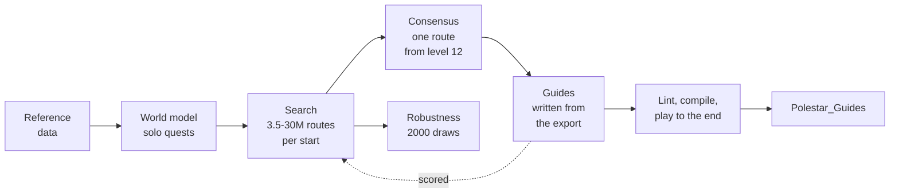

<p align="center">
  <picture>
    <source media="(prefers-color-scheme: dark)" srcset="docs/assets/banner-dark.svg">
    <source media="(prefers-color-scheme: light)" srcset="docs/assets/banner-light.svg">
    
  </picture>
</p>

<p align="center">
  A free, open-source guide addon for <b>World of Warcraft: Forever</b>: leveling routes for every start, found by simulation and written step by step.
</p>

<p align="center">
  <a href="https://github.com/fitzforge/polestar/releases"></a>
  <a href="https://www.curseforge.com/wow/addons/polestar-guides"></a>
</p>

<p align="center">
  On <a href="https://www.curseforge.com/wow/addons/polestar-guides"><b>CurseForge</b></a>, or from the Releases page. Questions, feedback and bug reports: join the <a href="https://discord.gg/vMbee6F2e9"><b>Polestar Discord</b></a>.
</p>

<p align="center">
  <a href="LICENSE"></a>
  
  
  <a href="https://github.com/fitzforge/polestar/actions/workflows/ci.yml"></a>
  <a href="https://discord.gg/vMbee6F2e9"></a>
  <a href="https://www.curseforge.com/wow/addons/polestar-guides"></a>
</p>

<p align="center">
  <a href="#quick-start">Quick start</a> ·
  <a href="#what-it-is">What it is</a> ·
  <a href="#a-look-inside">A look inside</a> ·
  <a href="#features">Features</a> ·
  <a href="#how-the-routes-are-made">How the routes are made</a> ·
  <a href="#guide-packs">Guide packs</a> ·
  <a href="#building-from-source">Building from source</a> ·
  <a href="#contributing">Contributing</a> ·
  <a href="#data-and-licensing">Data and licensing</a> ·
  <a href="https://discord.gg/vMbee6F2e9">Discord</a>
</p>

<table align="center">
  <tr>
    <td align="center" width="240"><a href="#quick-start"><b>Play</b></a><br>Install the addon and follow the arrow.</td>
    <td align="center" width="240"><a href="#writing-a-guide-pack"><b>Write guides</b></a><br>Publish your own routes as a guide pack.</td>
    <td align="center" width="240"><a href="#building-from-source"><b>Work on Polestar</b></a><br>Fix a guide, build the addon, run the tests.</td>
  </tr>
</table>

## Quick start

1. **Install it with the CurseForge app** (search for
   [Polestar Guides](https://www.curseforge.com/wow/addons/polestar-guides)),
   then skip to step 3. **Or download** `Polestar-<version>.zip` from the
   newest release on the
   [Releases page](https://github.com/fitzforge/polestar/releases), under
   *Assets* (not "Source code").
2. **Unzip it into the game's AddOns folder**, so the Polestar folders
   (`Polestar`, `Polestar_Guides`, `Polestar_QuestDB`, `Polestar_ItemDB`) sit
   directly inside it:
   `World of Warcraft/_classic_beta_/Interface/AddOns/` on the beta client,
   `_forever_` instead of `_classic_beta_` from launch.
3. **Restart the game completely** (a `/reload` does not load new addons) and
   log in. The guide window opens with a guide for your race, level and zone:
   follow the arrow, and the goals tick themselves off as you play.

Good to know:

- `/polestar guides` opens the hub: every guide, Lookup, Dungeons and Rares.
  `/polestar options` holds every setting; quest markers on the map are off
  until you turn them on under **Map**.
- `/polestar skip` moves on for good; `/polestar next` and `prev` only look
  ahead or back.
- **Updating:** delete the old Polestar folders, then unzip the new release
  the same way.
- **Memory:** the arrow's walking routes (`Polestar_Nav`) load after login,
  never in combat: about 26 MB for the walking maps, and while a walk is being
  searched up to about 54 MB more for the stretch of map it crosses, released
  when the search ends. **Walk real paths** (Options, Arrow & routes) off
  never loads them.
- **Optional:** `Polestar_Recorder-<version>.zip` from the same release
  records your sessions to improve the routes. It does nothing until you turn
  it on.
- **Guide packs** are other people's guides for Polestar, each a separate
  addon from its own author: see [Guide packs](#guide-packs).
- Something wrong? Click the bug in the guide window, beside Skip: say what
  went wrong, copy the report (it already holds the step, where you stand and
  the versions) and paste it on the
  [Polestar Discord](https://discord.gg/vMbee6F2e9). `/polestar report` opens
  it too, and [issues](https://github.com/fitzforge/polestar/issues) are
  welcome as well. The release's `SHA256SUMS` holds the zips' checksums.

## What it is

Polestar is one addon for the whole of WoW: Forever. It carries 220 guides:
57 leveling guides that take both factions from 1 to 60 from every race's
starting zone (Zephras Isle for the Skyborne included), 62 class guides for
every class's quest chains, the twelve professions from 1 to 300, 17
reputations, 7 exploration guides, the Legacy challenges and 64 collectible
guides, one per mount and per pet. Around the guides it adds a 3D waypoint
arrow that walks real paths (on Polestar's walking maps, with Shortest Path
Forever's routing engine by Cillian Berragan) and a travel planner, quest
markers on the map, an upgrade indicator on item tooltips, a search for where
any item, mount or pet comes from, a dungeon quest journal, rare alerts and
the quality-of-life helpers a long leveling session needs. Its interface is
in English, French, German and Latin American Spanish.

The leveling routes are not hand-picked. A simulator models every quest
Forever offers a faction, plays millions of complete 1-60 routes for each
start, and keeps the one that reaches 60 soonest under its model; the guides
are written from that route and scored under the same model
([How the routes are made](#how-the-routes-are-made)).

Other people can publish their own guides for Polestar as guide packs:
separate addons, made and supported by their authors
([Guide packs](#guide-packs)). Each new character's first login opens a short
welcome: a hello and what Polestar does; on the account's first character,
quest automation, the guide at login and the colour scheme; then the guide
Polestar suggests for that character, the Discord and guide packs
(`/polestar welcome` shows it again).

> [!NOTE]
> **Beta.** Every guide compiles, lints and plays to the end in a simulator
> for every race and class it serves, but nothing has been play-tested on
> Forever yet. Forever's new 30-60 content (Riverglades, Shen'dralas, Mount
> Hyjal) is not in any data yet; the routes take it in at launch.

## A look inside

Screenshots from the game: World of Warcraft: Forever (beta client) with
Polestar 0.1.0 at its default settings. Click a picture for full size.

<p align="center">
  
  <br><sub><b>The hub.</b> Guides, Lookup, Dungeons and Rares on one rail, Options at its foot. Here the Horde leveling guides by level band, and the selected guide's zone, progress, quests and the guide after it.</sub>
</p>

<table>
  <tr>
    <td width="36%" align="center">
      
      <br><sub><b>The guide window.</b> The step's goals with their counters, who comes next, XP per hour and the time to level.</sub>
    </td>
    <td width="36%" align="center">
      
      <br><sub><b>Transparent mode.</b> Outlined text straight on the world; the controls appear under the cursor.</sub>
    </td>
    <td width="28%" align="center">
      
      <br><sub><b>The arrow.</b> Distance and the goal it leads to.</sub>
    </td>
  </tr>
</table>

<table>
  <tr>
    <td width="50%" align="center">
      
      <br><sub><b>Lookup.</b> One search over guides, mounts, items, recipes, quests, NPCs and rares, each with where it comes from.</sub>
    </td>
    <td width="50%" align="center">
      
      <br><sub><b>Dungeons.</b> Every dungeon by level, its quests counted for your faction, the ones for your level marked.</sub>
    </td>
  </tr>
  <tr>
    <td width="50%" align="center">
      
      <br><sub><b>A dungeon's page.</b> Who starts and ends each quest and its chain; one button guides you round to pick them all up.</sub>
    </td>
    <td width="50%" align="center">
      
      <br><sub><b>Objectives and rewards.</b> The items to choose from with their icons, the experience and the money.</sub>
    </td>
  </tr>
  <tr>
    <td width="50%" align="center">
      
      <br><sub><b>Rares.</b> Every rare and treasure, its drops, where it spawns and how far, and when you last met it.</sub>
    </td>
    <td width="50%" align="center">
      
      <br><sub><b>Options.</b> Every setting as one row, applied as you change it; here Appearance.</sub>
    </td>
  </tr>
</table>

Lookup beyond the guides, Dungeons and Rares read a data pack that is built
locally and not in the release yet ([Lookup, Dungeons and
Rares](#lookup-dungeons-and-rares)). Not pictured yet: the rare alert, the
upgrade marks on the quest reward panel and the quest markers on the world
map. Renders of every window and state, drawn without the game, are in
[docs/preview](docs/preview).

## Features

### Guides and the engine

- **One person at a time.** In a quest hub the window shows only who to talk
  to now and their quests, then "Then: *next person*" and "Person 2 of 8";
  the arrow points at that person. Counters sit right after each goal ("Kill
  Zhevra Chargers 3/8") and a bar at the foot shows how far into the guide you
  are.
- **Goals check themselves off** as you play: accepted and turned-in quests,
  kills, loot, places reached, trainers visited, skills and reputation. Your
  place in a guide is recomputed from your quest log, so it survives lost
  saved variables.
- **A guide for where you are.** The window opens with a guide suggested for
  your race, class, level and location, and each guide hands over to the
  next one in its chain when you finish it.
- **Tabs.** Up to six guides open at once (a leveling route and a profession,
  say); quests are auto-accepted for all of them.
- **Professions** send you to the nearest trainer, vendor or inn of your own
  faction from where you stand, never into a city of the other faction; a
  goal's cycle button picks another.
- **Class training reminder** every two levels (configurable): the nearest
  trainer of your class, unless your guide is about to take you there.
- **Elite quests are optional.** Leveling routes use only quests a player can
  do alone; a quest that needs an elite appears as an extra marked "optional".

### Navigation

- **A 3D waypoint arrow** points at the current goal, shifting from the
  accent to jade as you arrive, with distance and ETA. Distances read in
  yards, the game's unit, or in metres (Options, Arrow & routes).
- **The travel planner** uses known flight paths, boats, zeppelins and your
  Hearthstone when they are faster. Each leg has its own caption on the arrow
  ("Fly to Crossroads", "Take the boat to Menethil Harbor", "Hearth to Razor
  Hill").
- **Trail dots** on the world map and the minimap crawl along the route
  between its waypoints (Map options can turn them off).
- **Zone crossings.** Walks between zones go through the real tunnels,
  passes, bridges and gates (Carbonite's zone connections), one waypoint at a
  time ("Go to Ashenvale"): from Sun Rock Retreat to Astranaar through the
  Talondeep Path, not over the ridge.
- **`/polestar way <x> <y> [label]`** points the arrow anywhere on the current
  map.
- **Go anywhere.** Shift-click the world map or the minimap and the arrow
  takes you there, routed like any goal; Alt-click works over map icons.
  Click the spot again to let it go.
- **Nearby services.** `/polestar near repair` (trainer, a profession,
  class, reagents, vendor, innkeeper, bank, auction, flight, stable) points
  the arrow at the quickest one to reach; the map's tracking menu lists them.
- **OpenMap.** On [OpenMap](https://www.curseforge.com/wow/addons/openmap)'s
  seamless world map the trail dots carry on across zone borders and show on
  the whole-world view too. OpenMap's menu has a "Polestar trail dots" switch.
- **Other addons' waypoints** (Options, Integrations, TomTom). Without TomTom, "Let other addons set
  waypoints" (off by default) lets addons that set TomTom waypoints point
  Polestar's arrow and makes `/way` work; addons that expect TomTom's own
  settings may not work with it on. With TomTom, the arrow can follow
  TomTom's. Addon authors: `Polestar.Nav.API` (docs/ARCHITECTURE.md, "Nav
  API").

### Pathing by Shortest Path Forever

The arrow walks real paths: round cliffs, water and walls, through the town
gate and down into the mine, not over the edge. That is the work of
[Shortest Path Forever](https://github.com/cjber/shortest-path-forever) by
**Cillian Berragan** ([cillian.dev](https://cillian.dev)), who baked walking
maps of the continents from the game client and wrote a router that finds a
route over them a couple of milliseconds at a time, so the game never
stutters. It is beautiful work, and he generously said yes when we asked to
use it. Polestar's travel planner still picks the flights, boats and
Hearthstone; his router walks every leg between them.

His pathing ships with Polestar as the `Polestar_Nav` folder: his router,
copied from his repository with only mechanical changes, runs on Polestar's
own walking maps of Eastern Kingdoms and Kalimdor, made from the game's
geometry in his map format by a port of his map baker, and on his map of
Zephras Isle (GPL-3.0-or-later; what came from where is in
[addon/Polestar_Nav/CREDITS.md](addon/Polestar_Nav/CREDITS.md)).
**Walk real paths** (Options, Arrow & routes) turns it off. If you like it, try
his addon:
[Shortest Path Forever on CurseForge](https://www.curseforge.com/wow/addons/shortest-path-forever)
plans whole journeys with flights, boats, zeppelins, portals and live
departure times.

**Works with Shortest Path Forever.** With it installed, Polestar hands it
the route: each goal goes to Shortest Path Forever, whose arrow, route and
journey take you there, and Polestar's own arrow, route lines, journey steps,
travel button, transport alerts, map clicks and `/way` step aside, so the two
never guide at once (Polestar's walking maps are not even loaded). The guide
window and the map pins stay. A kill or collect area is handed over as an
area, so it holds you there until the goal is done; if you clear or replace
the journey, Polestar leaves it be until the guide moves on. **Guide with
Shortest Path Forever when it's installed** (Options, Integrations) turns
it off.

### Quests and the map

- **Quest markers**: givers, objectives and turn-ins on the world map and the
  minimap, with tooltip lines on the mobs and items a quest needs and quest
  levels in the log. Nameplate icons mark the mobs you still need, beside the
  health bar of EllesmereUI and other replacement nameplates too.
- **Rare and treasure spawns, dungeon entrances, flight masters, docks and
  inns** can mark the map too. Every map icon is off by default and turns on
  under **Map** in the options; the arrow's target, its route and the
  regions the guide step's mobs and objects spawn in (shaded on the world map
  and the minimap) always show.
- **A world map without fog of war**, with coordinates and zone level ranges.

### Gear advice

- **Upgrade indicator** on item tooltips: by how much an item is an upgrade
  for your spec at your level, from stat weights per spec (detected from your
  talent points) and level band.
- **On the game's reward panel** every choice that is an upgrade gets a green
  arrow, the one to take is framed, and a coin marks the one that sells for
  most. Turn-in goals name the best reward.

### Lookup, Dungeons and Rares

- **Lookup** searches guides, items, mounts, pets, NPCs, quests, zones,
  dungeons and rares, and answers "how do I get that?" with the sources
  ranked for your character. "Guide me" opens the curated guide or builds one
  on the spot. Target or mouse over a player to see their mount and how to get
  it; Alt-click an item link for a guide.
- **Dungeons**: a journal page per dungeon with every quest (where it starts
  and ends, its objective, chain and rewards), the bosses and the entrance.
  "Pick up the quests" builds a guide that collects every quest of the
  dungeon you can take, earlier quests first, on the shortest path from where
  you stand to the entrance; after the run, "Hand in the quests" guides you
  to where they are turned in and takes the follow-ups there.
- **Rares**: rares and treasures by zone with their spawns and signature
  drop, and an alert when one shows up on your minimap, nameplates or target.

Lookup, Dungeons and Rares read the Codex, a data pack built on your own
machine from addons you have installed ([Data and licensing](#data-and-licensing));
it is not part of the release. Without it Lookup still searches the guides,
and each section says what is missing.

### Appearance and UI suites

- **Colour schemes**: Dusk (the default), Night and Graphite, and
  EllesmereUI's own panel colour and accent while it is installed. On top of
  any scheme: your own accent or your class colour, background colour,
  opacity and brightness. Text stays legible whatever you pick: a ground too
  light for its text is darkened until it reads.
- **Windows**: the border, its colour and thickness, the starlit header band
  and the shadow, each on or off; the guide window's style (standard, compact
  or transparent), scale, width and opacity; the menu scale; the arrow's style,
  scale, opacity and colours; reduced motion. Everything applies live,
  without a reload; right-click any setting to reset it.
- **Fonts**: the game's own by default, or Inter, or EllesmereUI's.
- **EllesmereUI** (Options, Integrations): Polestar follows its accent and font by default through
  its public skinning API, and where its Quality of Life or Friends module
  does the same job as a Polestar toggle, the toggle starts off.

### Quality of life

Quest item, target and Hearthstone buttons; XP per hour and time to level;
selling greys and repairing (optionally from the guild bank first); buying
what a step asks you to buy; learning new spells at class trainers; taking
the best quest reward and wearing rewards that are upgrades; instant quest
text, single-option gossip and faster auto-loot; hiding combat error spam;
flight map and death helpers, and releasing at once in battlegrounds.
Requests from other players: accept summons, resurrections and friends' or
guildmates' party invitations; decline other party invitations, guild
invitations and duels (friends and guild excepted). Hold **Shift** to skip
auto-accept, auto-turn-in, auto-sell, training or the flight helper once, or
to answer a request yourself.

### With a gamepad

Polestar plays with a gamepad on Forever (ported from Ding! by Yendi,
@moust4ki). Open its options from the minimap button (or `/polestar
gamepad` without the game's gamepad interface): their **Gamepad** page names
the buttons (Xbox letters or PlayStation shapes, read off the gamepad by
default), and its **Key bindings** tab binds every Polestar action: next and
previous step, browse the guide, show or hide the guide window, the guide
menu, the options, report a problem, and the quest item, target and
Hearthstone buttons. Nothing is bound until you bind it. Press A on a row,
then a button, or hold one button and press another for a combination:
Polestar watches its combinations itself, keeps the second button from the
game only while you hold the first, and never acts on one in a fight. With
the game's gamepad interface on, LB and RB are its targeting buttons and
every combination with them is the game's own: the row says so before it
binds one. Tap B to cancel, hold B to bind B itself; Y unbinds. The rows take
keys of the keyboard too.

The guide window never takes a button away from the game. To browse it with
the gamepad, bind **Browse the guide with the gamepad**: the D-pad picks a
line (up from the goals: Skip, the bug, the menu and the tabs), A points the
arrow there or uses the quest item on its line (not with the game's gamepad
interface, whose own buttons Polestar leaves alone), X shows the line's
details, LB / RB look at the previous and next step, Y minimizes the window,
and B gives the gamepad back to the game.

Every Polestar window you open (the guide menu with Lookup and Dungeons, the
options, the welcome, the route choice, the report and copy windows, the
drop-down menus) answers the gamepad while it is open: the D-pad moves the
focus (an accent ring), A selects, B closes or goes back, LB / RB change tabs
or pages, left / right adjust a slider or a drop-down, Y puts a setting back
to its default. A window that opens by itself (the welcome on a new
character, the choice of where to level next) takes no button until you press
the Browse the guide button, which its bar shows. A bar under the window lists
the buttons no button on screen shows; B sits on the window's close button.
The gamepad goes back to the game when the window closes or a fight starts,
and returns after it. Turn the bar off, or the windows' navigation
altogether, on the Gamepad page. Without a gamepad plugged in, none of it
shows: everything works with the mouse and keyboard as before.

### Recorder

`Polestar_Recorder` is an optional companion addon that records your
sessions to improve the routes. It is off until you turn it on (`/psrec on`,
or Options > Recorder > Start recording) and writes nothing while off.
Recordings replace the Classic Era estimates with Forever facts (quest XP,
NPC and object positions, trainers, flight paths and times), feed the Codex
what only play shows (rares and treasures, drops and how often they fall,
dungeon entrances and bosses), and
`record report` turns them into per-step timings: passes, median and p75
time, XP per hour, time in combat, deaths and travel, then the slowest
steps and detours, the steps to fix first.

### Slash commands

`/polestar` (or `/pole`) shows or hides the guide window; settings live in
`/polestar options`, grouped by what you came to do: Guide, Appearance, Map,
Questing, Discovery, Quality of Life, Integrations (settings for other addons
Polestar works with, such as Questie, shown while they are installed), Guide
packs, Gamepad, Recorder and About, with a search that finds any setting.

With the game's gamepad interface on (Options, Gamepad, Enable Gamepad UI)
there are no slash commands: the game blocks gamepad actions after any
addon command typed in chat, until the game freezes. Polestar's minimap
button (on by default then) and its key bindings open the guide and the
settings instead, and Polestar keeps out of the game's own windows.

<details>
<summary><b>Every slash command</b></summary>

| Command | What it does |
|---|---|
| `help` | List every command |
| `show`, `hide` | Show or hide the guide window |
| `guides` | Open the hub on Guides |
| `options [page]` | Open the settings, optionally on a page |
| `next`, `prev` | Look at the next or previous step (nothing is skipped) |
| `skip` | Skip the step shown, for good (the window offers Undo) |
| `status` | Current guide and step |
| `guide <id>` | Switch to a guide by id |
| `tabs`, `tab <n>`, `close` | List, switch and close guide tabs |
| `path` | Choose where to level next, where a guide offers a choice of route |
| `route` | Show the travel route to the current target |
| `way <x> <y> [label]` | Point the arrow at x y on your current map (no argument clears it) |
| `arrow show\|hide\|reset` | The waypoint arrow (drag it to move it) |
| `reset` | Clear ticks and skips for the current guide |
| `xp` | XP per hour, time to level and level splits |
| `gear [item link]` | Gear advice: the weights in use, or compare an item |
| `instances [clear]` | Instance limits, runs and lockouts |
| `dungeons [name]` | Open Dungeons, or a dungeon's page |
| `lookup [search]` | Open Lookup, optionally searching |
| `mount` | Look up the mount of your target (or mouseover) and how to get it |
| `rares [test]` | Open Rares, or show a sample rare alert |
| `questdb` | Quest database status |
| `packs` | Open Options > Guide packs |
| `gamepad` | Open Options > Gamepad: button names and key bindings |
| `welcome` | Show the welcome again |
| `where` | Print your map and position as guide lines (`zone map <id>`, `goto x,y live`), in a box to copy |
| `report` | Report a problem with the step on screen (the guide window's bug button) |
| `discord` | The invite to the Polestar Discord, to copy |
| `debug` | Toggle debug output |

The Recorder has its own: `/psrec on | off | mark <text> | clear` and a
few more listed by `/psrec`.

</details>

## How the routes are made



1. **World model.** Every quest the faction can do, with its level,
   prerequisites, givers and enders, and the work its objectives take: kills
   at the mob's spawn clusters, item drops at their recorded rates, objects,
   escorts. Dungeon, raid, PvP and elite quests are filtered out, so a route
   is something one player can do alone.
2. **Search.** For each start (Orc, Tauren, Undead and Skyborne for the
   Horde; Human, Dwarf, Night Elf and Skyborne for the Alliance), randomised
   greedy construction, local search and simulated annealing evaluate
   millions of complete 1-60 routes, restarting until the best route stops
   improving or a cap on evaluated routes is reached.
3. **Route rules.** When routes are compared, grinding counts 2.5 times and
   every move into another zone counts 7.5 minutes, so a route takes a hub's
   quests, does them in one loop and moves on rather than chasing a few
   experience points across the map. Reported hours stay real.
4. **Consensus.** Each start keeps its own route to level 12 (the starting
   zone guides); from there one shared route per faction is searched, so the
   guides join into one chain.
5. **Guides.** The consensus route is exported as skeleton guides, one per
   zone visit, and the guides are written from them by hand. They drop side
   trips for one or two small quests behind a flight, boat, hearth or long
   ride; where that leaves the level short, a step names a camp to grind at
   (with an optional dungeon for the long ones). The finished guides are
   scored under the same model, next to the best route found.

### The numbers

Hours to 60, solo, under the model. The routes were searched four times,
independently: the first search is the one the guides were written from;
each later one used another random seed, more routes and newer data. Each
search is scored on its own world. The guides are scored on the world of the
data this release ships with (`5eef72140b61`), beside those of the first
release.

The guides are scored on what they require. Their optional extras (quests
started by rare drops such as the OOX beacons, the Green Hills of
Stranglethorn pages, profession and bag quests, rares) are left out, because
most players will not get them; the last column counts them as done, which is
how these hours were published before 0.2.4 (issue
[#30](https://github.com/fitzforge/polestar/issues/30)).

| Start | Search 1: best / consensus | Search 2 | Search 3 | Search 4 | Guides 0.2.4 (grinding) | Guides 0.1.0 (grinding) | Guides 0.2.4 with every optional extra |
|---|---:|---:|---:|---:|---:|---:|---:|
| Orc | 119.4 / 120.5 | 120.7 / 117.8 | 117.7 / 116.8 | 119.6 / 117.3 | 131.1 (34.2) | 128.5 (29.7) | 122.8 |
| Tauren | 120.4 / 120.2 | 119.1 / 117.4 | 118.3 / 116.5 | 117.1 / 116.8 | 130.1 (34.2) | 127.8 (29.1) | 121.9 |
| Undead | 120.8 / 120.6 | 119.0 / 118.1 | 119.3 / 117.0 | 118.8 / 117.4 | 131.5 (33.8) | 128.9 (29.1) | 123.3 |
| Skyborne (Horde) | 120.2 / 120.1 | 117.3 / 117.3 | 116.3 / 116.3 | 116.8 / 116.8 | 130.1 (32.8) | 128.3 (28.2) | 122.3 |
| Human | 119.6 / 119.1 | 120.7 / 118.8 | 119.2 / 116.8 | 119.3 / 118.9 | 132.5 (37.0) | 132.1 (35.5) | 127.5 |
| Dwarf | 119.5 / 119.5 | 120.8 / 118.8 | 117.4 / 117.3 | 119.8 / 118.8 | 133.1 (36.9) | 132.6 (35.5) | 128.2 |
| Night Elf | 120.0 / 119.5 | 120.9 / 118.9 | 119.0 / 117.5 | 119.1 / 119.1 | 133.0 (37.1) | 132.6 (35.6) | 128.1 |
| Skyborne (Alliance) | 121.2 / 119.6 | 118.6 / 118.6 | 118.2 / 117.3 | 119.0 / 118.4 | 133.5 (36.2) | 132.5 (34.5) | 129.0 |

So a Horde character following the guides should expect about 130-132 h,
an Alliance one about 132-134 h; doing the optional extras as they come can
save up to about 8 h (Horde) and 5 h (Alliance). With every optional extra
counted, the guides of 0.2.4 and 0.1.0 are within 0.6 h (Horde) and the
Alliance guides of 0.2.4 are 0.8-1.6 h faster; counting only what each
requires, 0.1.0 comes out 1.8-2.6 h faster for the Horde because the later
guides marked more of their quests optional.

<p align="center">
  
</p>

<p align="center">
  
</p>

The charts show only the guides: the searches' best and consensus routes
were searched on earlier worlds, and a chart draws only numbers from one
world.

**How close to the best?** Nobody can prove a route is the best one
possible, so the claim is narrower and checked:

- **The searches land in the same place.** Four independent searches
  (3.5 to 30 million complete routes per start) find routes within
  116.3-121.2 h to 60, and their consensus routes within 116.3-120.6 h. The
  top of the search space is flat: many different routes finish within about
  2% of each other, and most searches were still finding small improvements
  when they reached their cap on routes, so later searches keep shaving
  minutes, not hours.
- **The winners hold up when the model is wrong.** Re-scored under 2000
  random draws of the model's parameters, the best route found stays within
  1% of each draw's best in 76-100% of draws (fourth search), and no route
  wins every draw: "best found" names one of several near-equal routes.
- **The guides trade hours for a smooth, safe run.** For what they require
  they take 13.3-14.1 h (Horde) and 13.6-15.1 h (Alliance) longer than the
  fourth search's consensus (scored on its own world). Almost all of that is
  grinding the guides choose: side trips for one or two small quests behind
  a flight, boat or hearth are left out, and quests that need a group, a
  rare drop or a level the route has not reached are optional or gone, so
  the guides grind about 33-34 h (Horde) and 36-37 h (Alliance) where the
  searched routes grind under 1 h and about 8 h. The Alliance mid-40s have
  few solo quests left once those trips are gone.
- **Dungeons do not beat questing solo** under the model: searched with
  dungeons allowed (Orc, Tauren, Undead), no dungeon route came out ahead.

> [!IMPORTANT]
> The hours are **model estimates in /played hours**, not measurements. No
> recorded play exists yet, so time parameters such as kill time and travel
> detours keep their priors, and Forever's 30-60 content is not in the data.
> Comparisons between routes are what the numbers support; absolute hours
> are not. Recordings from the Recorder are what will calibrate kill time
> (`sim calibrate`); travel detours keep their priors even then.

The whole method, every parameter and its known limitations are in
[docs/SIMULATION.md](docs/SIMULATION.md).

## A guide, from source to game

Guides are plain text, compiled to Lua. The compiler fills in names, titles
and coordinates from the reference data, so a line can be as short as
`accept 788`. From the Orc and Troll starting guide,
[`guides/forever/horde/orc-troll/01-durotar.guide`](guides/forever/horde/orc-troll/01-durotar.guide):

```
guide forever/horde/orc-troll/01-durotar
title Durotar
faction Horde
race Orc,Troll
levels 1-12
zone Durotar
next forever/horde/orc-troll/02-the-barrens

step Gornek
  tip Gornek waits inside the Den, the building just west of Kaltunk.
  turnin 4641
  accept 788
  accept 97279

step Training weapons and boars
  tip The weapons lie around the Den and the training grounds; the Mottled Boars roam the whole valley floor.
  collect 277653 quest 97279.1
  kill 3098 quest 788.1
```

The second step compiles to (goals wrapped here; the compiler writes each
on one line):

```lua
{
  title = "Training weapons and boars",
  note = "The weapons lie around the Den and the training grounds; the Mottled Boars roam the whole valley floor.",
  goals = {
    { t = "collect", quest = 97279, title = "Wayward Weapons",
      item = 277653, itemName = "Abandoned Training Weapon", count = 6, oi = 1,
      map = 1411, x = 44, y = 67.2, f = "e",
      spots = { { x = 44.4, y = 66.6, r = 45, n = 4 }, --[[ eleven more spawn clusters ]] } },
    { t = "kill", quest = 788, title = "Cutting Teeth",
      target = "Mottled Boar", npc = 3098, count = 10, oi = 1,
      map = 1411, x = 44.49, y = 65.1, f = "e",
      spots = { { x = 45, y = 65.7, r = 56, n = 8 }, --[[ ten more spawn clusters ]] } },
  },
},
```

Every verb, modifier and condition is in
[docs/GUIDE_FORMAT.md](docs/GUIDE_FORMAT.md); guides of your own ship as a
[guide pack](#guide-packs).

## Guide packs

A **guide pack** is someone else's guides for Polestar. It is a separate
addon, made and supported by its author; its guides are not Polestar's
leveling routes. Polestar does not ship, host or recommend any pack.
[docs/GUIDE_PACKS.md](docs/GUIDE_PACKS.md) explains packs in full, for
players and for authors.

### Installing a guide pack

Download the pack from wherever its author publishes it and install it like
any addon, next to the `Polestar` folders, then restart the game. Its guides
appear in the guide menu (`/polestar guides`) under "Guide packs", each
credited to its author. Options > Guide packs (`/polestar packs`) lists every
pack you have installed and turns each one on or off without a reload; it
also picks where the guide for your level is suggested from (Polestar's own
guides unless you choose a pack). A pack never replaces Polestar's guides or
another pack's.

Report a problem in a pack to its author, not to Polestar. A pack is an
addon like any other, so install packs from authors you trust.

### Writing a guide pack

You can write your own leveling guides with the tools Polestar uses for its
own: the guide format, the compiler, `lint`, `playtest`, and in the game the
guide engine, the arrow and the map markers. Publish them as your own addon
on the addon sites, and they appear in Polestar's guide menu as a pack. A
pack lives in its own folder, beside a clone of Polestar that provides the
tools (Node 24 or later; Lua 5.1 for `play` and `playtest`):

```sh
git clone https://github.com/fitzforge/polestar.git
cd polestar
npm link               # puts `polestar` on your PATH; no npm dependencies
polestar data build    # the reference data in data/forever/, which every guide command reads
polestar doctor        # checks the setup and prints the fix for anything missing
cd ..                  # your pack goes beside the clone, not inside it
polestar new my-pack   # asks for the id, title, author and licence
cd my-pack
polestar dev --play    # lint and build on every save, with the browser playground
```

`data build` downloads its public sources and also reads quest data from an
addon installed with the game, so today it is built on a machine with the
Forever client (`polestar help data` lists every source). `new` writes an
example guide that already lints and plays to the end. Before publishing,
`polestar playtest` plays every guide to the end in the real addon, for each
race that can reach it and each class it has steps for, and `polestar pack`
builds the zip, byte for byte reproducible. Upload it as your own addon
project, with Polestar as a required dependency, a title that cannot be
mistaken for Polestar's own addons, your name, a version, and a website or
support link where players can reach you. Write your own guide text: do not
copy Polestar's.

- [docs/GUIDE_PACKS.md](docs/GUIDE_PACKS.md): what a pack is, the steps from
  `new` to publishing, what the tools require and what we ask of authors
- [docs/PACKS.md](docs/PACKS.md): the handbook (setup, a first pack in 15
  minutes, testing, publishing, every problem and its fix)
- [docs/GUIDE_CHEATSHEET.md](docs/GUIDE_CHEATSHEET.md): the guide format on
  one page; [docs/GUIDE_FORMAT.md](docs/GUIDE_FORMAT.md) in full
- [docs/PACK_FORMAT.md](docs/PACK_FORMAT.md): what `pack.json` holds and what
  the tools write
- **Codespaces:** a pack made by `polestar new` carries a dev container; open
  its repository in GitHub Codespaces for Node, Lua and the tools with nothing
  to install (use `play` and `playtest` there, since `install` and `dev` need
  the game)

`polestar find <text>` turns quests, NPCs, objects, items, inns and flight
points into guide lines; in game, `/polestar where` gives your position as
one. A pack can hand over to any of Polestar's guides with `next`, so it can
cover one zone or one level range, and may use a licence of its author's
choice ([Data and licensing](#data-and-licensing)).

## Building from source

This part is for working on Polestar itself: players need only the
[Quick start](#quick-start), guide authors the [Guide packs](#guide-packs)
section. [docs/README.md](docs/README.md) maps every document, and
[CHANGELOG.md](CHANGELOG.md) lists what changed in each release.

Node 24 or later (no npm dependencies) and Lua 5.1 (`lua5.1`, `luac5.1`) for
the tests. Building the data needs a local Forever client: it reads the
client's tables and installed addons.

```sh
node tools/polestar.js data build         # reference data into data/forever/ (local)
node tools/polestar.js questdb build      # the Polestar_QuestDB pack
node tools/polestar.js lint               # check every guide
node tools/polestar.js compile            # build addon/Polestar_Guides
node --test "tests/**/*.test.js"          # the test suite
node tools/polestar.js preview            # render the UI to docs/preview/*.svg
node tools/polestar.js install --recorder # into a detected Forever or beta client
node tools/polestar.js version            # the release version in package.json, guides/pack.json and every addon TOC
node tools/polestar.js pack               # release zips and SHA256SUMS into dist/
```

`npm test` runs the suite. [CI](.github/workflows/ci.yml) runs it on every
push to main and every pull request, where the tests that need the locally
built data skip with a reason, and fails when the committed textures or UI
renders differ from a fresh `media` or `preview` build; with the data built,
all pass locally. `install`
finds the client under Wine, Proton and similar prefixes in your home folder,
or takes `$WOW_FOREVER_ADDONS` or `--dest <Interface/AddOns>`; `--link`
symlinks the folders instead, so an edit needs only a `/reload`.

Releases are built on a maintainer's machine, because the data addons come
from the game client's tables: [docs/RELEASING.md](docs/RELEASING.md) has
the steps and what each zip carries.

`node tools/polestar.js help` lists every command and `help <command>` its
options; [tools/README.md](tools/README.md) groups them, lists the generated
files and gives the rebuild order after a data change.

<details>
<summary><b>The playground: the real addon in a browser</b></summary>

```sh
node tools/polestar.js play              # prints http://127.0.0.1:8077/
node tools/polestar.js play --fresh      # a new level 1 character, default settings
```

One long-lived Lua 5.1 process runs Polestar, its guides and the built data
packs against the simulated world of the tests. The page shows a 1920x1080
game screen with the hub and the guide window; click, hover, scroll, drag,
type into search boxes and run slash commands from the chat line. A side
panel sets the look, jumps through a guide, opens any window and changes the
character, position and time. Zone paintings come only from a local folder
of your own client's art (`--art`); without it the world is dark.

</details>

<details>
<summary><b>The route planner: guides played on the real map</b></summary>

```sh
node tools/polestar.js planner art       # once: the map art (~330 MB downloaded, ~250 MB built; local only)
node tools/polestar.js nav build         # once: the navigation grid for terrain-aware walks (~750 MB, ~15-25 min; local only)
node tools/polestar.js planner           # prints http://127.0.0.1:8078/
node tools/polestar.js planner mcp       # the same commands for an AI agent (MCP over stdio)
```

The planner is Nivek_Gaming's idea ([@Nivek_Gaming](https://x.com/Nivek_Gaming)
on X): his route planning inspired this tool and the navigation grid
behind it. Thank you, Nivek.

Pick a guide and a character and the route plays on the game's own minimap
terrain, zone by zone or as the whole 1-60 route across the continents: each
step's start time and duration split into travel, combat, talking and
waiting, the level and XP, the quest log and items, the spawn areas and the
path. The clock is the simulator's model ([docs/SIMULATION.md](docs/SIMULATION.md)),
so treat absolute hours as estimates and compare steps against each other.
With the navigation grid built (`node tools/polestar.js nav build`, local
only) every walk follows the terrain, the walks between mobs in a kill area
too: around mountains, into caves and buildings, swimming, dropping off
ledges, mounted from level 40, at the speed of the character's class (Ghost
Wolf, Travel Form...). Flights follow the flight master's real path. The
first playback of a route shows straight lines while its walks are routed in
the background ("Routing…" in the footer), then "Routed N of M legs" (and
the hops between spawns); routes are cached under `data/local/nav`, so the
next start is immediate. A walk the grid cannot route stays a straight line,
marked ≈ in the steps list.
Layers adds Walkable (what the grid can walk: blocked, steep, climb, water,
indoors, zoomed in) and Arrow aids (the crossings and approach chains of
`nav aids`).
In Edit mode, drag a waypoint, add one with a click, bend a travel line into
a new labelled waypoint ("Cross the bridge"), or change any goal or
step in its form: every edit is written into the `.guide` file at once
(undo with Ctrl+Z; Changes lists and reverts them; Compile builds the addon
folder), so `dev` picks it up too. Given a pack folder it edits that pack;
`planner mcp` lets an assistant read routes, edit them and drive the open
page while you watch (`claude mcp add polestar-planner -- node tools/polestar.js planner mcp`).
The map art is the Forever client's own, fetched from wago.tools and never
committed or shipped.

</details>

<details>
<summary><b>Measuring routes with recordings</b></summary>

```sh
node tools/polestar.js record watch     # import sessions as the game saves them
node tools/polestar.js record import    # or import once
node tools/polestar.js data build       # fold recordings into the reference data
node tools/polestar.js record report    # how long each guide step really took
```

`record report [--guide <text>] [--json]` lists, per step, passes, median
and p75 time, XP per hour, time in combat, deaths, turn-ins and travel, then
the slowest steps, steps far over the guide's median and detours. Reloads,
AFK breaks (idle time counts at most 5 minutes), going back a step and other
tabs are accounted for.

At Forever's launch, the data is rebuilt and the simulator rerun to take in
the new zones ([docs/SIMULATION.md](docs/SIMULATION.md), "Refresh").

</details>

### Project layout

| Path | What lives there |
|---|---|
| [`addon/Polestar`](addon/Polestar) | The addon: engine, navigation, UI, modules, textures drawn in code ([addon/README.md](addon/README.md); every addon: [docs/ARCHITECTURE.md, "Overview"](docs/ARCHITECTURE.md#overview)) |
| [`addon/Polestar_Guides`](addon/Polestar_Guides) | The compiled guides (generated by `compile`) |
| [`addon/Polestar_ItemDB`](addon/Polestar_ItemDB) | Item stats for gear advice: `Items.lua` from `itemdb build`, `Forever.lua` from `gear build` |
| [`addon/Polestar_Nav`](addon/Polestar_Nav) | The arrow's walking routes: Shortest Path Forever's router by Cillian Berragan (GPL-3.0-or-later), vendored by `nav vendor`, on Polestar's walking maps of Eastern Kingdoms and Kalimdor in his format (`nav pack`) and his map of Zephras Isle ([CREDITS.md](addon/Polestar_Nav/CREDITS.md)) |
| [`addon/Polestar_Recorder`](addon/Polestar_Recorder) | The optional session recorder |
| [`guides/forever`](guides/forever) | The guide sources: leveling, professions, reputation, exploration, Legacy, collectibles |
| [`tools`](tools) | The command line (`polestar.js`), the guide compiler, the simulator, data importers, texture and preview renderers, the playground ([tools/README.md](tools/README.md)) |
| [`tests`](tests) | `node --test` suites; `tests/lua` is the simulated game client they run the addon in ([tests/README.md](tests/README.md)) |
| [`docs`](docs) | Architecture, guide format, simulation, the suite's scope, UI renders ([docs/README.md](docs/README.md)) |
| `data/` | Local build products and recordings, gitignored |

[docs/ARCHITECTURE.md](docs/ARCHITECTURE.md) describes the modules and their
contracts, [docs/SUITE.md](docs/SUITE.md) the suite and what is out of
scope (best-in-slot lists, loot browsing, talent builds), and
[docs/DESIGN.md](docs/DESIGN.md) the visual system.

## Contributing

Issues and pull requests are welcome, guide fixes most of all: a step in the
wrong order, a quest that is not where the guide says, a tip that would have
saved you a minute. Questions and ideas are welcome on the
[Polestar Discord](https://discord.gg/vMbee6F2e9).

- **Found a wrong step?** A guide's title names its file under
  `guides/forever/`; fix the step, run `node tools/polestar.js lint` and
  `playtest --filter <name>`, and open a pull request. Without the reference
  data (built from a local client today), send the fix or an issue anyway:
  [CONTRIBUTING.md](CONTRIBUTING.md) has the full walkthrough.
- **Code** follows the existing modules; read
  [docs/ARCHITECTURE.md](docs/ARCHITECTURE.md) first and keep
  `node --test "tests/**/*.test.js"` green.
- **UI** changes stay in the visual system of [docs/DESIGN.md](docs/DESIGN.md);
  `node tools/polestar.js preview` renders them for review.
- **Recordings** are the most useful contribution of all: play a guide with
  the Recorder on and attach `record report` for the steps that felt slow.
- **With an AI agent?** It reads [AGENTS.md](AGENTS.md) in a clone. To have
  Polestar's skills everywhere, install them:
  `npx skills add fitzforge/polestar -g`, or the Claude Code and Codex
  plugins in [CONTRIBUTING.md](CONTRIBUTING.md#installing-the-skills).

Contributions are accepted under the GPL-3.0, the project's licence.

## Data and licensing

Polestar is free and open source under the
[GNU General Public License, version 3](LICENSE).

Its data comes from public sources, the game client's own tables and
recordings; [THIRD_PARTY.md](THIRD_PARTY.md) lists every input, its licence
and what a release holds from it. The guides and the quest markers carry
facts (titles, givers, positions, levels) from QuestieDB's Forever store,
credited there. Inputs whose terms do not allow redistribution are read from
your installed copies at build time and their outputs stay local: the Codex
pack and the zone crossings pack are gitignored and never packaged. No game
art ships with Polestar: zone paintings are read from the player's own
client, and every texture is drawn in code. The screenshots in this README
show the game (© Blizzard Entertainment) and are not part of the release.

The Inter typeface (SIL Open Font License 1.1) ships with the addon; the
POLESTAR wordmark is cut from Cinzel (SIL Open Font License 1.1) and ships
only as images. The README's banner, buttons, logo, charts and the
CurseForge avatar are drawn by [`tools/readme`](tools/readme) from the same sources, with
Marcellus (SIL Open Font License 1.1) for the banner's lines; the CurseForge
button's anvil is the CurseForge mark from simple-icons (CC0 1.0).

The walking router in `Polestar_Nav` and its map of Zephras Isle are Shortest
Path Forever's, by Cillian Berragan, and its maps of Eastern Kingdoms and
Kalimdor are Polestar's, written in his format by a port of his baker; all of
it is under the GPL version 3 or later, used with his permission
(see [Pathing by Shortest Path Forever](#pathing-by-shortest-path-forever));
the guide-pack permission below does not cover them.

[LICENSE-EXCEPTION.md](LICENSE-EXCEPTION.md) adds a permission under section
7: guide packs produced by Polestar's compiler, including the reference data
it places in them, may be distributed under terms of the pack author's
choice (not guide text copied from Polestar's own guides, nor Polestar's
code).

<p align="center"></p>

<p align="center"><sub>World of Warcraft is a trademark of Blizzard Entertainment. Polestar is a community project, not affiliated with or endorsed by Blizzard.</sub></p>
