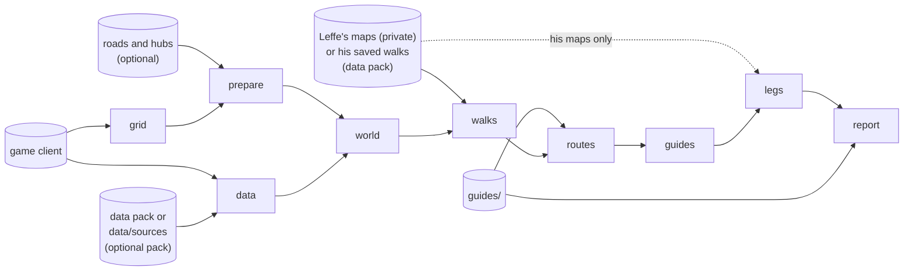

# Polestar Forge

Forge is the tool that makes Polestar's leveling routes. From the game installed on your computer
and Polestar's guides it builds the reference data, works out how long every walk takes, improves
each start's route from level 1 to 60, writes the improved route into the guides and checks the
result the way a player would follow it. One command does all of it:

```sh
forge build --guides guides --out forge-out
```

and `forge-out/report.md` says what changed and how much faster the new guides are in the model.

You need Forge if you want to rebuild the routes, test a change to the guides' order, or find out
why a quest is or is not in a route. You do not need it to play: the addon ships with its guides
already written.

Two words come back on every page. A **start** is one leveling start, by race and faction (Orc,
Human, Skyborne for each side, ...); each start has its own route from level 1 to 60. A **cut** is
one run of the route search for one start, with the files it writes: the route and its two
ledgers.

**On this page:** [How it works](#how-it-works) · [Requirements](#requirements) ·
[Install](#install) · [Updating](#updating) · [First build](#your-first-build) ·
[How Forge finds the game](#how-forge-finds-the-game) · [The data pack](#the-data-pack) ·
[Leffe's navigation maps](#leffes-navigation-maps) · [Roads and hubs](#roads-and-hubs) ·
[Reading the report](#reading-reportmd) · [Why is a quest in or out?](#why-is-a-quest-in-or-out) ·
[Overrides](#overrides) · [Changing the data](#changing-the-data) ·
[Fixing a generated guide](#fixing-a-generated-guide) ·
[Troubleshooting](#troubleshooting) · [More](#more)

## How it works

`forge build` runs nine stages in order. Each one is skipped when its inputs did not change.



1. **grid**: the walking grid, built from the game's map files.
2. **data**: the reference data (quests, NPCs, items, travel) from the game and the other sources.
3. **prepare**: the walk graphs the walks are priced on.
4. **world**: each faction's quests, givers, camps and areas.
5. **walks**: how long every walk between those places takes.
6. **routes**: each start's route, improved from the current guides.
7. **guides**: the improved route written into the guides.
8. **legs**: the walk into every step of the written guides, drawn on Leffe's maps when you have
   them (our grid where his have no way or a detour, as the walks stage chooses; our grid alone
   without his maps), kept as its corners with each
   stretch's move and floor and the ground's height every 2 yards, and written beside each start's
   guides as `legs.json` (`legs-qa.txt` lists the walks it left out, and why). Compiling the guides
   puts them into the race parts, and the arrow follows them in game instead of searching
   (docs/PACK_FORMAT.md, "Format 7"). `forge guide bake --guides <dir>` does the same for one
   written guides folder.
9. **report**: the written guides played the way a player follows them, and compared with the
   current guides.

## Requirements

- World of Warcraft: Forever installed on the same computer (Forge reads its files, read only).
- A checkout of the Polestar repository: Forge reads its `guides/` folder and its tools' data.
- Memory: about 5 to 6 GB of RAM per faction for the walks stage, at the default 8 threads; lower
  `--threads` on a smaller machine.
- Disk: several GB for `forge-out/` (the walking grid and the walk stores are the largest parts).
- Time: the first build takes a long while, roughly an hour or more (the grid, the walk graphs and
  every walk are built from nothing; [nav.md](forge/nav.md#memory-and-time) has the parts). Later
  builds redo only what changed and take minutes.

All numbers are approximate and depend on the machine.

## Install

**Prebuilt.** Each Forge release on the
[Releases page](https://github.com/fitzforge/polestar/releases) (tags `forge-v*`) has one archive
per system:

| System | Archive |
|---|---|
| Windows (x86-64) | `polestar-forge-windows-x86_64.zip` |
| Linux (x86-64) | `polestar-forge-linux-x86_64.tar.gz` |
| macOS (Apple silicon) | `polestar-forge-macos-aarch64.tar.gz` |

Each holds one program, `forge` (`forge.exe` on Windows), with the licence files (`LICENSE`,
`LICENSE-EXCEPTION.md`), the notices (`NOTICE.md`, `THIRD_PARTY.md`) and `THIRD_PARTY_RUST.md`,
the licence list of the Rust libraries Forge is built from. Unpack it and put `forge` anywhere on your `PATH`.

Check the download against the release's `SHA256SUMS` before you run it:

```sh
sha256sum -c --ignore-missing SHA256SUMS                       # Linux
shasum -a 256 -c --ignore-missing SHA256SUMS                   # macOS
```

On Windows (PowerShell), compare the output of
`Get-FileHash polestar-forge-windows-x86_64.zip -Algorithm SHA256` with the line for that file in
`SHA256SUMS`.

The binaries are not signed. On macOS, the first start is refused: remove the quarantine flag with
`xattr -d com.apple.quarantine forge`, or right-click `forge` in Finder and choose Open. On
Windows, SmartScreen may warn: choose "More info", then "Run anyway".

Then clone the repository, which holds the guides Forge builds from:

```sh
git clone https://github.com/fitzforge/polestar.git
```

**From source.** With Rust 1.87 or newer:

```sh
git clone https://github.com/fitzforge/polestar.git
cd polestar/rust
cargo build --release -p forge        # the program is rust/target/release/forge
```

Check it runs:

<!-- ci -->
```sh
forge --help
forge doctor --help
```

## Updating

Download the new release's archive again, check it against that release's `SHA256SUMS`, and
replace the old `forge` with the new one. Pull the repository too (`git pull`), so the guides match.
A new Forge may change what a stage writes; the stages it affects run again on the next build.

## Your first build

1. **Have the game installed.** Forge reads World of Warcraft: Forever's own files (read only; it
   never writes into the game folder). See [How Forge finds the game](#how-forge-finds-the-game).
2. **Check what Forge finds:**

   ```sh
   forge doctor
   ```

   It lists the game folder (and how it was found) with every installed build, whether Forever's
   quest data addon is installed, the data or the data pack, whether the install is complete for
   the leveling maps, Leffe's navigation maps and the walking grid, with a fix for anything
   missing; optional things are shown as a note. It exits 1 when `forge build` could not run.
3. **Get the data.** In a Polestar checkout that has its own `data/sources`, Forge uses those.
   Everyone else will download the public data pack with `forge data fetch`; it has not been
   published yet ([The data pack](#the-data-pack)).

4. **Build.** From the Polestar checkout (its `guides/` folder holds the current guides):

   ```sh
   forge build --out forge-out
   ```

   A build applies the fixes of **one checkout**: its guides, `forever-db/corrections`
   and `data/route-fixes.json` (the checkout above `--guides`, else above here; `--checkout`
   names it). Build from an up-to-date checkout, or fixes merged since are missing; `fixes.md`
   names the commit of every input and warns when they come from different checkouts.

   Useful options:

   | Option | What it does |
   |---|---|
   | `--starts Orc,Human` | only these starts (default `all`: Orc, Troll, Tauren, Undead, Skyborne-horde, Human, Dwarf, Gnome, NightElf, Skyborne-alliance) |
   | `--wow <folder>` | the game folder, when Forge does not find it (remembered for next time) |
   | `--grid <folder>` | a walking grid already built (or `$POLESTAR_GRID`); without it Forge builds one from the game into `forge-out/grid` |
   | `--allow-incomplete` | build the walking grid even when the install lacks files ([Troubleshooting](#troubleshooting)) |
   | `--no-questie` | build the data without QuestieDB. Without this flag the build stops when no client's AddOns folder holds QuestieDB's Forever store (the live `_forever_` client first, then a `_classic_beta_` one, a test install under `~/Games/*/World of Warcraft`, any other client; `$WOW_FOREVER_ADDONS` names one): without it about a sixth of the quests are missing |
   | `--accept-fewer-quests` | take a data build with over 5% fewer quests than the previous build's (else the build stops, naming the missing quests by source) |
   | `--forever-tables saved\|client\|wago` | where the data stage reads the Forever client tables (zones, map frames, races, factions, items). Always at the build the walking grid was built from (its `index.json`), never whatever client is installed: `saved` (default) reads the copy under `data/sources/client-tables/<build>/`; `client` refreshes that copy from the installed client (`wow_classic_beta` or `wowf` at the grid's build) and reads it; `wago` reads the wago.tools cache `data/sources/wago/<build>/`. The build log names the source and build. Tables missing for the grid's build stop the build |
   | `--allow-build-mismatch` | take Forever tables of another build than the grid's (the newest saved or cached, or the installed client's) instead of stopping; the log warns |
   | `--until data\|walks` | stop after the data stage, or after the walks stage |
   | `--nav grid\|leffe\|hybrid` | which walking maps price the walks ([Leffe's navigation maps](#leffes-navigation-maps)) |
   | `--threads N` | worker threads (default 8) |
   | `--guides <folder>` | the guides to start from (default: the checkout's `guides/`, its generated guides read from the seed) |
   | `--checkout <folder>` | the checkout whose fixes the build applies (default: the one above `--guides`, else above here) |
   | `--root <checkout>` | the checkout whose sources to read (default: the nearest folder above here with `data/sources`) |
   | `--strict` | for release builds: fail when a fix no longer applies ([Fixing a generated guide](#fixing-a-generated-guide)), when the route check (`check.md`) has a blocker, and when the walks would be on our grid alone (no Leffe's maps or saved walks). Every report's first line names the walking maps the build used |

5. **Run it again after a change.** Each stage remembers a key of its inputs in
   `forge-out/.forge/`; a stage whose inputs did not change is skipped. Change one guide and only
   the routes, guides and report stages run again.

What lands in `forge-out/`:

| Path | What |
|---|---|
| `grid/` | the walking grid, built from the game (once; kept until the game's build changes) |
| `data/forever/` | the reference data this build used |
| `world/world-<faction>.json` | each faction's quests, givers, camps and areas |
| `walks/` | the priced walks and the walk store |
| `routes/<start>.json` | each start's improved route, with `<start>.skips.json` (quests left out, and why) and `<start>.edits.json` (every change against the current guides) |
| `guides/<start>/` | the guides with the route written in |
| `report.md`, `report.json` | the judge's report |
| `fixes.md`, `fixes.json` | the fixes ledger: every fix in the checkout and what this build did with it (also the report's last section) |
| `check.md`, `check.json` | the route check (`forge judge check`, [judge.md](forge/judge.md#the-route-gate-forge-judge-check)): every rule the written guides break, one line each; its summary line ends `report.md` |

Forge also reads a few environment variables; [internals.md](forge/internals.md#environment-variables)
lists them all.

## How Forge finds the game

Forge needs the folder that holds `.build.info` and `Data/` (for example
`C:\Program Files (x86)\World of Warcraft`, or the same path inside a Wine prefix). It takes the
first of:

1. `--wow <folder>` on the command line,
2. the `POLESTAR_WOW_DIR` environment variable,
3. the folder it remembered: whenever you pass `--wow`, Forge saves that folder in its config file
   (`polestar-forge/config.toml` in your config folder: `~/.config` on Linux, `~/Library/Application
   Support` on macOS, `%APPDATA%` on Windows; `POLESTAR_FORGE_CONFIG` names another file),
4. a search: Wine, Proton, Lutris, Bottles and Steam prefixes under your home folder, then the usual
   Windows and macOS install folders.

`forge doctor` prints which one it used and every other install it found;
`forge doctor --forget` clears the remembered folder.

One install can hold several builds (the live game, the beta). Forge reads the Forever client
(`wow_classic_beta`) at the build installed now; the reference data records that build, and
`forge doctor` lists each build with its version. The data builders that take a build
(`forge data build --forever-build <version>`) refuse a version other than the installed one,
because the files on disk are that version's.

## The data pack

Some inputs are not in the game: Forever's quest data from other projects, the quest facts players
and tools have gathered, the walks already priced. Polestar maintainers keep them in the checkout's
`data/sources`. Everyone else will get the **data pack**, a release asset holding only data we may
share, with every source, licence and credit in its `manifest.json`.

**No public data pack has been published yet.** Once it is, `forge data fetch` downloads it from
the `data-pack` release; until then it says so, and you build from your own game client
(`forge build --wow <path>`).

```sh
forge data fetch                      # the pack of the data-pack release
forge data fetch --dest ~/forge-data  # somewhere else
```

It downloads the pack, checks its size and BLAKE3 hash and every file against the manifest, and
only then replaces the previous pack. The default place is `polestar/data-pack` in your data folder
(`~/.local/share` on Linux, `~/Library/Application Support` on macOS, `%LOCALAPPDATA%` on Windows),
or `$POLESTAR_DATA_PACK`. `forge build` uses the pack automatically when the checkout has no
`data/sources`. The walking grid is not in the pack: Forge builds it from your own game (or takes
`--grid`). [data.md](forge/data.md) has what is in it and how maintainers build it
(`forge data pack`).

Forever's quest data is read from the addon installed in your own client, never from the pack.
Without it, Forge still builds, with fewer quest facts; the report says so.

## Leffe's navigation maps

Leffe made navigation maps of Azeroth's continents and lets Polestar use what they give: thank
you, Leffe. **His maps are private**: they are not in the repository or the data pack, and only
people Leffe gives access to have them (`--leffe <folder>` / `$POLESTAR_LEFFE_NAV`).

What is shared is the walks his maps answered. The data pack's walk stores hold, for every walk a
maintainer build asked of his maps, its length and time, plus the zone of each place on his maps
(numbers, no map geometry). So everyone builds with the **hybrid**: Leffe's walks first, and
Polestar's own walking grid wherever his maps have no way or a much longer one (a few city parts),
and wherever the pack holds no walk of his (a place that is new since the pack was built).

| You have | Walks | Legs |
|---|---|---|
| his maps | hybrid on his maps | his maps, our grid as the fallback |
| the data pack, not his maps | hybrid on his saved walks, our grid for the walks they lack | our grid |
| neither | our grid | our grid |

`forge build --nav grid|leffe|hybrid` forces one (`leffe` needs his maps; `POLESTAR_NAV` does the
same for `forge walks walks` only). [nav.md](forge/nav.md) explains both and when each wins.

### Building as a contributor

Without his maps your build is close to the maintainers' but not the same: the walks the pack does
not hold, and every leg, come from our grid. That is fine for checking a change. Send the change
to the sources (guides, corrections, `data/route-fixes.json`), not the generated guides: the
maintainers rebuild the guides that ship with his maps after merging, and the report of that
build is the one that counts. Compare your build with your own build of the same commit without
your change, not with the shipped guides.

## Roads and hubs

Two optional layers shape the walks: the **roads** layer (players prefer roads) and the **hubs**
layer (each faction's towns, so walks avoid the other side's guards). Forge makes them from the
installed client, the CMaNGOS dump and the cached client tables:

```sh
forge nav layers roads
forge nav layers hubs --dir <grid folder>
```

Without them, the prepare stage builds walk graphs with no road preference and no hostile-hub
avoidance; the build still runs. [nav.md](forge/nav.md#rebuilding-the-grid) has the details.

## Reading report.md

The report compares, for every start, the current guides (the chain `guides` in the report)
with the guides Forge wrote (`written`):

- **The table at the top:** per start and chain: hours to 30 and 60 in the model, quests, zone
  changes, quests **passed by** (walked past and never or only later taken), **returns** (coming
  back for work you could have done on the first visit) and the time they waste, quests left
  behind, deaths, training stops and minutes of grinding, and the quest log's peak.
- **Checks:** the guide checks from player reports (seed tests) and lint, per chain. A failing
  check on the written guides means a change undid a fix players asked for.
- **Per start:** the honest playtest (a player following the guide literally) for the current and
  the written guides; the comparison of the route as searched with the route as written (events
  only in one, out of order, and the biggest losses), which shows where writing the order into the
  guides cost time.
- **Sources:** which data, client build and walking maps the build used.
- **Fixes:** the commit of each input, and every fix record the build applied: see
  [Fixing a generated guide](#fixing-a-generated-guide).

An example of its shape (the values are placeholders, not results; the table has more columns):

```markdown
# Route report

Sources: guides `guides`, data `forge-out/data/forever` (built …), sim `…`, root `…`; worlds horde …, alliance ….

| start | chain | to | hours | level | quests | zone changes | passed by (never/later) | returns (wasted) | … | log peak |
|---|---|---|---|---|---|---|---|---|---|---|
| Orc | guides | 61 | H.H | 60.00 | N | N | N (N/N) | N (N) | … | N |
| Orc | written | 61 | H.H | 60.00 | N | N | N (N/N) | N (N) | … | N |

## Horde Orc

Route `forge-out/routes/Orc.json`, written `forge-out/guides/Orc`.
```

Hours are **model hours** to compare routes with each other, not a promise of /played time.
[model.md](forge/model.md) explains the model and [judge.md](forge/judge.md) every column.

## Why is a quest in or out?

Every route cut writes two ledgers beside it. Ask about one quest:

```sh
forge sim why 788 --start Orc --out forge-out
```

prints where the quest is in Orc's route (its steps, levels and the edits that moved it), or the
row of the skip ledger saying why it is not in it. The whole list:

```sh
forge sim skips --out forge-out
forge sim skips --reason missing-info --out forge-out
```

`missing-info` lists the quests Forge leaves out because something about them is not known for
certain (an objective, a giver's place, an item's source), each with what is missing and where the
fix goes. It is the "help us with these quests" list. [routes.md](forge/routes.md) has every reason
code.

## Overrides

When a route is wrong for a reason the model cannot see, write an override in the checkout's
`data/route-fixes.json`, under `overrides`. Every build reads that file from the checkout it builds
(it is never built into `forge`); `POLESTAR_ROUTE_FIXES` names another file for a try-out:

```json
"overrides": {
  "include": [{ "q": 940, "reason": "players take it here", "issue": 647 }],
  "skip":    [{ "q": 98299, "reason": "not offered on Forever", "issue": 229 }],
  "revert":  [{ "q": 109, "edit": "drop" }] }
```

`include` puts a quest into the route, `skip` keeps it out, `revert` undoes one of the cut's edits.
Every cut honours them as hard rules and the ledgers show `override` as the reason. Data mistakes
(a wrong giver, a missing objective) belong in `forever-db/corrections` instead, so every
tool sees the fix. [routes.md](forge/routes.md#11-overrides) has the full format.

## Changing the data

Contributors fix the data in committed files (the guides have two more: `data/places.json`
and `data/guide-fixes.json`, in the next section). Each correction has a `source`, the evidence
(`{ "kind": "in-game-check", "ref": "#647" }`; the kinds are in each file's `_about`, and
`check-corrections` fails without one), and a `note` in our own words; a route fix has `reason` and
`issue`:

| To change | Edit | Example |
|---|---|---|
| a quest fact (giver, turn-in, prerequisites, breadcrumb, objectives, races, XP), an NPC's or object's rank, key or place, a wrong drop | `forever-db/corrections/{quests,npcs,objects,items}.json` | `"91921": { "set": { "pre": [91920] }, "source": { "kind": "in-game-check", "ref": "issue 640" }, "note": "…" }` in `quests.json` |
| a hand-checked fix of how a quest is done, over every layer | `forever-db/corrections/mechanics.json` | `"114": { "params": [{ "kind": "delayed-offer", "after": 112, "npc": 253, "sec": 10 }], "source": { … }, "note": "…" }` |
| a quest step's or note's wording, place or confidence in the public database | `forever-db/corrections/notes.json` | `"2:s:1a2b3c4d": { "set": { "fact": "…" }, "source": { … }, "note": "…" }` |
| how a quest is done (an item summons the target, an object to click, a delayed offer) | `data/mechanics-public.json` | `"114": { "kinds": [{ "kind": "delayed-offer", "confidence": "high" }], "params": [{ "kind": "delayed-offer", "after": 112, "npc": 253, "sec": 10 }], "note": "…" }` |
| whether the route takes a quest, or an order players asked for | `data/route-fixes.json` | `{ "q": 940, "reason": "players take it here", "issue": 647 }` under `overrides.include`; a pair under `deliberate.pairs` |

Check the edit, then build:

```sh
forge data check-corrections     # shape, ids, conflicts; exits 1 on an error
forge data build                 # the corrections  (forge build reruns its data stage by itself)
forge data build --kb            # mechanics-public.json -> data/forever/mechanics.json
```

Corrections apply with or without Forever's quest data; a correction for a record the build lacks
becomes that record when it has enough fields, else the build warns. Route fixes take effect in the
next routes stage. [data.md](forge/data.md#changing-the-data)
has a worked example for each file.

## Fixing a generated guide

After the cutover Forge writes the leveling guides (`guides/forever/horde/**`,
`guides/forever/alliance/**`). Each starts with `# Generated by forge build ...` and is listed in
`guides/GENERATED.json`; the next build would undo a hand edit, so CI refuses one
(`tests/generated-guides.test.js`, and the pull-request check *Generated guides*). Every other guide
(class, professions, reputation, dungeons, ...) and the translations stay hand-written. Before the
cutover (no `GENERATED.json`, no header) the leveling guides are still edited by hand on `next`; the
cutover seeds Forge from `next`, so those edits are kept.

A fix goes into a record the next build applies, whoever builds:

| The fix | Where |
|---|---|
| a quest fact: giver, turn-in, prerequisite, objective, XP, races; an NPC's or object's place or rank; a wrong drop | `forever-db/corrections/{quests,npcs,objects,items}.json` |
| how a quest is done: an item from a chest, a delayed offer, an object to click | `forever-db/corrections/mechanics.json` |
| whether the route takes a quest; an order players asked for | `data/route-fixes.json` (`overrides`, `deliberate`) |
| the check that pins it | `tests/guides-reported.test.js` |
| an arrow point: where an objective is done, or where a giver or ender stands; a road the target walks; an objective that needs its own goal line | `data/places.json` |
| a step's tip, or a `level` gate before a goal | `data/guide-fixes.json` |

Places and guide fixes are anchored on a quest's goal, never on a line or a step, and the writer
applies them to the guides it writes, last:

```json
{ "places": [
  { "id": "646-azshara-rimtori", "quest": 3505, "objective": 3,
    "at": { "map": 1447, "x": 59.53, "y": 31.47, "frame": "era" },
    "note": "Magus Rimtori's camp, where the quest's event is", "source": { "kind": "in-game-check", "ref": "PR #646" }, "pr": 646 },
  { "id": "674-gordo-road", "quest": 99141, "objective": 3,
    "path": { "map": 1420, "frame": "era", "points": [[53.8, 53.1], [51.8, 55.4], [43.1, 54.7]] }, "…": "…" },
  { "id": "703-shendar-rathiril", "quest": 93461, "objective": 1, "write": true, "…": "…" } ] }
```

`objective` is the objective's number (as in `quest 3505.3`), `"giver"` or `"ender"`. The point goes
on the objective's goal line, on the `goto` right before it when the step leads there with one, or on
the quest's bare `complete`. A `path` becomes a `loop` of `goto`s before the goal. `write: true`
gives the objective its own goal line from the data (`kill`, `interact` or `collect … quest Q.N`)
before the bare `complete`, which goes once every objective has one.

```json
{ "fixes": [
  { "id": "674-gordo-tip", "at": { "quest": 5481, "goal": "accept" }, "tip": "Gordo walks the road …", "…": "…" },
  { "id": "698-sleeping-bag", "at": { "quest": 79008, "goal": "accept" }, "level": 14, "…": "…" } ] }
```

`at.goal` is `accept`, `turnin`, `complete` or `objective` (with `at.objective`); `tip` sets the
step's tip, `level` puts a `level N` gate right before the goal. A place or guide fix with
`"faction": "Alliance"` (or `"Horde"`) holds for that side's routes only.

Each record says why, in our own words, and names its issue (`#647`) or pull request; a correction,
place or guide fix also has its `source`. `forge data check-corrections` checks all five files. A record fix shows in the guides
only after the maintainer's build; a report check it does not deliver is listed as `undone`.

**The seed.** Forge starts from `forge/seed/guides`: the leveling guides as they were when Forge
took them over, cut once by `forge guide seed` (a later cut resets every route's baseline, so it
needs `--force`). With a seed in the checkout, `forge build` reads `guides/` with each generated
guide replaced by its seed, never its own earlier output. After a build the maintainer writes the
result into the checkout with `forge guide publish --from <written guides>` (header and
`GENERATED.json`), then `polestar regen`. `forge guide check-generated` runs the CI check locally.

**The ledger.** Every build writes `fixes.md` and `fixes.json` (and the report's last section): the
commit of each input, how many of the maintainer's private corrections the data build applied (none
in every public build: they never ship in the data pack, and only the maintainer's full build is
released), then every record and what became of it:

| State | Meaning | Blocks `--strict` |
|---|---|---|
| `applied`, `created` | in force (a correction that is the record itself is `created`) | no |
| `redundant` | the merged sources (or, for a place or guide fix, the written guides) already say the same | no |
| `not for these starts` | none of its quests are in the starts built | no |
| `unused` | a correction that matched nothing and cannot stand alone | yes |
| `stale` | a mechanic the build's `mechanics.json` lacks (rebuild the knowledge base) | yes |
| `left out` | a route rule a start's own seed order breaks, so the cut did not keep it there | yes |
| `stale` (place, guide fix) | its quest is in the route, but the written guides have no line to anchor it on | yes |
| `conflicting` | two places or guide fixes set the same goal differently; neither is applied | yes |
| `undone` | a player-report check that passes on the seed and fails on the written guides | yes |
| `error` | `check-corrections` finds the entry wrong (an id not in the data, a conflict) | yes |

A normal build lists them; a release build (`--strict`) fails until each is fixed or removed. It
fails on the route check's blockers too (`check.md`): the build still writes every file first, so
the list is there to read.

## Troubleshooting

Start with `forge doctor`: it names the problem and the fix for most setups.

| Message | Fix |
|---|---|
| `no data/sources above here: pass --root` and no data pack | run from inside a Polestar checkout with `data/sources`; once the public data pack is published, `forge data fetch` |
| `forge data fetch` says no public data pack has been published yet | build from your own game client: `forge build --wow <path>` |
| `the data pack has no navigation grid ... no client ... was found` | install the game (Forge builds the grid from it), or pass `--grid <a built grid>` |
| the game is not found | pass `--wow <folder>` once (it is remembered), or set `POLESTAR_WOW_DIR` |
| `forge doctor` says the install is not complete, or `... is not in the local storage` | the launcher has not downloaded those files, or reused their space for others: run **Scan and Repair** in the launcher, let it finish, then `forge doctor` again (`forge gamedata check` lists the files per map). `forge build` refuses to build the walking grid from such an install (it would be wrong where files are missing) unless given `--allow-incomplete` |
| `encrypted with TACT key ...; N records skipped` | a note, not an error: those rows are encrypted in the client and are left out |
| a stage runs every time | its outputs were removed or edited; delete `forge-out/.forge/<stage>.key` to force one stage, the whole `forge-out` to start over |
| out of memory | lower `--threads`; the walks stage and Leffe's maps cache are the largest ([nav.md](forge/nav.md)) |

## Forge's other commands

Forge also replaces the Node commands that built the data, the guides and the releases
(`node tools/polestar.js compile`, `lint`, `data`, `release`, `pack` and their neighbours now only
print the forge command to run):

| Command | Does |
|---|---|
| `forge guide compile`, `lint`, `check` | compile and lint a guide pack; read written guides as a player would |
| `forge guide seed`, `publish`, `check-generated` | the seed, the generated leveling guides and their CI check |
| `forge data build`, `sources`, `check`, `check-corrections` | the reference data, its sources and its gates |
| `forge data questdb`, `names`, `itemdb`, `codex`, `gear`, `talents`, `maps`, `trainers`, `travel`, `professions`, `dungeons` | the data addons and the generated Lua |
| `forge data pack`, `fetch`, `publish` | the data pack for contributors, and the open Forever database |
| `forge nav grid`, `prepare`, `pack`, `check`, `layers` | the walking grid, the walk graphs, Polestar_Nav's maps and their ground layers |
| `forge release version`, `pack`, `notes`, `credits` | the version, the release zips, the release notes, the Guiding Stars page |
| `forge changelog add`, `check`, `show`, `build` | the changelog fragments in `changes/` |

`forge <command> --help` gives each one's options. The contributor tools `playtest`, `find`,
`record`, `new`, `dev`, `install`, `play`, `preview` and the planner stay on Node
(`node tools/polestar.js help`).

## More

| Page | For |
|---|---|
| [forge/data.md](forge/data.md) | reading the game's data, the reference data, corrections, the knowledge base, the data pack |
| [forge/nav.md](forge/nav.md) | the walking grid, Leffe's navigation maps, the walk store |
| [forge/model.md](forge/model.md) | the time model: what a route's hours are made of |
| [forge/routes.md](forge/routes.md) | how a route is improved from the current guides: edits, guards, the shared route, ledgers, overrides |
| [forge/writer.md](forge/writer.md) | how a route becomes guides |
| [forge/judge.md](forge/judge.md) | the checks and the report |
| [forge/release.md](forge/release.md) | releasing the addon: the version, the release zips, the changelog fragments, the release notes, the credits |
| [forge/i18n.md](forge/i18n.md) | the translations: interface strings, guide texts, English left on screen |
| [forge/internals.md](forge/internals.md) | the code: crates, stages and keys, environment variables, CI |

Credits: the full credits and licences are in [rust/NOTICE.md](../rust/NOTICE.md) and
[THIRD_PARTY.md](../THIRD_PARTY.md), both in each release archive, and in the data pack's
`manifest.json`. Forge's route search adapts ideas from Factoruide (MIT, used with its author's
permission); the walks drawn on Leffe's navigation maps are used and published with Leffe's
permission (his maps themselves are private); EG Link's data is used under
CC BY 4.0.
