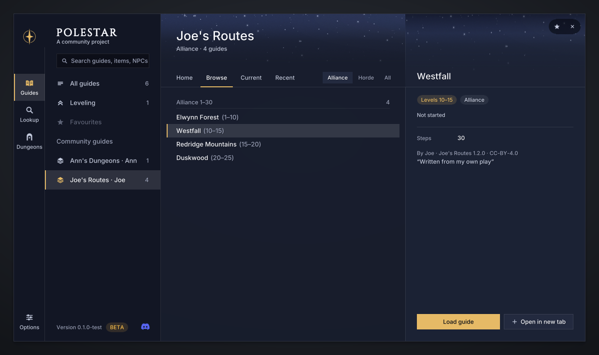
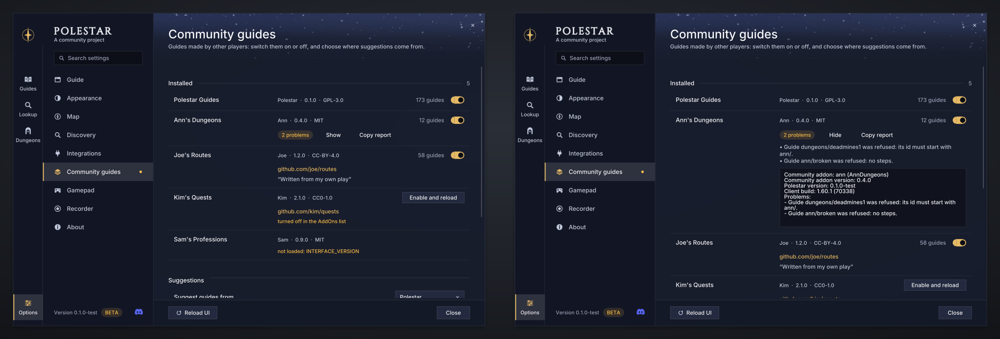

# Community guides

Guides for Polestar written by other players and published as their own
addons. Install one next to Polestar and its guides show up in the guide
menu, with the arrow, the map markers and everything else Polestar does.

<table>
  <tr>
    <td width="50%" valign="top">
      <b><a href="#for-players">I want to play them</a></b><br>
      Install a community addon, find its guides, turn it on or off, and
      know who to ask when something is wrong.
    </td>
    <td width="50%" valign="top">
      <b><a href="#for-authors">I want to write my own</a></b><br>
      Write guides in plain text, check them with Polestar's tools and
      publish them as your own addon.
    </td>
  </tr>
</table>

<p align="center">
  
</p>

## For players

### At a glance

| | Polestar's own guides | Community guides |
|---|---|---|
| **Written by** | Polestar | the addon's author |
| **Tested by Polestar** | yes | no: Polestar does not test or vouch for them |
| **How you get them** | they come with Polestar | a separate addon you install yourself |
| **Where they show** | the guide menu's categories (Leveling, Professions…) | the guide menu, under **Community guides** |
| **Where to report a problem** | the [Polestar Discord](https://discord.gg/vMbee6F2e9) or GitHub | the addon's author, where they publish it |

A community addon only adds guides: it never replaces Polestar's own or
another community addon's. Polestar does not ship, host or recommend any;
you only see one if you install it yourself.

### Install one

1. **Install Polestar first.** A community addon does nothing without it.
2. **Download the community addon** from wherever its author publishes it:
   CurseForge, Wago or the author's own site. Its page there should say that
   it needs Polestar.
3. **Install it like any addon**: with your addon app, or by unzipping it
   into the game's `Interface/AddOns` folder, next to the `Polestar` folders.
4. **Restart the game.**

> [!TIP]
> After the first install, `/reload` is enough to pick up an update.

### Find its guides

Open the guide menu (`/polestar guides`). Below Polestar's own categories is
the **Community guides** heading, with one entry per community addon: its
title and its author. Every guide's details say who wrote it:
"By &lt;author&gt; · &lt;title&gt; &lt;version&gt; · &lt;licence&gt;".

### Turn one on or off

**Options > Community guides** (`/polestar packs`) lists every community
addon you have installed, with its author, version, licence and website.

<p align="center">
  
</p>

- **The switch** on a row shows or hides its guides at once, without a
  reload.
- **Suggest guides from** picks where the guide for your level is suggested
  from. It is Polestar's own guides unless you choose a community addon;
  Polestar's guides still fill in wherever that addon has nothing for your
  character.
- **To remove one for good**, delete its folder or uninstall it in your
  addon app.

### When something is wrong

Report wrong steps and other problems in a community addon to **its
author**, not to Polestar. The author wrote those guides and is the one who
can fix them.

- When a community addon has problems, its row on the Community guides page
  says how many. **Show** lists them; **Copy report** copies them, with the
  versions, ready to send.
- When it cannot run at all, its row says why (for example, turned off in
  the AddOns list, or made for a newer Polestar).
- The row shows the author's website when they gave one.

> [!WARNING]
> A community addon is an addon like any other, and the game runs it like
> any other. Install community addons only from authors you trust, and only
> from the place the author publishes them.

<details>
<summary><b>Telling a community addon from Polestar's own in the AddOns list</b></summary>

<br>

In the game's AddOns list, Polestar has one entry in the Quests category.
Open it and you see Polestar's own addons and your community addons side by
side.

- **Polestar's own addons** are Polestar Guides and the addons that carry
  Polestar's data (Polestar Quest Database, Polestar Item Data, Polestar
  Codex), plus Polestar Recorder for guide authors. Each lists Polestar as
  its author.
- **A community addon** built with Polestar's tools is titled
  "Polestar Community:" and its own name, such as
  "Polestar Community: Emberway Routes". Point at it and the tooltip shows
  its version and a line such as "Community addon for Polestar by Ashka",
  unless its author wrote their own.
- One built before Polestar used that name reads "Polestar Pack:" until its
  author rebuilds it. Polestar reads both.

</details>

<details>
<summary><b>Can I use several at once?</b></summary>

<br>

Yes. Each one gets its own entry under Community guides, and you can open
guides from different addons in different tabs.

</details>

## For authors

### What you get

If you write leveling guides, you can use everything Polestar uses for its
own:

- **The guide format**: plain text `.guide` files. The compiler fills in
  quest titles, givers and coordinates from the reference data, so
  `accept 7` is a whole line.
- **The checks**: `lint` checks every guide against the game's data, and
  `playtest` plays each one to the end in the real addon, without the game.
- **In the game**: Polestar's guide engine, its waypoint arrow, its travel
  planner and its markers on the map.

You publish the result as your own addon, under your name and a licence of
your choice.

### Quick start

You need Node 24 or newer, and Lua 5.1 or LuaJIT for `play` and `playtest`.
[PACKS.md, "Setup"](PACKS.md#setup) has the install command for each system.

```sh
git clone https://github.com/fitzforge/polestar.git
cd polestar
npm link               # puts `polestar` on your PATH
polestar data build    # the reference data every guide command reads
polestar doctor        # checks the setup and prints the fix for anything missing
cd ..                  # your pack goes beside the clone, not inside it
polestar new my-pack   # asks for the id, title, author and licence
cd my-pack
polestar dev --play    # lint and build on every save, with the browser playground
```

> [!TIP]
> No Node or Lua on your machine? When your Polestar clone came from GitHub,
> a pack made by `polestar new` carries a dev container: open the pack's
> repository in GitHub Codespaces and everything is set up. `install` and
> `dev` need the game, so use `play` and `playtest` there.

### What a pack looks like

A community addon is built from a **pack**: a folder with a `pack.json` and
your `.guide` files.

```text
my-pack/
├── pack.json          your addon's id, title, author, version and licence
├── guides/
│   └── westfall.guide your guides, in any layout
├── LICENSE            the licence you chose
└── README.md          for your players
```

```json
{
	"id": "joe-routes",
	"title": "Joe's Routes",
	"author": "Joe",
	"version": "1.2.0",
	"license": "CC-BY-4.0",
	"website": "https://github.com/joe/joe-routes"
}
```

```text
guide joe-routes/northshire
title Northshire Valley
faction Alliance
race Human
levels 1-4
zone Elwynn Forest

step Deputy Willem
  accept 783
  turnin 783
  accept 7

step Kobold camp
  kill 6 x10 quest 7.1

step Back to the abbey
  turnin 7
```

The tools build the addon from these: the TOC, your credits, the compiled
guides and the licence files. Don't edit the built files: change the pack
and build again. [PACK_FORMAT.md](PACK_FORMAT.md) describes every line of
them.

### From first guide to published

1. **Start**: `polestar new my-pack` writes `pack.json`, an example guide
   that already passes every check, a README for your players and the
   `LICENSE` you chose. In a clone of the public repository it also writes
   a GitHub workflow that checks every push.
2. **Write**: `polestar find <text>` prints quest, NPC, object, item, inn
   and flight-point lines ready to paste. In the game, `/polestar where`
   prints where you stand as a guide line.
3. **Check**: `polestar lint` checks every guide against the game's data,
   and `polestar playtest` plays each one to the end, for each race that
   can reach it and each class it has steps for.
4. **Try**: `polestar play` opens the real addon in your browser with your
   pack loaded, and `polestar install` copies it into the game's AddOns
   folder (restart the game the first time).
5. **Build**: `polestar pack` writes `dist/<folder>-<version>.zip`, byte
   for byte reproducible.
6. **Publish**: upload the zip as a new addon project on CurseForge, Wago
   or GitHub. On CurseForge and Wago, mark Polestar as a required
   dependency so addon apps install it too. With the template's workflow, a
   version tag on GitHub builds the zip and attaches it to a release.
7. **Update**: raise `version` in `pack.json`, run `polestar pack` again and
   upload the new zip.

> [!NOTE]
> An AI assistant can help you draft guides from your own material.
> [PACKS.md, "With an AI assistant"](PACKS.md#with-an-ai-assistant) says
> how, and why every id it writes needs checking. Every pack `new` writes
> includes a skill for coding agents, polestar-guide-pack.

### Before you publish

**The tools check these.** `lint` reports them, and `compile`, `install` and
`pack` stop until they are fixed:

- [ ] `pack.json` has an `id`, `title`, `author`, `version` and `license`.
      The id is 2 to 32 lower-case letters, digits or hyphens, and not one
      Polestar reserves. A title or an author name is at most 64 characters.
- [ ] Every guide id starts with your pack id and a slash
      (`ashka-emberway/westfall`).
- [ ] The addon folder is not named `Polestar` and does not start with
      `Polestar_`. By default it is `PolestarPack_` and your title
      (`PolestarPack_EmberwayRoutes`).
- [ ] A `website`, when you give one, starts with `https://` or `http://`.
- [ ] A `next` line hands over only to a guide that exists, is for the same
      faction, and that the characters of your guide can follow.

`lint` also warns while `LICENSE` still holds the placeholder line `new`
writes for a licence it has no text for.

**We ask these of you.** No tool checks them, but players need them to tell
your addon apart and to reach you:

- [ ] **A name of your own** that can't be mistaken for Polestar's addons.
      The tools put "Polestar Community:" before it in the AddOns list. Say
      on your addon page that it is a community addon for Polestar, and if
      you write your own `notes` line, keep that clear there too.
- [ ] **Your name** as the author: the name players will look for.
- [ ] **A version** you raise with every release.
- [ ] **A website or support link** in `website`, so the Community guides
      page shows players where to report problems. Say the same on your
      addon page and in your README.
- [ ] **A licence of your choice.** Polestar's
      [LICENSE-EXCEPTION.md](../LICENSE-EXCEPTION.md) lets you publish a
      community addon built by its compiler, including the reference data
      the compiler puts in it, under any terms you like.
- [ ] **Your own guide text.** Don't copy text from Polestar's own guides:
      the licence exception does not cover it. Handing over to one of
      Polestar's guides with `next` is fine, since that points to the guide
      rather than copying it.
- [ ] **Support for it.** Players are told to report problems to the author,
      so answer them where you publish.

<details>
<summary><b>How your addon shows in the AddOns list</b></summary>

<br>

The TOC places your community addon under Polestar's entry in the Quests
category, titled "Polestar Community: &lt;your title&gt;", with the line
"Community addon for Polestar by &lt;author&gt;" unless you write your own
`notes`. Polestar's own menus show your title as you wrote it. Community
addons built before this name read "Polestar Pack:" until you rebuild them;
Polestar reads both.

</details>

### Where to go next

| You want to… | Read |
|---|---|
| Write your first pack, step by step | [PACKS.md, "A first pack in 15 minutes"](PACKS.md#a-first-pack-in-15-minutes) |
| Write guides by playing, from the simulator, by hand or with an AI assistant | [PACKS.md, "Four ways to write guides"](PACKS.md#four-ways-to-write-guides) |
| Look up a guide line quickly | [GUIDE_CHEATSHEET.md](GUIDE_CHEATSHEET.md) |
| Read the whole guide format | [GUIDE_FORMAT.md](GUIDE_FORMAT.md) |
| Fix a lint message or an in-game problem | [PACKS.md, "Lint messages"](PACKS.md#lint-messages) and ["In game: statuses and problems"](PACKS.md#in-game-statuses-and-problems) |
| Update after a game patch | [PACKS.md, "Updating"](PACKS.md#updating) |
| Know exactly what the tools write | [PACK_FORMAT.md](PACK_FORMAT.md) |

Questions, or a community addon to show? Players and authors meet on the
[Polestar Discord](https://discord.gg/vMbee6F2e9).
