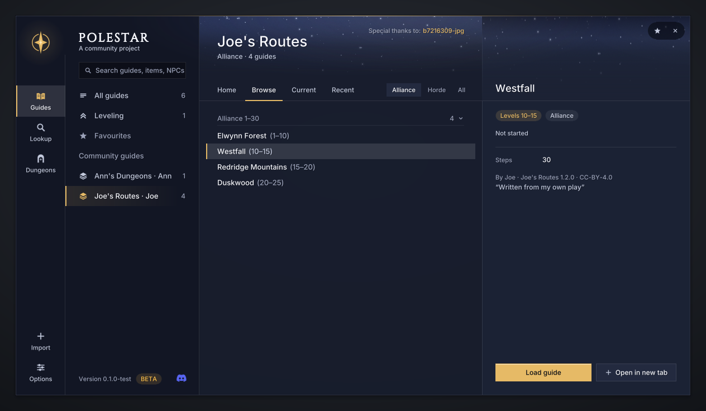
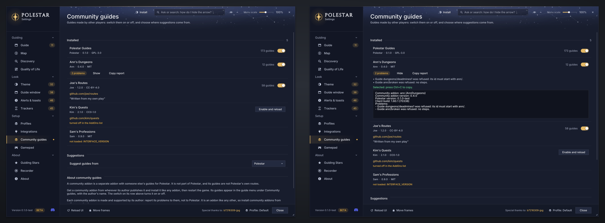

# Community guides

Guides for Polestar written by other players and published as their own
addons. Install one next to Polestar and its guides show up in the guide
menu, with the arrow, the map markers and everything else Polestar does.

<table>
  <tr>
    <td width="50%" valign="top">
      <b><a href="#for-players">I want to play them</a></b><br>
      Install a community addon, find its guides, turn it on or off, and
      know who to ask when something is wrong.
    </td>
    <td width="50%" valign="top">
      <b><a href="#for-authors">I want to write my own</a></b><br>
      Write guides in plain text, check them with Polestar's tools and
      publish them as your own addon.
    </td>
  </tr>
</table>

<p align="center">
  
</p>

## For players

### At a glance

| | Polestar's own guides | Community guides |
|---|---|---|
| **Written by** | Polestar | the addon's author |
| **Tested by Polestar** | yes | no: Polestar does not test or vouch for them |
| **How you get them** | they come with Polestar | a separate addon you install yourself |
| **Where they show** | the guide menu's categories (Leveling, Professions…) | the guide menu, under **Community guides** |
| **Where to report a problem** | the [Polestar Discord](https://discord.gg/polestar) or GitHub | the addon's author, where they publish it |

A community addon only adds guides: it never replaces Polestar's own or
another community addon's. Polestar hosts them, but doesn't review or
recommend any; you only see one if you install it yourself.

### Install one

1. **Install Polestar first.** A community addon does nothing without it.
2. **Download the community addon** from wherever its author publishes it:
   CurseForge, Wago or the author's own site. Its page there should say that
   it needs Polestar.
3. **Install it like any addon**: with your addon app, or by unzipping it
   into the game's `Interface/AddOns` folder, next to the `Polestar` folders.
4. **Restart the game.**

> [!TIP]
> After the first install, `/reload` is enough to pick up an update.

### Find its guides

Open the guide menu (`/polestar guides`). Below Polestar's own categories is
the **Community guides** heading, with one entry per community addon: its
title and its author. Every guide's details say who wrote it:
"By &lt;author&gt; · &lt;title&gt; &lt;version&gt; · &lt;licence&gt;".

### Turn one on or off

**Options > Community guides** (`/polestar packs`) lists every community
addon you have installed, with its author, version, licence and website.

<p align="center">
  
</p>

- **The switch** on a row shows or hides its guides at once, without a
  reload.
- **Suggest guides from** picks where the guide for your level is suggested
  from. It is Polestar's own guides unless you choose a community addon;
  Polestar's guides still fill in wherever that addon has nothing for your
  character.
- **To remove one for good**, delete its folder or uninstall it in your
  addon app.

### Polestar Experimental

Polestar comes with one more set of guides, off until you want it:
**Polestar Experimental**, guides for Forever's new zones while they are
still being written and tested (alpha); none at the moment (the Riverglades,
Shen'dralas and Mount Hyjal are part of both routes). Nothing of them loads until you want them, and there is nothing to
install.

- **Choose one on your route.** Where a leveling guide ends at one of these
  zones, "Choose your path" offers it beside the usual zone, marked
  experimental and never recommended. Choosing it switches the experimental
  guides on and opens the zone's guide; its last part hands you back to the
  usual route.
- **Turn them on by hand** under **Options > Community guides** (`/polestar packs`):
  switch on **Polestar Experimental**. Its guides come in at once, with no
  reload, and stay on for all your characters until you switch them off.
- **Open one** from the guide menu (`/polestar guides`), under **Community
  guides** > Polestar Experimental. Polestar never suggests them and never
  puts them in your route by itself: you choose when to follow one.
- **Turn them off** with the same switch: its guides leave the guide menu,
  and from your next login nothing of them loads.
- They are Polestar's own, so report what you find in them on the
  [Polestar Discord](https://discord.gg/polestar) or GitHub.

### When something is wrong

Report wrong steps and other problems in a community addon to **its
author**, not to Polestar. The author wrote those guides and is the one who
can fix them.

- When a community addon has problems, its row on the Community guides page
  says how many. **Show** lists them; **Copy report** copies them, with the
  versions, ready to send.
- When it cannot run at all, its row says why (for example, turned off in
  the AddOns list, or made for a newer Polestar).
- The row shows the author's website when they gave one.

> [!WARNING]
> A community addon is an addon like any other, and the game runs it like
> any other. Install community addons only from authors you trust, and only
> from the place the author publishes them.

<details>
<summary><b>Telling a community addon from Polestar's own in the AddOns list</b></summary>

<br>

In the game's AddOns list, Polestar has one entry in the Quests category.
Open it and you see Polestar's own addons and your community addons side by
side.

- **Polestar's own addons** are Polestar Guides and the addons that carry
  Polestar's data (Polestar Quest Database, Polestar Item Data, Polestar
  Codex), plus Polestar Experimental (off until you choose one of its zones or switch it on, above)
  and Polestar Recorder for guide authors. Each lists Polestar as its author.
- **A community addon** built with Polestar's tools is titled
  "Polestar Community:" and its own name, such as
  "Polestar Community: Emberway Routes". Point at it and the tooltip shows
  its version and a line such as "Community addon for Polestar by Ashka",
  unless its author wrote their own.
- One built before Polestar used that name reads "Polestar Pack:" until its
  author rebuilds it. Polestar reads both.

</details>

<details>
<summary><b>Can I use several at once?</b></summary>

<br>

Yes. Each one gets its own entry under Community guides, and you can open
guides from different addons in different tabs.

</details>

### One guide from a string

A small guide, such as a quest chain, an item, a mount or an errand, can
come as an **import string** instead of an addon: one line of text its
author shares on Discord, GitHub or a forum. Nothing to install.

1. Open **Import** at the foot of the hub's left rail, just above Options
   (`/polestar import`).
2. Paste the string into the box. Polestar reads it and shows what it
   holds before anything is saved: "Cozy Sleeping Bag · by Yendi · 14
   steps · levels 30–40 · Alliance and Horde · CC-BY-4.0".
3. Press **Import**. The guide is in the guide menu under **Community
   guides**, in the entry **Imported**, credited to its author: "By Yendi ·
   Imported · CC-BY-4.0". It stays imported on every character of your
   account.

- **To update it**, paste the newer string: the button reads **Update**,
  and your progress stays where the guide's steps did not change.
- **To remove it**, press **Delete** on its row under **Your imported
  guides** (twice: the second click confirms).
- A string Polestar cannot read, one that is too big, or one holding a guide
  Polestar refuses is turned down with the reason, and nothing is saved.
- Polestar never suggests an imported guide on its own: you pick it.

An import string is data, never code: Polestar reads the guide out of it
field by field and runs nothing in it, so it cannot do anything a guide
cannot. As with a community addon, Polestar does not test or vouch for the
guide; report its problems to its author.

## For authors

### What you get

If you write leveling guides, you can use everything Polestar uses for its
own:

- **The guide format**: plain text `.guide` files. The compiler fills in
  quest titles, givers and coordinates from the reference data, so
  `accept 7` is a whole line.
- **The checks**: `lint` checks every guide against the game's data, and
  `playtest` plays each one to the end in the real addon, without the game.
- **In the game**: Polestar's guide engine, its waypoint arrow, its travel
  planner and its markers on the map.

You publish the result as your own addon, under your name and a licence of
your choice.

### Quick start

You need Node 24 or newer, and Lua 5.1 or LuaJIT for `play` and `playtest`.
[PACKS.md, "Setup"](PACKS.md#setup) has the install command for each system.

```sh
git clone https://github.com/fitzforge/polestar.git
cd polestar
npm link               # puts `polestar` on your PATH
cd rust && cargo build --release -p forge && cd ..   # or a prebuilt forge from the Releases page
rust/target/release/forge data build    # the reference data every guide command reads
polestar doctor        # checks the setup and prints the fix for anything missing
cd ..                  # your pack goes beside the clone, not inside it
polestar new my-pack   # asks for the id, title, author and licence
cd my-pack
polestar dev --play    # lint and build on every save, with the browser playground
```

> [!TIP]
> No Node or Lua on your machine? When your Polestar clone came from GitHub,
> a pack made by `polestar new` carries a dev container: open the pack's
> repository in GitHub Codespaces and everything is set up. `install` and
> `dev` need the game, so use `play` and `playtest` there.

### What a pack looks like

A community addon is built from a **pack**: a folder with a `pack.json` and
your `.guide` files.

```text
my-pack/
├── pack.json          your addon's id, title, author, version and licence
├── guides/
│   └── westfall.guide your guides, in any layout
├── LICENSE            the licence you chose
└── README.md          for your players
```

```json
{
	"id": "joe-routes",
	"title": "Joe's Routes",
	"author": "Joe",
	"version": "1.2.0",
	"license": "CC-BY-4.0",
	"website": "https://github.com/joe/joe-routes"
}
```

```text
guide joe-routes/northshire
title Northshire Valley
faction Alliance
race Human
levels 1-4
zone Elwynn Forest

step Deputy Willem
  accept 783
  turnin 783
  accept 7

step Kobold camp
  kill 6 x10 quest 7.1

step Back to the abbey
  turnin 7
```

The tools build the addon from these: the TOC, your credits, the compiled
guides and the licence files. Don't edit the built files: change the pack
and build again. [PACK_FORMAT.md](PACK_FORMAT.md) describes every line of
them.

### From first guide to published

1. **Start**: `polestar new my-pack` writes `pack.json`, an example guide
   that already passes every check, a README for your players and the
   `LICENSE` you chose. In a clone of the public repository it also writes
   a GitHub workflow that checks every push.
2. **Write**: `polestar find <text>` prints quest, NPC, object, item, inn
   and flight-point lines ready to paste. In the game, `/polestar where`
   prints where you stand as a guide line.
3. **Check**: `forge guide lint` checks every guide against the game's data,
   and `polestar playtest` plays each one to the end, for each race that
   can reach it and each class it has steps for.
4. **Try**: `polestar play` opens the real addon in your browser with your
   pack loaded, and `polestar install` copies it into the game's AddOns
   folder (restart the game the first time).
5. **Build**: `forge release pack` writes `dist/<folder>-<version>.zip`, byte
   for byte reproducible.
6. **Publish**: upload the zip as a new addon project on CurseForge, Wago
   or GitHub. On CurseForge and Wago, mark Polestar as a required
   dependency so addon apps install it too. With the template's workflow, a
   version tag on GitHub builds the zip and attaches it to a release.
7. **Update**: raise `version` in `pack.json`, run `forge release pack` again and
   upload the new zip.

> [!NOTE]
> An AI assistant can help you draft guides from your own material.
> [PACKS.md, "With an AI assistant"](PACKS.md#with-an-ai-assistant) says
> how, and why every id it writes needs checking. Every pack `new` writes
> includes a skill for coding agents, polestar-guide-pack.

### Writing guides for Polestar 0.4.4

Polestar 0.4.4 changes how guides read in the guide window. Guides written
for 0.4.3 keep working; these rules make yours read like Polestar's own.
Every line is in [GUIDE_FORMAT.md](GUIDE_FORMAT.md), and its
[Cookbook](GUIDE_FORMAT.md#cookbook) has a worked example of each.

**Every action is a row.** A step's goal rows say
what to do and where: the arrow, the map pin and the quest item button
follow them, and a player who reads only the rows still does everything. An
action that lives only in a tip is one players miss.

| Write a row | Not only a tip |
|---|---|
| `use 5411 quest 754.1 @53.7,66.2` | `tip Use the totem at the well.` |
| `interact 176793 quest 5545.1` | `tip Click the bundles of wood.` |
| `equip 12846 optional` | `tip Wear the Argent Dawn Commission.` |
| `task "/salute at Fizzule" optional` | `tip Salute Fizzule.` |

- `use <item> quest <Q>.<O>`: the use that counts for a quest objective. The
  quest item button shows the item while the step is live.
- `use <item> anywhere`: an item used where the player stands (a campfire
  kit, a lure on the pole). It has no place, so the arrow leads nowhere.
- An action only some players need ("if one drops", "while you fight the
  Scourge") is the same row marked `optional`: it shows, and it never holds
  the step.
- A tip is one short line of why or a heads-up: "Deviate Hides drop rarely:
  one run may not be enough."

**The tip lint.** In Polestar's own guides, `forge guide lint` stops on a
tip that tells the player to do something (use, right-click or read an item,
click or open an object, wear something, talk to someone, an emote, board a
ship) that no goal row of its step does. It doesn't check community packs,
but the same rule keeps yours easy to follow. When a tip is right as it is
(a potion between waves, the spellbook to open), put `# tip-ok: <why>` on the
line right above it.

**Leveling guides: steps of places only become hints.** In a leveling
guide, a step whose goals are only `goto`s, a `fly` or an `enter` is no
longer a step of its own. The compiler makes it a hidden hint for the step
after it: the player never sees it in the list, and the arrow goes by it
only while it is on the way. A player who is past it, came another way or
has a faster one (a class teleport, the Hearthstone, a flight) goes straight
to the work. The guide's last steps of places only, with nothing after
them, stay steps: that is where the guide ends. To keep a step that must
stay, say why with `keep <kind> <reason>`:

```
step Cenarion Enclave
  keep door the walking maps have no way up inside the druids' building: its south door first
  zone Darnassus
  goto 35.8,11.6 "Cenarion Enclave"
```

The kinds are `door` (a door or cave mouth the walking maps can't see),
`instance` (an instance's entrance), `boarding` (an NPC who teleports you, a
boarding whose timing matters), `phasing` (a place that starts a phase or an
event) and `safety` (a spot to stand at, such as where to pull to). A kept
step passes once the step it leads to is done. GUIDE_FORMAT.md, ["Steps of
places only"](GUIDE_FORMAT.md#steps-of-places-only), has the rules.

**Profession guides** (`category Professions`) show the skill and its bar
where a leveling guide shows XP. Write them as Polestar's are: one action a
step, in the order a first-timer does them, under a `section` per skill
range.

1. **Learn** the profession (`train First Aid Apprentice`).
2. **Buy** the tool, if it needs one (`buy 5956 x1 nearest`: a Blacksmith
   Hammer).
3. **Get N** of one material: its `collect … gather` and its `auction` in
   one step. The window shows the two as a choice, gather it or buy it, and
   the player picks per material. What they buy goes on the Shopping list
   beside the Auction House.
4. **Go to** a station, when the recipe needs one: `goto … nearest` over two
   or more anvils, forges or fires, and the arrow takes the nearest (needs
   Polestar 0.4.4).
5. **Craft N** until the next skill point you aim for (`craft 3275 until
   40`). "· Professions tab (K by default)" in the step title tells a
   first-timer where the recipe is.
6. **Train** the next rank, then learn its recipes (`learn 3276`).

A gathering guide's "until N" steps take farming loops (`loop <zone> lvl <n>
…` lines): of the loops safe at the player's level, the arrow takes the one
quickest from where they are, and runs round it. The full example is in the
[Cookbook](GUIDE_FORMAT.md#professions-train-learn-craft-skill).
Polestar's own profession guides are built from route files
(`tools/lib/professions/routes/<profession>.json`); a pack writes the same
steps by hand. [docs/forge/professions.md](forge/professions.md) has the
route files and the rules every profession guide keeps.

**Dungeon guides** (`category Dungeons`) show the dungeon instead of the
step's person: its picture and name, and your level when it is below the
dungeon's. Title the guide with the dungeon's name as the Dungeons page
writes it ("Wailing Caverns"). Pick up the quests, end the way there with
`enter "<Dungeon>" @x,y` at its entrance, then the run's objectives and the
hand-ins. Inside, the dungeon tracker shows the quests you hold there and
the bosses, whatever guide is open. After the run, the Dungeons page's
**Hand in the quests** leads to every finished quest of that dungeon,
whichever guide took it. The
example is in the [Cookbook](GUIDE_FORMAT.md#dungeon-guides).

### Moving a pack to 0.4.4

**What keeps working unchanged:** every guide line 0.4.3 reads, the pack
format (a pack needs a newer one only for `goto … nearest`, format 12), and
every `collect … gather` with its `auction`. An older Polestar shows a hidden
hint as the step you wrote.

**What to check:**

- [ ] **Leveling guides:** each step of only `goto`s, a `fly` or an `enter`
      followed by work is now a hidden hint. Give the ones that must stay
      visible a `keep` line. Lint warns about a `keep` on a step with work,
      or outside a leveling guide.
- [ ] **Tips:** move every "use", "click", "wear" or "talk to" into a goal
      row (`use`, `interact`, `equip`, `talk`, `task`), `optional` when only
      some players need it, and keep the tip for the why.
- [ ] **Profession guides:** one action a step, as above. Polestar no longer
      asks up front how to get materials: the "How do you want to get them?"
      card, the Materials window (`/polestar materials`), the guide menu's
      Gather, Buy and Mix rows and the Options default are gone. No guide line
      named them, so no guide changes; drop any README or tip text that sends
      players there. Players pick on each Get step instead.

Then run `forge guide lint` and `polestar playtest` again.

### Before you publish

**The tools check these.** `lint` reports them, and `compile`, `install` and
`pack` stop until they are fixed:

- [ ] `pack.json` has an `id`, `title`, `author`, `version` and `license`.
      The id is 2 to 32 lower-case letters, digits or hyphens, and not one
      Polestar reserves. A title or an author name is at most 64 characters.
- [ ] Every guide id starts with your pack id and a slash
      (`ashka-emberway/westfall`).
- [ ] The addon folder is not named `Polestar` and does not start with
      `Polestar_`. By default it is `PolestarPack_` and your title
      (`PolestarPack_EmberwayRoutes`).
- [ ] A `website`, when you give one, starts with `https://` or `http://`.
- [ ] A `next` line hands over only to a guide that exists, is for the same
      faction, and that the characters of your guide can follow.

`lint` also warns while `LICENSE` still holds the placeholder line `new`
writes for a licence it has no text for.

**We ask these of you.** No tool checks them, but players need them to tell
your addon apart and to reach you:

- [ ] **A name of your own** that can't be mistaken for Polestar's addons.
      The tools put "Polestar Community:" before it in the AddOns list. Say
      on your addon page that it is a community addon for Polestar, and if
      you write your own `notes` line, keep that clear there too.
- [ ] **Your name** as the author: the name players will look for.
- [ ] **A version** you raise with every release.
- [ ] **A website or support link** in `website`, so the Community guides
      page shows players where to report problems. Say the same on your
      addon page and in your README.
- [ ] **A licence of your choice.** Polestar's
      [LICENSE-EXCEPTION.md](../LICENSE-EXCEPTION.md) lets you publish a
      community addon built by its compiler, including the reference data
      the compiler puts in it, under any terms you like.
- [ ] **Your own guide text.** Don't copy text from Polestar's own guides:
      the licence exception does not cover it. Handing over to one of
      Polestar's guides with `next` is fine, since that points to the guide
      rather than copying it.
- [ ] **Support for it.** Players are told to report problems to the author,
      so answer them where you publish.

<details>
<summary><b>How your addon shows in the AddOns list</b></summary>

<br>

The TOC places your community addon under Polestar's entry in the Quests
category, titled "Polestar Community: &lt;your title&gt;", with the line
"Community addon for Polestar by &lt;author&gt;" unless you write your own
`notes`. Polestar's own menus show your title as you wrote it. Community
addons built before this name read "Polestar Pack:" until you rebuild them;
Polestar reads both.

</details>

### Import strings

A single small guide can go to players as one line of text instead of an
addon: they paste it on Polestar's Import page (`/polestar import`). Use it
for a quest chain, an item, a mount, an errand; a route or a set of guides is
a community addon.

| | Import string | Community addon |
|---|---|---|
| **For** | one small guide | a whole route or a set of guides |
| **You run** | `polestar export <file.guide>` | `forge release pack` |
| **Players** | paste it on the Import page | install it, then restart the game |
| **Updates** | raise the guide's `version` and share the new string: players press Update | raise `version` in `pack.json` and upload the new zip |
| **Size** | one guide of at most 60 steps (and 50,000 characters) | no limit |

```sh
forge guide lint && polestar playtest       # the same checks as for an addon
polestar export guides/cozy-sleeping-bag.guide > cozy.txt
```

- The guide still lives in a pack: `export` finds the `pack.json` above the
  file, and the guide id starts with your pack id
  (`yendi/cozy-sleeping-bag`), so two authors' guides never collide. The
  string carries the guide and your pack's `license`; its author is the
  guide's `author`, else the pack's.
- `export` lints the pack first and refuses a guide with errors (another
  guide's errors do not stop it). It prints only the string on stdout, so
  `> file.txt` keeps just that line.
- A guide's `version` decides between Import and Update in the game: raise
  it when you share a new string.
- A `next` or route choice may lead only to one of Polestar's guides or to a
  guide the player imported before; `export` names the guides to import
  first. Polestar refuses a string whose guide leads anywhere else.
- A guide id under the id of a community addon the player has installed
  stays that addon's: the string is refused.
- In `polestar play <pack>` (and `polestar dev --play`), **Copy import
  string** beside the guide picker gives the string of the guide picked.

The format of the string is in [PACK_FORMAT.md, "Import
strings"](PACK_FORMAT.md#import-strings). Strings are covered by the same
[licence exception](../LICENSE-EXCEPTION.md) as community addons.

### Where to go next

| You want to… | Read |
|---|---|
| Write your first pack, step by step | [PACKS.md, "A first pack in 15 minutes"](PACKS.md#a-first-pack-in-15-minutes) |
| Write guides by playing, by hand or with an AI assistant | [PACKS.md, "Three ways to write guides"](PACKS.md#three-ways-to-write-guides) |
| Look up a guide line quickly | [GUIDE_CHEATSHEET.md](GUIDE_CHEATSHEET.md) |
| Read the whole guide format | [GUIDE_FORMAT.md](GUIDE_FORMAT.md) |
| Fix a lint message or an in-game problem | [PACKS.md, "Lint messages"](PACKS.md#lint-messages) and ["In game: statuses and problems"](PACKS.md#in-game-statuses-and-problems) |
| Update after a game patch | [PACKS.md, "Updating"](PACKS.md#updating) |
| Write guides the 0.4.4 way, and move a pack to it | ["Writing guides for Polestar 0.4.4"](#writing-guides-for-polestar-044) and ["Moving a pack to 0.4.4"](#moving-a-pack-to-044) |
| Know exactly what the tools write | [PACK_FORMAT.md](PACK_FORMAT.md) |

Questions, or a community addon to show? Players and authors meet on the
[Polestar Discord](https://discord.gg/polestar).
