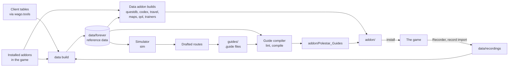

# Polestar documentation

Where each question is answered, grouped by who asks it: players who install
and go, guide authors who write community addons (other people's guides for
Polestar, each a separate addon), contributors who fix and build,
and maintainers who release. Paths are from the repository root.

## The docs

| Doc | Reader | What it answers |
|---|---|---|
| [README.md](../README.md) | players, everyone | What Polestar is, how to install it, what it does, where to go next |
| [CHANGELOG.md](../CHANGELOG.md) | players, guide authors, contributors | What changed in each release, under "For players", "For guide authors" and "For contributors"; what is merged but not released yet is in `changes/` ([changes/README.md](../changes/README.md)) |
| [docs/GUIDE_PACKS.md](GUIDE_PACKS.md) | players, guide authors | What a community addon is and is not, how to tell one from Polestar's own addons, installing one, turning it on or off, who supports it; for authors, the steps from `new` to publishing, what the tools require and what we ask of you. The in-game Community guides page links here |
| [docs/GUIDE_CHEATSHEET.md](GUIDE_CHEATSHEET.md) | guide authors | The guide format on one page: every header line, goal and condition, with what it does and a short example |
| [docs/GUIDE_FORMAT.md](GUIDE_FORMAT.md) | guide authors | The `.guide` language in full: header, steps, goals, conditions, what the compiler fills in, validation, a cookbook |
| [docs/PACKS.md](PACKS.md) | guide authors | The full handbook: how to write, test, publish and update a community addon; every problem the tools or the game can report, with its fix |
| [docs/PACK_FORMAT.md](PACK_FORMAT.md) | guide authors, tool builders | The contract between a community addon and Polestar: `pack.json`, the addon the compiler writes, the rules Polestar enforces, versioning |
| [LICENSE-EXCEPTION.md](../LICENSE-EXCEPTION.md) | guide authors | The permission to distribute a compiled community addon under terms of your choice |
| [CONTRIBUTING.md](../CONTRIBUTING.md) | players, guide authors, contributors | Ways to help; how to report a wrong step; how to fix a guide; setting up; code changes; which branch a pull request goes to; using an AI agent; commits and pull requests; the licence of contributions |
| [AGENTS.md](../AGENTS.md) and [skills/](../skills) | contributors' coding agents | AGENTS.md points every agent to its skill: `polestar-contributing` (branches, generated files, changelog fragments, what a pull request must not do, posting on issues), `polestar-triage` (checking a report before agreeing it is a bug), `polestar-guide-fix`, `polestar-guide-pack` |
| [SECURITY.md](../SECURITY.md) | everyone | How to report a security problem privately, and what counts as one |
| [docs/TRANSLATING.md](TRANSLATING.md) | translators, contributors | The languages and their status, the locale file and how to fill it, formats, the glossary, the `i18n` commands, adding or reviewing a language |
| [docs/ARCHITECTURE.md](ARCHITECTURE.md) | contributors | The contract between the addon's modules, the compiled guide data, the toolchain and the tests |
| [addon/README.md](../addon/README.md) | contributors | Which addon is which, the modules in load order with each file and its public table, where a hub screen lives, the generated files inside `addon/` |
| [tools/README.md](../tools/README.md) | contributors, maintainers | The commands by group, the `tools/lib` folders, every generated file with its command and inputs, how to tell it is stale, the rebuild order after a data change |
| [tests/README.md](../tests/README.md) | contributors | The test layers, the fake client, the helpers, how to run one test, what needs local data |
| [docs/SUITE.md](SUITE.md) | contributors | The modules and their scope, which other addons and sites Polestar reads, the data layer, the in-game packs |
| [docs/SIMULATION.md](SIMULATION.md) | contributors | The route simulator: world model, character model, search, calibration, results |
| [docs/DESIGN.md](DESIGN.md) | contributors | The design system: who the windows are for and what they must do, then colour, type, layout and component tokens |
| [docs/NAV_QA.md](NAV_QA.md) | contributors, maintainers | The pathing checks: every problem reported against Shortest Path Forever that touches what Polestar uses from it, the check Polestar holds itself to and the test or in-game step that enforces it |
| [docs/RELEASING.md](RELEASING.md) | maintainers | What ships, setting the version, the feature release steps, patch releases from a `hotfix/` branch, release candidates |
| [docs/curseforge/README.md](curseforge/README.md) | maintainers | The CurseForge listing: the summary, the project settings, what to upload where, and the description to paste ([description.md](curseforge/description.md)) |
| [THIRD_PARTY.md](../THIRD_PARTY.md) | guide authors, maintainers | Where every input comes from, its licence, and what may enter the repository or a release |

`docs/preview/` holds renders of the addon's windows (`node tools/polestar.js
preview`); `docs/assets/` holds the README's art and screenshots.

## The moving parts

Data flows from the game client and local sources into reference data, from
there into the data addons and the compiled guides, and from `addon/` into
the game. The Recorder sends play back into the reference data; the
simulator turns reference data into route drafts for the guides.

`data/forever`, `data/recordings` and the local data addons stay on the
machine that built them; [tools/README.md](../tools/README.md) lists every
generated file, whether it is committed, and the order to rebuild in.

## Glossary

- **Hub**: Polestar's main window: a rail of sections (Guides, Lookup, Dungeons, Rares) with Options at its foot (`UI/Picker.lua`).
- **Guide menu**: the hub's Guides section, where a player picks a guide.
- **Guide window**: the small window that shows the current step and its goals while playing (`UI/GuideFrame.lua`).
- **Guide**: one route, written as a `.guide` file and compiled to Lua; its id reads like `forever/alliance/human/01-elwynn-forest`.
- **Step**: one stop in a guide: a title, optional conditions and tip, and at least one goal.
- **Goal**: one thing to do in a step, as a verb and its arguments (`accept 783`, `kill`, `goto`, `turnin`...).
- **Pack**: an addon of guides for Polestar, built by the compiler from a folder with a `pack.json` (the folder is a pack too); Polestar's own is `Polestar_Guides` (pack id `guides`). **Community addon**: every other pack, a separate addon made and supported by its author, listed under Community guides ([GUIDE_PACKS.md](GUIDE_PACKS.md)).
- **Reference data**: the game facts in `data/forever/*.json` (quests, NPCs, objects, items, zones, map frames and more) that the compiler and the data builds read; built locally by `data build`.
- **Data addon**: a companion addon that carries data, not code, mostly loaded on demand: `Polestar_QuestDB`, `Polestar_ItemDB`, `Polestar_Codex`, `Polestar_Travel`.
- **Codex**: Lookup's database of items, mounts, pets, recipes, NPCs, rares, quests, zones, dungeons and treasures, with where each comes from (`codex build`, the `Polestar_Codex` addon).
- **QuestDB**: the quest database behind quest markers and tooltips (`questdb build`, the `Polestar_QuestDB` addon).
- **ItemDB**: item stats for the gear advice (`itemdb build` and `gear build`, the `Polestar_ItemDB` addon).
- **Recorder**: the optional `Polestar_Recorder` addon that records play; `record import` turns its sessions into `data/recordings`.
- **Playground**: the real addon running in a browser against a simulated world (`node tools/polestar.js play`).
- **Simulator**: the route model and search that finds and scores leveling routes (`node tools/polestar.js sim`, [SIMULATION.md](SIMULATION.md)).
- **Playtest**: playing a pack's guides to the end in the real addon, once per class they branch on (`node tools/polestar.js playtest`).
