# Routes that make sense.

**Polestar is a free, open-source guide addon for World of Warcraft: Forever.** It takes every race from 1 to 60 on routes planned from the game's own data, with a guide window that keeps up with you and an arrow that walks real paths. Around the routes: class quests, professions, reputations, mounts and pets, a search for where anything comes from, a dungeon journal, and the helpers a long leveling session needs.

***

## Leveling routes for every race

Every race starts in its own zone, Zephras Isle for the Skyborne included, then joins one shared route for its faction all the way to 60. The routes are built from the game's data, played through the way you would follow them, read step by step, and every problem players report is fixed for good: whole towns in one visit, quests on the road picked up as you pass, training where you already are, elite quests with a solo way past.

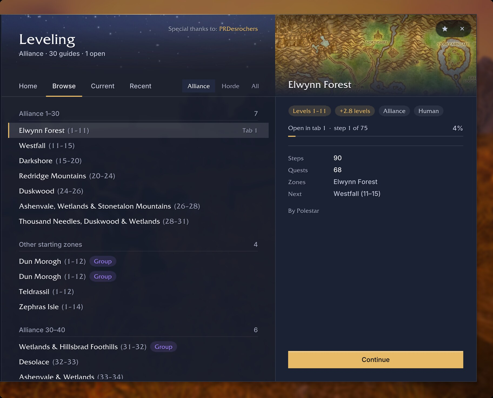

## The arrow walks real paths

Around cliffs, through town gates, into caves and out of the capitals by their streets, on walking maps of the whole world. Pick how it walks (fastest, balanced or on the roads); it keeps out of the other faction's towns and says when you have arrived.

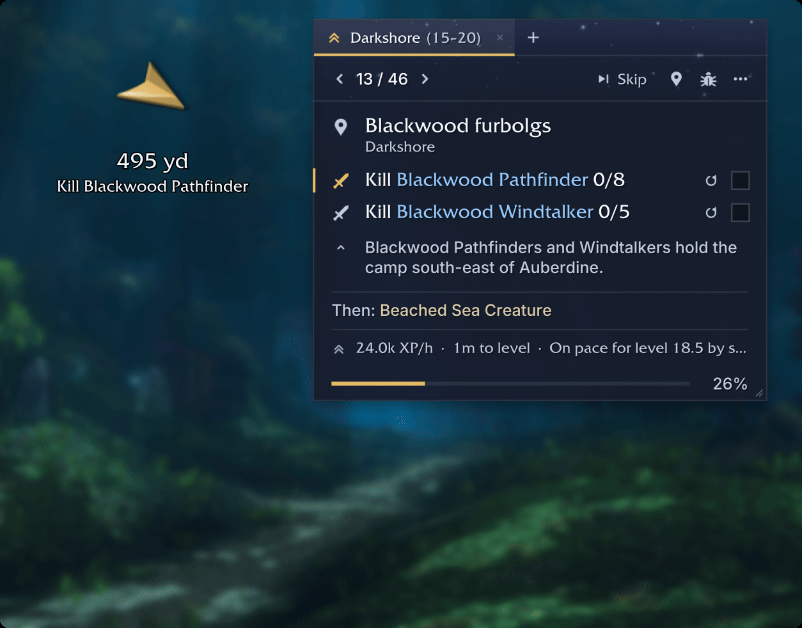

## Flights, boats and your Hearthstone

The travel planner takes flight paths, boats, zeppelins, the tram and portals when they are faster, on their real timetables, and suggests your Hearthstone when it saves a long trip. Every leg is timed, waits included.

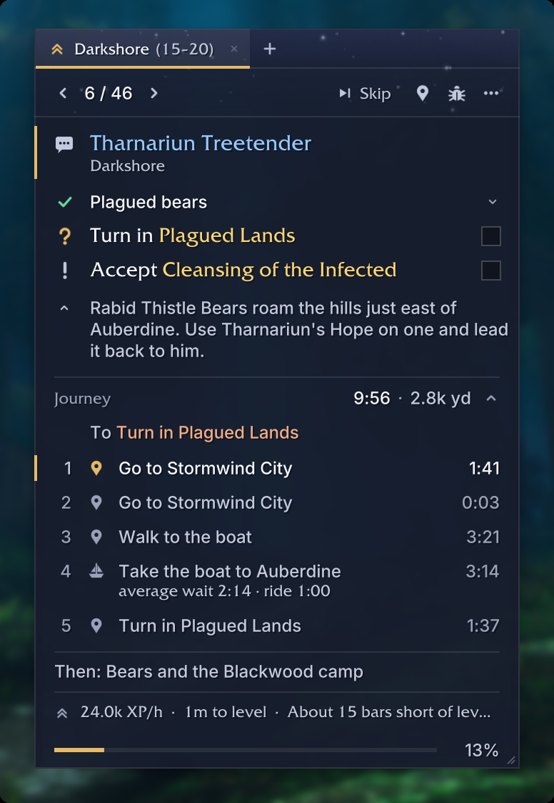

## Nearby services

The nearest vendor, repair, innkeeper, flight master, trainer, bank or mailbox, one click from the guide window. The arrow takes you there and comes back to the guide when you are done.

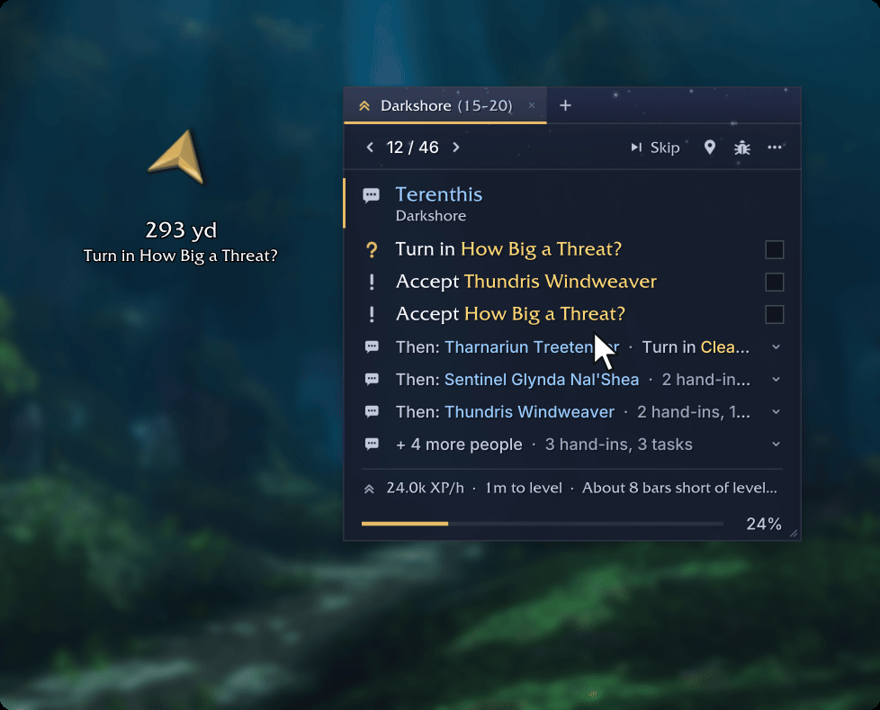

## A guide window that keeps up with you

Goals tick off when the game confirms them: quests taken and handed in, kills, loot, places, trainers. In a town it shows one person at a time, folds away what is done, and shows only your character's steps, with the quest's own objectives and counts. Work you can do on the way waits under the steps you walk to.

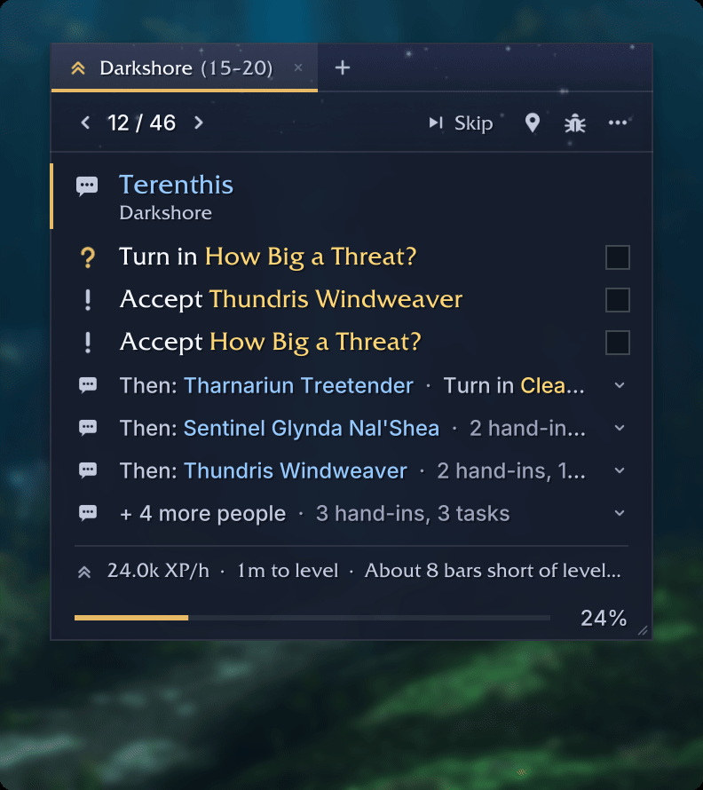

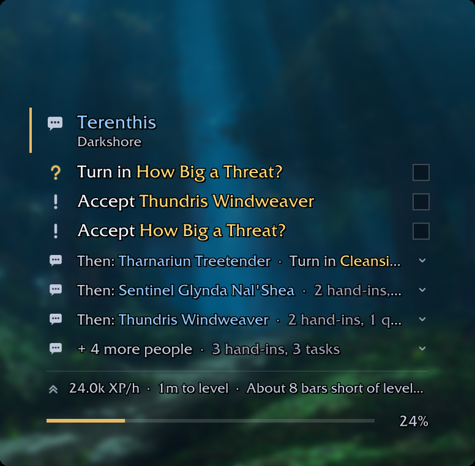

Skip a quest with undo, look ahead without losing your place, answer group quests once, and keep up to six guides open in tabs. Standard, compact or transparent; every window answers a gamepad.

## Every guide in one place

Leveling for every race, class quests for every class (spells, pets, totems, forms and class mounts), all twelve professions with where every material comes from, reputations with what each turn-in or kill pays, mounts and pets, exploration, the Legacy challenges and talent plans for every spec.

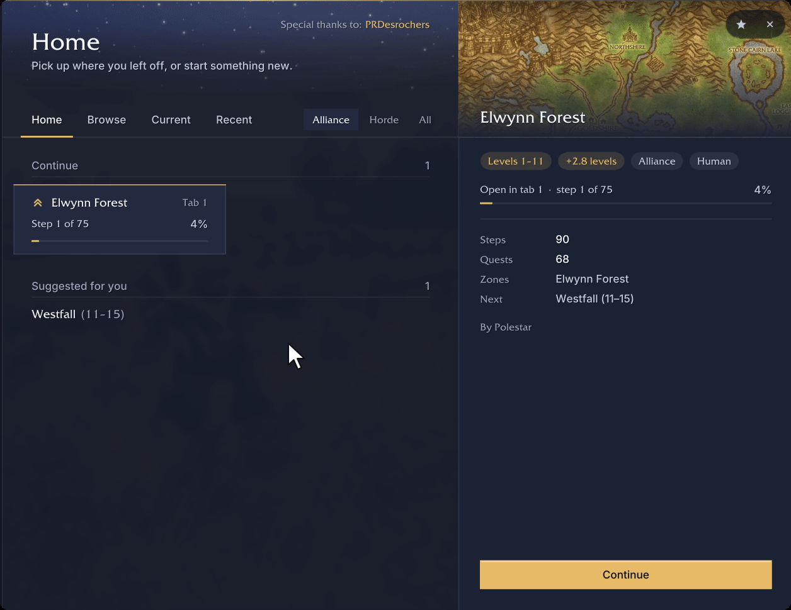

## Lookup: how do I get that?

Search any item, mount, pet, recipe, quest, NPC or zone and see every place it comes from, ranked for your character. Guide me builds a guide there on the spot.

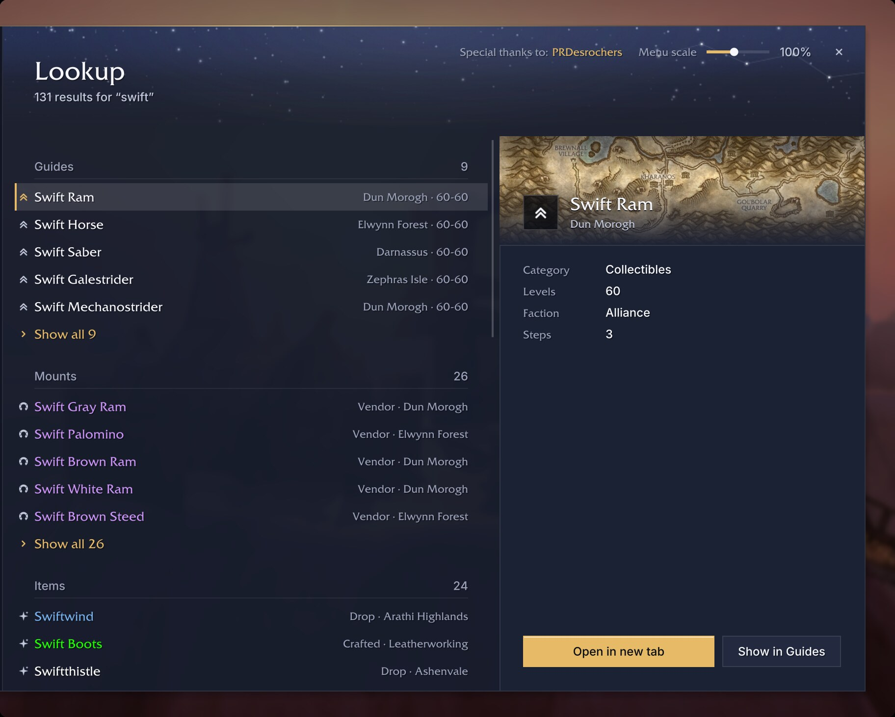

## Dungeons and Rares

Every dungeon's quests with who starts and ends them, their chains and rewards, the bosses and the entrance, and one button that guides you round to pick the quests up. Rares lists every rare and treasure by zone and tells you when one shows up.

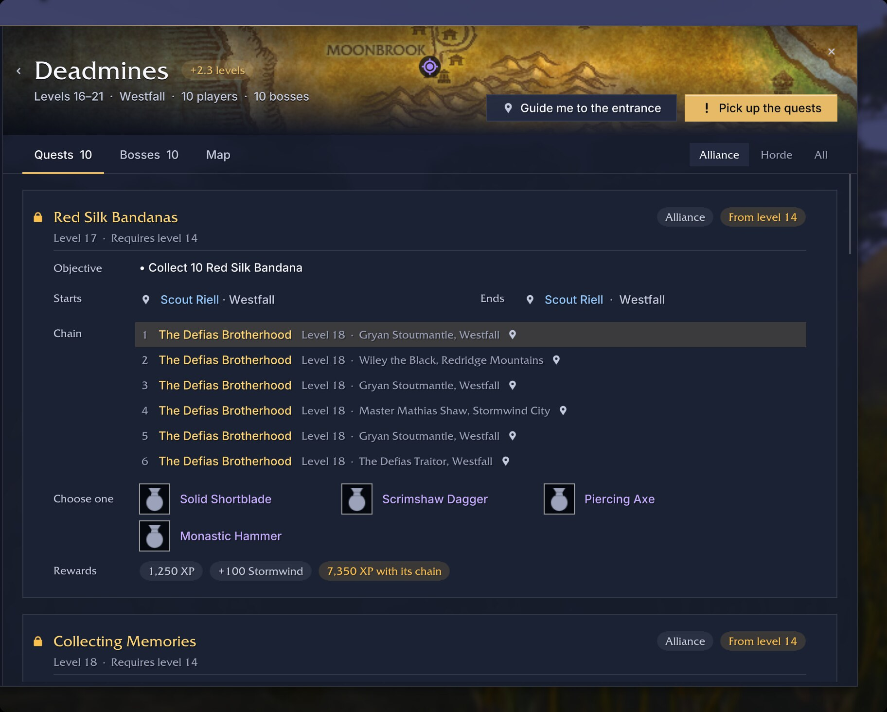

## Quests on the map

Givers, objectives and turn-ins on the world map and the minimap, the step's area shaded, the route drawn, and icons on the nameplates of mobs you still need.

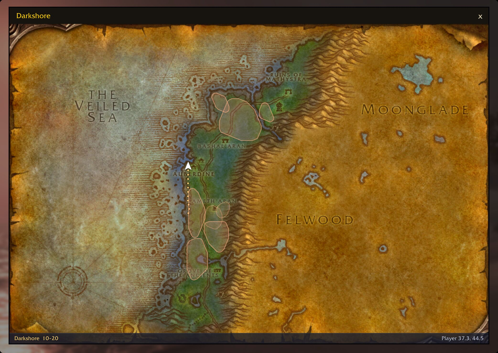

## Quality of life

Accept and hand in guide quests, sell junk and repair, buy what a step needs, restock food and ammo, keep quest items from being sold, warn before your bags fill up, and point out gear upgrades on tooltips and quest rewards. Each one is a switch you can turn off.

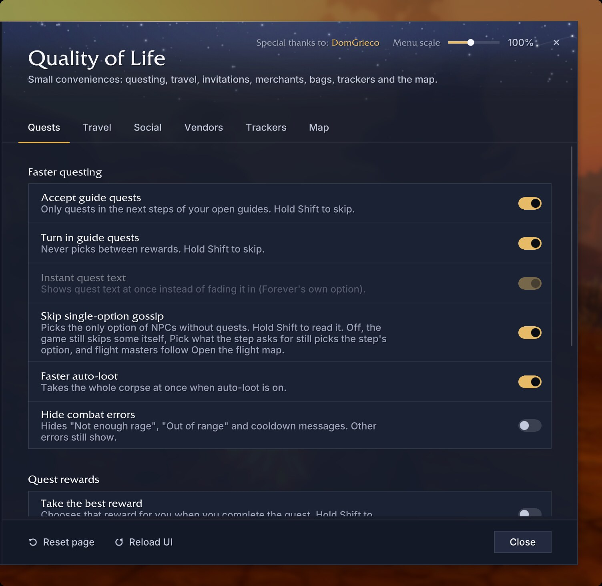

The guide window's menu lists the quests in your log the route no longer needs, grey ones included, with a button to abandon each.

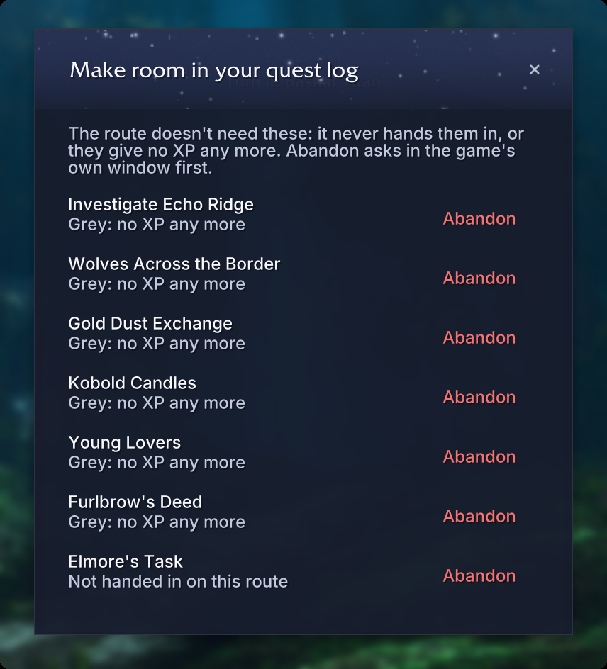

## Play together

With friends who also run Polestar, you see each other's progress on shared quests, the step waits until everyone has what they need, and a Share button offers a quest someone is missing. A party panel shows each friend's level, step and needs, and Polestar can say in party chat when you finish an objective. Friends without Polestar see nothing.

## Routes that learn from real play

The optional Polestar Recorder notes what only play can show: kill pace, drops, which quests an NPC offers, flight times. It records no character, realm or account names, and with your consent the Polestar Client sends it in, so the next routes are built on Forever's real numbers.

## Polestar Client and community guides

The [Polestar Client](https://polestar.guide/client) for Windows, macOS and Linux finds WoW: Forever, installs and updates Polestar and the Recorder, and installs community guides from [polestar.guide](https://polestar.guide) in one click. Players publish their own routes there, and a shared guide can also be pasted in as an import string.

## Your language, your look

English, German, French, Spanish (Spain and Latin America), Brazilian Portuguese, Russian, Korean and Chinese (Simplified and Traditional), with every NPC, place, item and quest named as your game names it. Skins, colour schemes, your own accent or class colour, and EllesmereUI's look when it is installed.

***

## Getting started

1. **Install** with the [Polestar Client](https://polestar.guide/client) or the CurseForge app, then restart the game completely.
2. **Open the guide menu** with `/polestar guides` (a welcome opens on each new character too).
3. **Pick your start** and follow the arrow. Goals tick off by themselves as you play.

Installing by hand: unzip into `World of Warcraft/_forever_/Interface/AddOns/` so the Polestar folders sit directly inside it, and restart the game. Delete the old Polestar folders before an update.

## FAQ

**How do I close a guide tab?**  
Click the × on the tab in the guide window. On the guide menu's Home, point at a card under Continue and click its ×, or right-click the card and choose Close tab.

**How do I clean up my quest log?**  
Open the guide window's ⋯ menu and choose Clean up quest log, or type `/polestar questlog`.

**How do I stop the party messages?**  
Options › Questing › Quests › Group: turn off "Tell my party in chat when I finish a quest objective".

**Which commands are there?**  
`/polestar` shows the guide window, `/polestar guides` opens the guide menu, `/polestar options` holds every setting, `/polestar near vendor` points at the nearest vendor, and `/polestar help` lists the rest.

**A step is wrong. How do I report it?**  
Click the bug button on the guide window (or type `/polestar report`), copy the report, and post it on the [Polestar Discord](https://discord.gg/vMbee6F2e9) or as a [GitHub issue](https://github.com/fitzforge/polestar/issues).

**How do recordings help, and how do I opt out?**  
Recordings replace estimates with what really happens in Forever, so routes get faster and wrong steps get found. Sharing is on by default in the Polestar Client: turn it off there at any time, type `/psrec off`, or don't install the Recorder.

**What changed in each version?**  
See the [changelog](https://github.com/fitzforge/polestar/blob/main/CHANGELOG.md).

***

## Links

*   **Discord:** [Polestar | Leveling Guides](https://discord.gg/vMbee6F2e9)
*   **Website:** [polestar.guide](https://polestar.guide)
*   **Source code:** [github.com/fitzforge/polestar](https://github.com/fitzforge/polestar)
*   **Changelog:** [what changed in each version](https://github.com/fitzforge/polestar/blob/main/CHANGELOG.md)
*   **Write your own guides:** [community guides explained](https://github.com/fitzforge/polestar/blob/main/docs/GUIDE_PACKS.md)

## Support Polestar

Polestar is free and stays free, with no ads and nothing locked. If it saves you some hours on the way to 60, you can [buy me a coffee on Ko-fi](https://ko-fi.com/0xfitz). Reports, guides and translations help just as much.

## Licence and credits

Free and open source under the [GNU GPL, version 3](https://github.com/fitzforge/polestar/blob/main/LICENSE). The walking paths use Leffe's navigation maps and Polestar's own, with a router that started from Cillian Berragan's [Shortest Path Forever](https://github.com/cjber/shortest-path-forever), used with his kind permission. Every data source is credited with its licence in [THIRD_PARTY.md](https://github.com/fitzforge/polestar/blob/main/THIRD_PARTY.md). No game art ships with Polestar; the pictures show the game (© Blizzard Entertainment).

_World of Warcraft is a trademark of Blizzard Entertainment. Polestar is a community project, not affiliated with or endorsed by Blizzard._
