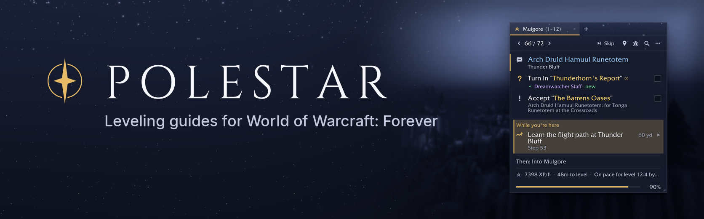
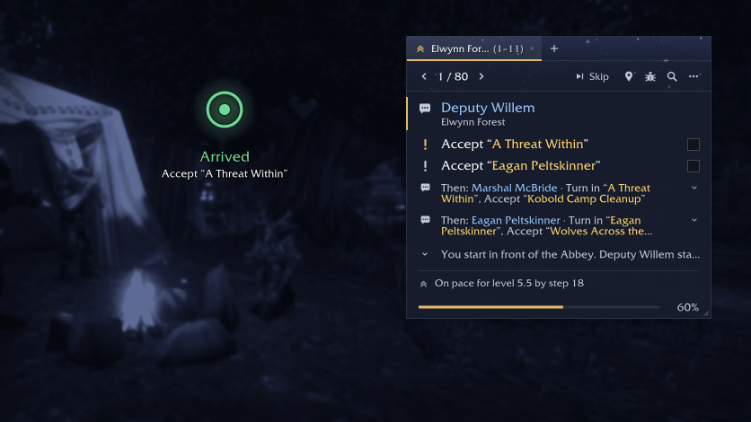
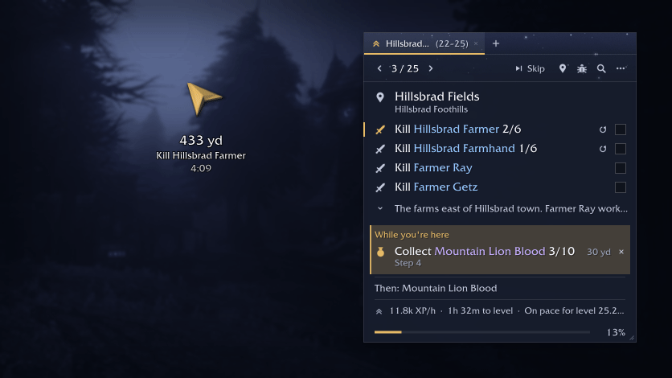
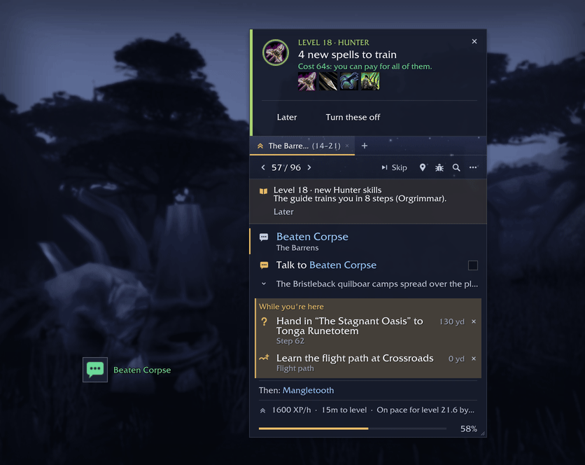
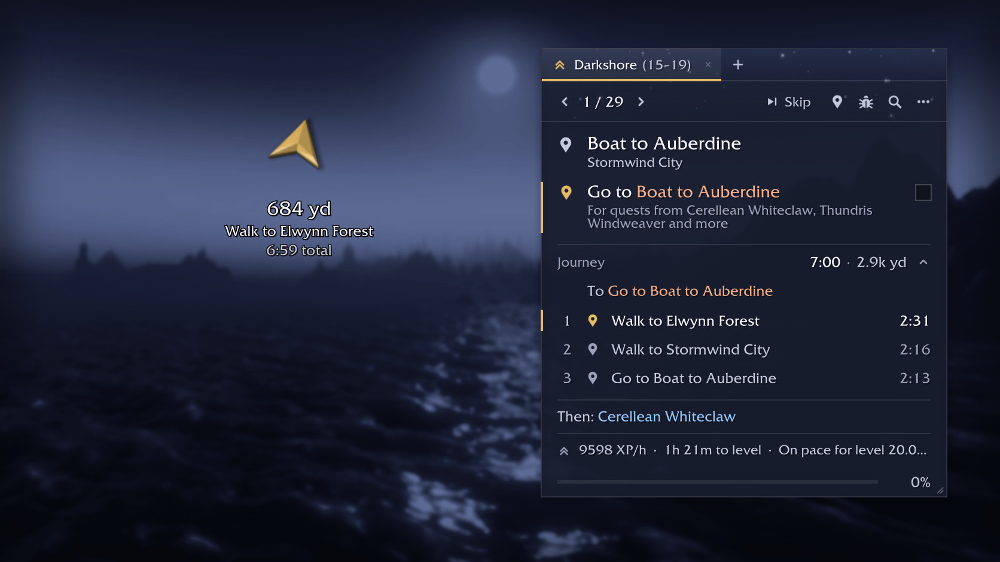
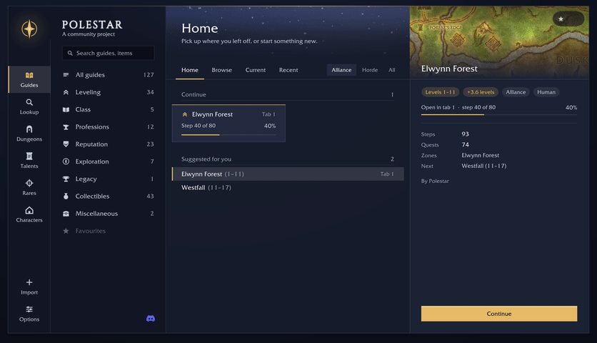
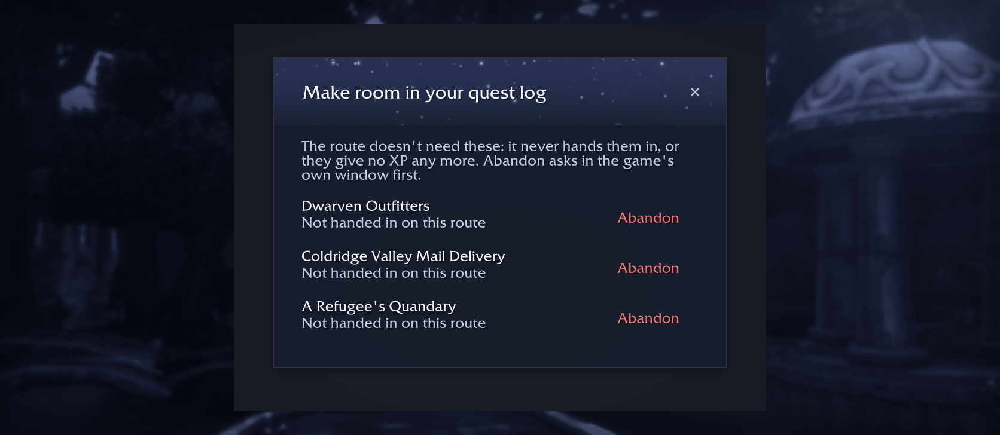

# Leveling guides for every race, 1 to 60.

**Polestar is a free, open-source guide addon for World of Warcraft: Forever.** Routes planned from the game's own data, a guide window that ticks goals off as you play, and an arrow that walks the real paths between them.

**Get started:** install with the CurseForge app or the [Polestar Client](https://polestar.guide/client), restart the game completely, and type `/polestar guides` to pick your start.

## A guide window that keeps up with you

Goals tick off when the game confirms them: quests taken and handed in, kills, loot, places, trainers. In a town it shows one person at a time, folds away the people you are done with, and turns the arrow to the next.

Skip a quest with undo, look ahead without losing your place, keep up to six guides open in tabs, and choose a standard, compact or transparent window. Every window answers a gamepad.

## While you're here

Nobody follows a route exactly, so Polestar watches what is around you. Kills, items and hand-ins from other steps show up while you are close, with how far away they are, and count as you do them.

## New spells when you level up

A card lists the spells your trainer has for you, what they cost and where to train. Train All learns them in one click at the trainer, and Upgrade puts the new ranks on your action bars.

## Routes for every race

Every race starts in its own zone, Zephras Isle for the Skyborne included, then joins one route for its faction all the way to 60: whole towns in one visit, quests on the road picked up as you pass, training where you already are, and a solo way past every elite or group quest. Each route is played through, read step by step, and every problem players report is fixed for good.

## Flights, boats and your Hearthstone

The travel planner takes flight paths, boats, zeppelins, the tram and portals when they are faster, on their real timetables, and suggests your Hearthstone when it saves a long trip. Every leg is timed, waits included.

## Nearby services

The nearest vendor, repair, innkeeper, flight master, trainer, bank or mailbox, one click from the guide window. The arrow takes you there and brings you back to the guide.

## Every guide in one place

Leveling for every race, class quests for every class, all the professions (starting where your skill is) with where every material comes from, reputations, mounts and pets, exploration, the Legacy challenges, and guides from the community.

## Lookup: how do I get that?

Search any item, mount, pet, recipe, quest, NPC or zone and see every place it comes from, ranked for your character. One click builds a guide there.

## Dungeons

Every dungeon's quests with who starts and ends them, their chains and rewards, the bosses and the entrance, and one button that guides you round to pick the quests up.

## Quests on the map

Givers, objectives and turn-ins on the world map and the minimap, the route drawn, and icons on the nameplates of mobs you still need.

## A tidy quest log

Quests the route will never hand in, and ones that no longer give XP, in one list with an Abandon button each. Open it from the guide window's menu or with `/polestar questlog`.

## And everything around it

| Feature | What it does |
|---|---|
| **Quest helpers** | Loot that starts a quest glows on the quest item button until you take it, and timed quests count down at the top of the window. |
| **Browse all steps** | Click the step number to see every step of the guide. |
| **Hide it all** | One click on the minimap button hides everything Polestar shows; another brings it back. |
| **Update notice** | At login, a card says when a newer Polestar is out and how to update. |
| **Play together** | See where friends are on the guide and who still needs what, share a quest someone is missing, and offer your step with Sync to my guide. |
| **Class quests** | Spells, pets, totems, forms and class mounts for every class, with a heads-up when one opens at your level. |
| **Rares** | Every rare and treasure by zone, with an alert when one shows up. |
| **Gear** | Upgrades marked on tooltips and quest rewards, from your own Pawn scale if you have one. |
| **Bags and vendors** | Junk and keep marks, quest items kept from being sold, selling greys, repairing and restocking food and ammo. |
| **Quest automation** | Accept and hand in guide quests and pick the best reward. Each helper is a switch you can turn off. |
| **Your pace** | XP per hour, time to level, and whether you will reach the guide's next level on time; Boosted Rest and your sleeping bag too. |
| **Characters** | Every character on your account at a glance. |
| **Keybinds** | Bind Polestar's buttons in the game's Quick Keybind Mode. |
| **Your look** | Skins, colour schemes, your own accent or class colour, and EllesmereUI's look when it is installed. |
| **Your language** | English, German, French, Spanish (Spain and Latin America), Brazilian Portuguese, Russian, Korean and Chinese (Simplified and Traditional), with every NPC, place, item and quest named as your game names it. |
| **Polestar Client** | For Windows, macOS and Linux: finds WoW: Forever, installs and updates Polestar, and installs community guides in one click. |
| **Polestar Recorder** | Optional. Notes kill pace, drops and flight times, never character, realm or account names, so the routes are built on Forever's real numbers. Sent only with your consent. |

## Getting started

1. **Install** with the CurseForge app or the [Polestar Client](https://polestar.guide/client), then restart the game completely.
2. **Open the guide menu** with `/polestar guides` (a welcome opens on each new character too).
3. **Pick your start** and follow the arrow. Goals tick off by themselves as you play.

Installing by hand: unzip into `World of Warcraft/_forever_/Interface/AddOns/` so the Polestar folders sit directly inside it, and restart the game. Delete the old Polestar folders before an update.

## FAQ

**Which commands are there?**  
`/polestar` shows the guide window, `/polestar guides` opens the guide menu, `/polestar options` holds every setting, `/polestar near vendor` points at the nearest vendor, and `/polestar help` lists the rest.

**How do I close a guide tab?**  
Click the × on the tab in the guide window. On the guide menu's Home, point at a card under Continue and click its ×.

**A step is wrong. How do I report it?**  
Click the bug button on the guide window (or type `/polestar report`), copy the report, and post it on the [Polestar Discord](https://discord.gg/vMbee6F2e9) or as a [GitHub issue](https://github.com/fitzforge/polestar/issues). Every report becomes a fix the next build keeps.

**How do recordings help, and how do I opt out?**  
Recordings replace estimates with what really happens in Forever, so routes get faster and wrong steps get found. Sharing is on by default in the Polestar Client: turn it off there at any time, type `/psrec off`, or don't install the Recorder.

***

## Links

*   **Discord:** [Polestar | Leveling Guides](https://discord.gg/vMbee6F2e9)
*   **Website:** [polestar.guide](https://polestar.guide)
*   **Source code:** [github.com/fitzforge/polestar](https://github.com/fitzforge/polestar)
*   **Changelog:** [what changed in each version](https://github.com/fitzforge/polestar/blob/main/CHANGELOG.md)
*   **Write your own guides:** [community guides explained](https://github.com/fitzforge/polestar/blob/main/docs/GUIDE_PACKS.md)

## Support Polestar

Polestar is free and stays free, with no ads and nothing locked. If it saves you some hours on the way to 60, you can [buy me a coffee on Ko-fi](https://ko-fi.com/0xfitz). Reports, guides and translations help just as much.

## Licence and credits

Free and open source under the [GNU GPL, version 3](https://github.com/fitzforge/polestar/blob/main/LICENSE). The walking paths use Leffe's navigation maps and Polestar's own, with a router that started from Cillian Berragan's [Shortest Path Forever](https://github.com/cjber/shortest-path-forever), used with his kind permission. Every data source is credited with its licence in [THIRD_PARTY.md](https://github.com/fitzforge/polestar/blob/main/THIRD_PARTY.md). No game art ships with Polestar; the pictures show the game (© Blizzard Entertainment).

_World of Warcraft is a trademark of Blizzard Entertainment. Polestar is a community project, not affiliated with or endorsed by Blizzard._
