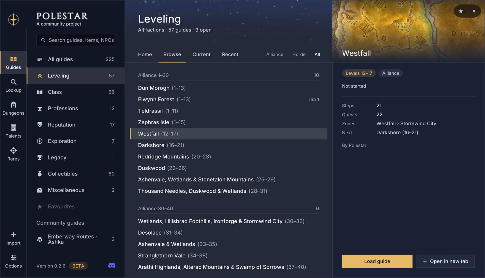

# Routes that make sense.

**Polestar is a free, open-source guide addon for World of Warcraft: Forever.** Every race, 1 to 60, with a guide window that keeps up with you and an arrow that walks real paths. Every step is the one you'd pick yourself, with nothing pointless in between.

**New in 0.3.0:** the leveling routes are rebuilt from the ground up, every guide has been rebuilt or reviewed for Forever, and the new [Polestar Client](https://polestar.guide/client) installs and updates everything for you.

***

## Leveling routes that make sense

*   **Your race's own start, then one route for your faction.** Every race levels through its own starting zone (Zephras Isle for the Skyborne included), then joins the Horde route from the Barrens or the Alliance route from Westfall, all the way to 60.
*   **Towns in one visit.** Everything ready in a town is picked up and handed in while you're there, including where a flight or your hearth lands you. No running back for one quest.
*   **Work on the way.** Quests that share the same ground are done together, and quests on the road are picked up as you pass.
*   **Training where you already are,** weapon trainers "while you're here", and riding at 40 on a visit the route makes anyway.
*   **The hearthstone used properly:** set where you'll need it, never asked for while it's cooling down.
*   **Elite and group quests, your call,** always with a solo way past. **Rare drops never hold you up.**
*   **Built from player reports.** Every route was checked step by step the way you'd play it, and every problem players reported is fixed for good.

## A guide that keeps up with you

*   **Steps tick off when the game confirms them:** quests taken and handed in, kills, loot, places reached, trainers visited. Your place is worked out from your quest log, so it survives a lost save.
*   **One person at a time.** In a quest hub the window shows who to talk to now ("Person 2 of 8") while the arrow points at them.
*   **Your way through a route.** Skip a single quest (with undo), look ahead without losing your place, pin quests "along the way", answer group quests once, and let Polestar pick the chat option, goods, training or flight the step asks for.
*   **It looks after you.** A full quest log helper, items a later step needs kept safe from selling, a hearth helper, a trainer reminder that knows your route, and warnings before ambushes and linked pulls.
*   **Class quests in their own tab,** with a heads-up when one opens at your level.
*   **Tabs and gamepad.** Up to six guides open at once, and every window answers a gamepad.

## Finding the way

*   **A 3D waypoint arrow** with distance and ETA that walks paths worked out for every step: round cliffs and walls, through town gates, into caves, up and down lifts, and out of the capitals by their streets.
*   **The travel planner** uses flight paths, boats, zeppelins, the tram, portals, class teleports and your Hearthstone when they're faster, on their real timetables.
*   **Quest markers** on the map and minimap, new icons sized like the game's own, tooltip lines on the mobs and items a quest needs, and nameplate icons on the mobs you still need.

## Every guide in one place

*   **Leveling** for every race and both factions, 1 to 60.
*   **Class quests** for every class: spells, pets, totems, forms, class items and class mounts.
*   **Professions:** gathering, secondary and crafting, with the cheapest sensible path and where every material comes from.
*   **Reputations,** ten new factions among them, with what every turn-in, kill or run pays.
*   **Mounts, pets, exploration,** the Legacy challenges and the Library Books.
*   **Community guides** from other players, credited to their authors.

## Lookup, Dungeons and Rares

*   **Lookup** answers "how do I get that?" for any item, mount, pet, NPC, quest or zone, with the sources ranked for your character.
*   **Dungeons:** every quest, its chain and rewards, the bosses and the entrance, and one button that guides you round to pick the quests up.
*   **Rares:** rares and treasures by zone, with an alert when one shows up.

## Quality of life

*   **Characters page** with every character on your account at a glance, and **restock** that buys each character's food, drink and ammo.
*   **Gear advice** on tooltips and quest rewards, with an offer to put an upgrade on, and your own stat weights from a Pawn scale.
*   **Bags:** junk and keep marks, a warning when they're nearly full.
*   **XP per hour, time to level** and whether you'll reach the guide's next level on time.
*   Quest item, target and Hearthstone buttons, selling greys and repairing, the best quest reward, instant quest text, flight map and death helpers.
*   **Playing with friends:** see where each of them is on the guide and share a quest someone is missing.

## Your look

Skins (Polestar's own, Halo, Hearth, WoW Forever, Blizzard and Classic), colour schemes with your own accent or class colour, standard, compact or transparent windows, text size, and EllesmereUI's accent and font when it's installed.

**Every language:** English, German, French, Spanish (Spain and Latin America), Brazilian Portuguese, Russian, Korean and Chinese (Simplified and Traditional), with every NPC, place, item and quest named as your game names it.

***

## Polestar Client and polestar.guide

*   **[Polestar Client](https://polestar.guide/client)** is a small app for Windows, macOS and Linux that finds WoW: Forever, installs and updates Polestar for you, and installs community guides in one click.
*   **[polestar.guide](https://polestar.guide)** has every guide readable step by step, the community guides, and the docs.
*   **Help improve the routes:** the optional Polestar Recorder makes small, anonymous recordings, sent only with your consent through the Client.

## Install

**With Polestar Client or the CurseForge app:** install Polestar, then restart the game completely.

**By hand:** download the zip from the Files tab and unzip it into `World of Warcraft/_forever_/Interface/AddOns/`, so the Polestar folders sit directly inside it. Restart the game completely (a `/reload` doesn't load new addons). To update, delete the old Polestar folders first.

**Coming from 0.2.6?** Delete the old `Polestar_Guides_<language>` and `Polestar_Names_<language>` folders; Polestar reminds you once.

## Getting started

*   A short **welcome** opens on each new character with the guide Polestar suggests (`/polestar welcome` shows it again).
*   **`/polestar guides`** opens the hub, **`/polestar`** shows the guide window, **`/polestar options`** holds every setting, **`/polestar help`** lists every command.

## Beta

Polestar is in beta and grows with your reports. A step in the wrong order, or a quest that isn't where the guide says? Tell us on the [Polestar Discord](https://discord.gg/vMbee6F2e9) or [open an issue on GitHub](https://github.com/fitzforge/polestar/issues), with the guide, the step and what you saw. Every report becomes a fix the next build keeps.

***

## Links

*   **Discord:** [Polestar | Leveling Guides](https://discord.gg/vMbee6F2e9)
*   **Website:** [polestar.guide](https://polestar.guide)
*   **Source code:** [github.com/fitzforge/polestar](https://github.com/fitzforge/polestar)
*   **Changelog:** [what's new](https://github.com/fitzforge/polestar/blob/main/CHANGELOG.md)
*   **Write your own guides:** [community guides explained](https://github.com/fitzforge/polestar/blob/main/docs/GUIDE_PACKS.md)

## Support Polestar

Polestar is free and stays free, with no ads and nothing locked. If it saves you some hours on the way to 60, you can [buy me a coffee on Ko-fi](https://ko-fi.com/0xfitz). Reports, guides and translations help just as much.

## Licence and credits

Free and open source under the [GNU GPL, version 3](https://github.com/fitzforge/polestar/blob/main/LICENSE). The walking paths use Leffe's navigation maps and Polestar's own, with a router that started from Cillian Berragan's [Shortest Path Forever](https://github.com/cjber/shortest-path-forever), used with his kind permission. Every data source is credited with its licence in [THIRD\_PARTY.md](https://github.com/fitzforge/polestar/blob/main/THIRD_PARTY.md). No game art ships with Polestar; the screenshots show the game (© Blizzard Entertainment).

_World of Warcraft is a trademark of Blizzard Entertainment. Polestar is a community project, not affiliated with or endorsed by Blizzard._
