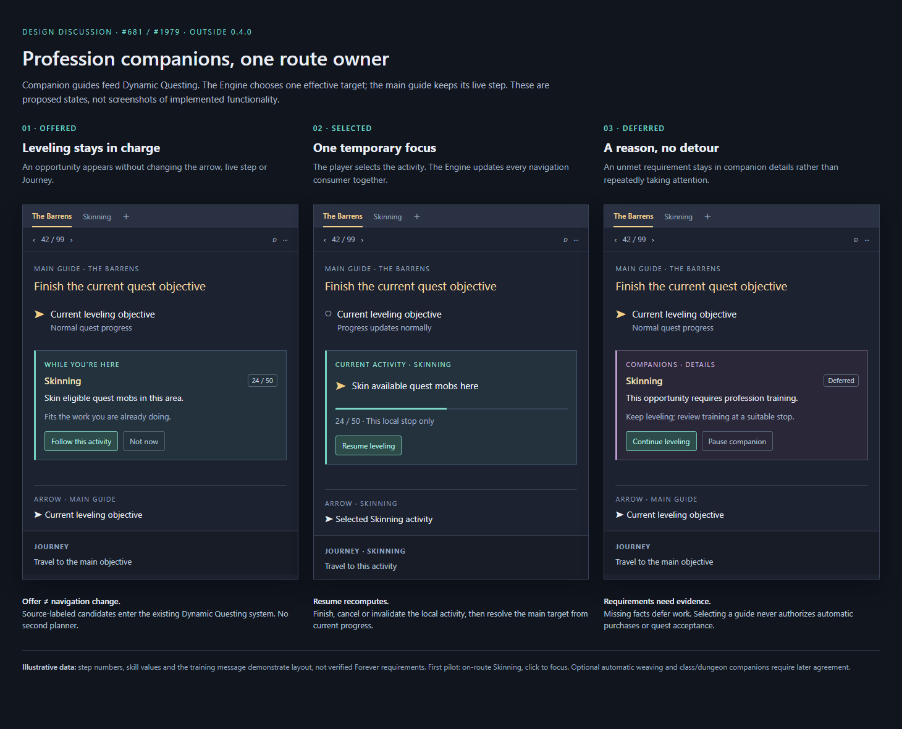

# Profession companions: route ownership proposal

Design discussion for PR #1979. The existing code is an earlier prototype; this document proposes a revised approach for maintainer feedback.



## What it would do

Following the [feedback on #1979](https://github.com/fitzforge/polestar/pull/1979#issuecomment-6849588455), I'd like to settle a route ownership contract before further implementation. This is a design discussion, outside 0.4.0.

The goal is to see useful companion objectives alongside leveling, starting with professions (#681). Class chains and dungeon preparation would follow later.

The change from #1979: **companions supply candidates to While you're here, rather than running a second planner or replacing Dynamic Questing.** The draft PR remains a reference.

## Proposed route ownership contract

The Engine owns one effective target for the arrow, maps, travel planner, Journey, target controls and quest-item controls.

The main guide keeps its live step; companions keep independent progress. Selecting companion work changes the Engine's temporary focus, not the active tab or main step.

| State | Effective target | Guide window | Journey |
|---|---|---|---|
| Leveling | The Engine's current valid main-guide target | Main step and its normal progress | Travel to that target |
| Companion offered | Still the main-guide target | While you're here row, with source guide and reason it fits | Unchanged; no speculative detour |
| Companion selected | The Engine temporarily focuses the selected, eligible candidate | Main step remains visible; a clearly marked companion activity names the source and offers Resume leveling | Actual travel to the selected activity, labeled with its source |
| Companion deferred | Still the main-guide target | A reason appears in companion details; no repeated alerts | Unchanged |
| Companion finished, cancelled or invalid | The Engine recomputes the valid main-guide target from live progress | Return to the normal main-step view | Rebuilt from the new target, never a saved old waypoint |

Step numbers always refer to the main guide. Tab clicks only browse; changing the main guide is explicit. Manual targeting pauses companion selection until Resume leveling.

## Candidates and progress

- Explicit companion opt-in per character, within the six-tab limit. An open tab alone opts into nothing.
- Providers supply source guide/objective identity, live progress, eligibility and why the opportunity fits. Removed or replaced sources invalidate their candidates.
- Dynamic Questing owns eligibility, ranking, dismissal and focus, using its existing checks and travel estimates. Missing facts or unknown costs defer work.
- Preserve prerequisites, authored order, level/skill/tool requirements, group choices, skips, exclusive quests and sequence-sensitive pickups. Proximity alone never authorizes early work.
- Deduplicate shared objectives and credit each source through live game progress. Ending a local profession opportunity does not complete its whole skill band.
- Suggestions and guide selection authorize no purchases, training, crafting or quest acceptance. The pilot adds no automation for these actions.
- Preserve progress across pause/removal/disable. Restore selections on reload, but return focus to leveling. Chapter changes update the main context; death suspends companion focus.

## First pilot: Skinning while leveling

Start on one agreed leveling route with Skinning opportunities on quest mobs. Verify eligibility against Forever evidence and coordinate with #681's activity work and existing authored pilot.

- Disabled by default; **on my route only**, with source labels and actual skill progress.
- Existing click-to-focus behavior. Follow this activity selects one bounded local opportunity, not a repeating farming loop.
- Resume leveling is always available. End the opportunity when completed or no longer suitable; defer unmet requirements without repeated prompts.
- Support compact mode and controller navigation. This does not change all existing along rows.

## Mock-ups

These are illustrative wireframes, not screenshots of a working feature. Guide titles and the 24/50 skill values illustrate the layout; they are not proposed Forever progression requirements.

### 1. Opportunity offered: leveling remains in charge

```text
MAIN GUIDE · The Barrens             Step 42 / 99
Finish the current quest objective
[>] Current leveling objective

WHILE YOU'RE HERE
Skinning · 24 / 50
Skin eligible quest mobs in this area.
Fits the work you are already doing.
[Follow this activity]  [Not now]

ARROW    Current leveling objective
JOURNEY  Travel to the main objective
```

### 2. Companion selected: one temporary Engine focus

```text
MAIN GUIDE · The Barrens             Step 42 / 99
[ ] Current leveling objective (live progress)

CURRENT ACTIVITY · Skinning
[>] Skin available quest mobs here
24 / 50 · This local stop only
[Resume leveling]

ARROW    Selected Skinning activity
JOURNEY  Skinning · Travel to this activity
```

Main and companion work remain visible with separate labels. Resume leveling recalculates the main target.

### 3. Companion deferred: a reason, without a detour

```text
MAIN GUIDE · The Barrens             Step 42 / 99
[>] Current leveling objective

COMPANIONS · DETAILS
Skinning · Deferred
This opportunity requires profession training.
Keep leveling; review training at a suitable stop.
[Continue leveling]  [Pause companion]

ARROW    Current leveling objective
JOURNEY  Travel to the main objective
```

The requirement above is an illustrative state. A real provider must have evidence for the reason it displays.

## Later: automatic weaving and other guide types

Automatic weaving remains the longer-term goal, through the same candidate system after this contract is agreed and tested.

The main route retains priority. Propose an adjustable five-minute added-travel budget between main stops; replanning/reload must not reset spent allowance. Activity duration needs a separate bound. Unknown costs are not free.

Class and dungeon companions would reuse source references and eligibility checks. Escorts, timers, dungeon entry and closing quest choices need explicit commitment. Warn before anything starts immediately; for escorts, advise finishing the current objective first. Never redirect away mid-activity. Return through the same Engine focus resolution afterward.

These are later requirements, not part of the Skinning pilot.

## What would demonstrate the contract

- Offers leave the main step and target unchanged; selected work gives every navigation/control surface the same source-aware objective.
- Completion, cancellation, invalidation, death, reload and chapter changes preserve progress and resolve a valid main target.
- Shared credit, skips and dismissals retain their intended scope. Ineligible work stays deferred; suggestions trigger no unrelated automation or farming loop.
- Verify compact/controller presentation in the addon test client and the agreed pilot route in game.

## Feedback requested

Does the single-owner contract above fit the Engine, step card and Journey model? Would a source-labeled Dynamic Questing candidate provider, starting with on-route Skinning and click-to-focus, be the right first slice for #681?

#1979 remains a draft reference. Its tests may be reusable, but this proposal does not ask to merge its separate planner. No release date is requested.
