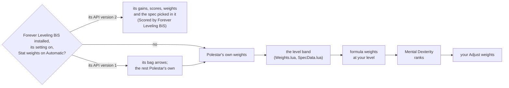

# Gear advice: the stat weights

Gear advice scores an item by adding up its stats, each times a weight: how
many points of the spec's main stat one point (or 1%) of that stat is worth to
a character of that spec at that level. This page says where the weights come
from, which game formulas make the ones Polestar works out itself, and gives
every spec's weights at levels 10 to 60.

## With Forever Leveling BiS installed

Gear scores from Forever Leveling BiS by Timearc when it is installed, through
its public API. Polestar copies nothing of it: it asks the copy the player
runs (`ForeverLevelingBiS_API`, `addon/Polestar/Gear/FLB.lua`), while Settings
> Questing > Rewards & gear > Use Forever Leveling BiS when installed is on
(the default) and Stat weights is Automatic. What it takes, by the API's
version:

| Its API | What gear advice takes from it |
|---|---|
| version 1 (Forever Leveling BiS 1.2.1 and later) | The upgrade arrows in your bags: its own bag arrow's answer, its "no" included (it says no while its Bag upgrades switch is off). Its OnChanged tells Polestar when to look again. Tooltips, reward picks and the rest stay Polestar's own. |
| version 2 | Also: its gain (GetGain) as the upgrade amount on tooltips, the reward panel and reward picks; its score (ScoreItem) where Polestar needs an item's whole score; its weights (GetWeights) wherever Gear weighs stats itself (pairing a one-hander with a bag shield against a worn two-hander, say); the spec picked in it (GetSpec) as Automatic's spec. The line under the advice says "Scored by Forever Leveling BiS (Arms)". |

- A spec or custom weights chosen in Polestar's Stat weights, or the setting
  off, keep Polestar's own advice.
- Your Adjust weights and Mental Dexterity's ranks change Polestar's own
  weights only; Forever Leveling BiS's answers are used as it gives them.
- Every call is guarded: an API that errors, is missing a function or answers
  in a shape Polestar does not know (not a number, not finite, not a known
  spec) leaves Polestar's own answer for that item. `/polestar gear spec`
  says what of it gear advice uses.

## Polestar's own weights

- **The authored table** (`addon/Polestar/Gear/Weights.lua`, `Gear.WEIGHTS`):
  per spec, set from Classic's stat formulas for levelling (solo questing
  first, dungeons second), with Forever's own ratings (haste, expertise,
  armor penetration) set from the spec's crit and hit weights (#1529). Its
  header says how each kind of weight was set.
- **The level bands** (`addon/Polestar/Gear/SpecData.lua`,
  `Gear.WEIGHT_BANDS`, written by `forge data gear`): for levels 25-39,
  40-49, 50-59 and 60, the authored table blended with wowsims simulations of
  the spec where one exists (each band names its simulation and share), the
  authored table alone below 25 and where no simulation exists.
- **The formula weights** (below), worked out for the band in use at your
  level.
- **Mental Dexterity**, for the ranks you have (below).
- **Your Adjust weights** on top (Settings > Questing > Rewards & gear >
  Adjust weights).

`Gear.WeightsFor` then gives a spec with no melee weapon DPS weight a 0.01
one as a tiebreak (a low-level caster still hits with the staff), and Feral 14
times its attack power weight (Forever's forms hit with the weapon's DPS). An
off-hand weapon counts at a scale's own off-hand weight where it has one
(Pawn's OffHandDps), else at half of the main hand's, its damage penalty.

### The formula weights

Worked out on the band in use, at your level (`Gear.WeightsFor`; marked `*` in
the tables at the end):

| Weight | Formula |
|---|---|
| Health | Stamina's weight / 10 |
| Mana | (Intellect's weight - spell crit's weight / Intellect per 1% spell crit at your level) / 15, for the classes with mana |
| Haste (1%) | the band's crit (spell crit for casters and healers) times the spec's haste-to-crit ratio in the authored table |
| Expertise (1%) | the band's hit times the spec's expertise-to-hit ratio in the authored table |
| Armor penetration (1%) | the band's crit times the share of a hit a same-level mob's armor takes, for the specs that weigh physical crit |

A formula whose input the spec does not weigh leaves the band's (or the
authored table's) value: Protection Paladin weighs no physical crit, so its
haste and armor penetration stay the table's. The authored table's spell crit
weight does not change with level, while a point of Intellect gives more
spell crit at low level, so there more of Intellect's weight counts as spell
crit and less as mana.

The ratios carry #1529's rules to every band: 1% haste is about 0.6 of 1%
crit for melee (specials are not hasted), 0.7 for Hunters, 0.8 of 1% spell
crit for casters (more where crit counts for little) and 0.6 for healers; 1%
expertise about 0.9 of 1% hit.

### Mental Dexterity

Mental Dexterity (Shaman, 3 ranks, talent spell 415140, the Enhancement
column's second row) turns a share of Intellect into attack power. Forever's
hotfix of 12 November 2026 set the share to 33%, 66% and 100% for one, two and
three ranks (it was 50%, 100% and 150%); the client's hotfix data carries it
(talent curve 85272, read with `forge gamedata hotfix`). Polestar's weights
come from Classic formulas and simulations that know no Forever talent, so
`Gear.TALENT_STATS` adds the share times the attack power weight to Intellect
for the ranks on the talent config the talent frame shows (`/polestar gear
spec` prints what it added). Enhancement at 60, in Strength:

| Mental Dexterity | Intellect |
|---|---:|
| none | 0.094 |
| 1/3 (+ 0.33 x 0.453) | 0.243 |
| 2/3 (+ 0.66 x 0.453) | 0.393 |
| 3/3 (+ 1.00 x 0.453) | 0.547 |

## The game's formulas behind the weights

What each stat does for a character, from the Forever client's tables (read
with `forge gamedata`), its hotfix data, and Classic's formulas where the
client has no table (as the community TrinityCore server for Forever has them;
its world database gives creature armor).

| Stat | What it gives | Source |
|---|---|---|
| Strength | 2 attack power (Warrior, Paladin, Shaman, Druid), 1 (Hunter, Rogue, casters) | client `ChrClasses` |
| Agility | 1 attack power (Hunter, Rogue; in Cat Form too), 2 ranged attack power (Warrior, Hunter, Rogue); crit and dodge (below); 2 armor | client `ChrClasses`, Cat Form's passive; Classic |
| Attack power | 1 weapon DPS per 14 attack power | Classic |
| Stamina | 10 health per point, at every level | client `gametables/hppersta.txt` |
| Intellect | 15 mana per point; spell crit (below) | Classic |
| Spirit | mana per 2-second tick outside the five-second rule: Spirit/4 + 12.5 (Mage, Priest), /5 + 17 (Shaman), /5 + 15 (Druid, Hunter, Paladin, Warlock); health regeneration out of combat | Classic |
| Ratings | per 1%: crit 14, hit 10, haste 10, expertise 10, armor penetration 10, dodge 12, parry 15, block 5; defense 1 per skill point; the same at every level | client `gametables/combatratings.txt` |
| Armor penetration | ignoring 1% of a mob's armor adds about armor/(armor + 400 + 85 x level) % to a physical hit | Classic; creature armor below |

Agility per 1% melee crit, between the class's level 1 and 60 values (dodge:
the same, or twice as much Agility for Rogues and Hunters):

| Class | 10 | 20 | 30 | 40 | 50 | 60 |
|---|---:|---:|---:|---:|---:|---:|
| Warrior | 6.4 | 9.1 | 11.8 | 14.5 | 17.3 | 20.0 |
| Paladin, Shaman, Druid | 6.9 | 9.6 | 12.2 | 14.8 | 17.4 | 20.0 |
| Rogue | 6.3 | 10.8 | 15.4 | 19.9 | 24.5 | 29.0 |
| Hunter | 11.1 | 19.4 | 27.8 | 36.2 | 44.6 | 53.0 |
| Mage | 14.0 | 15.2 | 16.4 | 17.6 | 18.8 | 20.0 |
| Priest | 12.4 | 13.9 | 15.4 | 16.9 | 18.5 | 20.0 |
| Warlock | 10.2 | 12.1 | 14.1 | 16.1 | 18.0 | 20.0 |

Intellect per 1% spell crit: the level-60 value x (0.2 + 0.8 x (level - 1) / 59):

| Class | 10 | 20 | 30 | 40 | 50 | 60 |
|---|---:|---:|---:|---:|---:|---:|
| Mage | 19.2 | 27.2 | 35.3 | 43.4 | 51.4 | 59.5 |
| Priest | 19.1 | 27.1 | 35.1 | 43.1 | 51.2 | 59.2 |
| Warlock | 19.5 | 27.7 | 35.9 | 44.2 | 52.4 | 60.6 |
| Druid, Hunter | 19.3 | 27.5 | 35.6 | 43.7 | 51.9 | 60.0 |
| Shaman | 19.2 | 27.2 | 35.3 | 43.4 | 51.4 | 59.5 |
| Paladin | 17.4 | 24.7 | 32.0 | 39.4 | 46.7 | 54.0 |

A same-level melee mob's armor and the share of a physical hit it takes:

| Level | 12 | 22 | 32 | 42 | 52 | 60 |
|---|---:|---:|---:|---:|---:|---:|
| Mob armor | 552 | 892 | 1229 | 2193 | 3043 | 3466 |
| Share of a hit | 0.280 | 0.282 | 0.283 | 0.356 | 0.387 | 0.387 |

### What the formulas say about the weights

- **Arms Warrior, attack power and weapon DPS.** Strength gives 2 attack
  power, so attack power is 0.5 Strength; 14 attack power add 1 weapon DPS, so
  weapon DPS is 7 Strength in the authored table, as the formula gives.
- **Arms Warrior, Agility at 60.** 1% crit is 10 Strength and takes 20
  Agility, so Agility's crit is worth 0.5; with its 2 armor at 0.005, 0.51 of
  the band's 0.706. The rest is Agility's dodge and what the simulation finds
  beyond the formulas.
- **Frost Mage, Intellect at 60.** The band weighs 1% spell crit at 12.98
  spell damage, and it takes 59.5 Intellect, so Intellect's spell crit is
  worth 0.218 of its 0.629; the remaining 0.411 is its 15 mana, so a point of
  mana is worth 0.027 spell damage, the formula's mana weight.

## Refreshing the weights

- The level bands: `forge data gear` writes them from the authored table and
  the cached simulations (`data/sources/wowsims`).
- The formula weights follow the bands by themselves; their game numbers are
  in Weights.lua (`Gear.HEALTH_PER_STA`, `Gear.MANA_PER_INT`, Intellect per
  spell crit, creature armor), to change there when the game's change.
- A talent that turns one stat into another goes in `Gear.TALENT_STATS`.
- The addon tests `gear_weights::*` check every spec's weights at every level
  against the rules above; `gear_flbis::*` check what is taken from Forever
  Leveling BiS, with a stub of its API.

## The weights at levels 10 to 60

Polestar's own weights, without talents or Adjust weights: each spec's band
for that level, with the formula weights (`*`). Crit, hit, haste, expertise,
armor penetration, dodge, parry and block are per 1%; weapon DPS per 1 DPS.

#### Warrior Arms

| Stat | 10 | 20 | 30 | 40 | 50 | 60 |
|---|---:|---:|---:|---:|---:|---:|
| Strength | 1.00 | 1.00 | 1.00 | 1.00 | 1.00 | 1.00 |
| Agility | 0.600 | 0.600 | 0.600 | 0.600 | 0.671 | 0.706 |
| Stamina | 0.500 | 0.500 | 0.500 | 0.500 | 0.250 | 0.125 |
| Spirit | 0.100 | 0.100 | 0.100 | 0.100 | 0.050 | 0.025 |
| Attack power | 0.500 | 0.500 | 0.500 | 0.500 | 0.449 | 0.424 |
| Crit (1%) | 10.0 | 10.0 | 10.0 | 10.0 | 10.0 | 10.0 |
| Hit (1%) | 9.00 | 9.00 | 9.00 | 9.00 | 10.2 | 10.8 |
| Haste (1%) * | 6.00 | 6.00 | 6.00 | 6.00 | 6.00 | 6.00 |
| Expertise (1%) * | 8.10 | 8.10 | 8.10 | 8.10 | 9.19 | 9.74 |
| Armor penetration (1%) * | 2.82 | 2.81 | 2.82 | 3.35 | 3.87 | 3.87 |
| Weapon DPS | 7.00 | 7.00 | 7.00 | 7.00 | 5.87 | 5.31 |
| Ranged weapon DPS | 0.500 | 0.500 | 0.500 | 0.500 | 0.250 | 0.125 |
| Health per 5 s | 1.00 | 1.00 | 1.00 | 1.00 | 0.500 | 0.250 |
| Armor | 0.020 | 0.020 | 0.020 | 0.020 | 0.016 | 0.0050 |
| Defense | 0.200 | 0.200 | 0.200 | 0.200 | 0.100 | 0.050 |
| Dodge (1%) | 3.00 | 3.00 | 3.00 | 3.00 | 1.50 | 0.750 |
| Parry (1%) | 3.00 | 3.00 | 3.00 | 3.00 | 1.50 | 0.750 |
| Block (1%) | 0.300 | 0.300 | 0.300 | 0.300 | 0.150 | 0.075 |
| Block value | 0.050 | 0.050 | 0.050 | 0.050 | 0.025 | 0.013 |
| Health * | 0.050 | 0.050 | 0.050 | 0.050 | 0.025 | 0.013 |

#### Warrior Fury

| Stat | 10 | 20 | 30 | 40 | 50 | 60 |
|---|---:|---:|---:|---:|---:|---:|
| Strength | 1.00 | 1.00 | 1.00 | 1.00 | 1.00 | 1.00 |
| Agility | 0.650 | 0.650 | 0.650 | 0.650 | 0.696 | 0.718 |
| Stamina | 0.500 | 0.500 | 0.500 | 0.500 | 0.250 | 0.125 |
| Spirit | 0.100 | 0.100 | 0.100 | 0.100 | 0.050 | 0.025 |
| Attack power | 0.500 | 0.500 | 0.500 | 0.500 | 0.449 | 0.424 |
| Crit (1%) | 11.0 | 11.0 | 11.0 | 11.0 | 10.5 | 10.2 |
| Hit (1%) | 11.0 | 11.0 | 11.0 | 11.0 | 11.2 | 11.3 |
| Haste (1%) * | 6.60 | 6.60 | 6.60 | 6.60 | 6.30 | 6.15 |
| Expertise (1%) * | 9.90 | 9.90 | 9.90 | 9.90 | 10.1 | 10.2 |
| Armor penetration (1%) * | 3.11 | 3.09 | 3.10 | 3.68 | 4.06 | 3.96 |
| Weapon DPS | 6.50 | 6.50 | 6.50 | 6.50 | 5.62 | 5.19 |
| Ranged weapon DPS | 0.500 | 0.500 | 0.500 | 0.500 | 0.250 | 0.125 |
| Health per 5 s | 1.00 | 1.00 | 1.00 | 1.00 | 0.500 | 0.250 |
| Armor | 0.020 | 0.020 | 0.020 | 0.020 | 0.016 | 0.0050 |
| Defense | 0.200 | 0.200 | 0.200 | 0.200 | 0.100 | 0.050 |
| Dodge (1%) | 3.00 | 3.00 | 3.00 | 3.00 | 1.50 | 0.750 |
| Parry (1%) | 3.00 | 3.00 | 3.00 | 3.00 | 1.50 | 0.750 |
| Health * | 0.050 | 0.050 | 0.050 | 0.050 | 0.025 | 0.013 |

#### Warrior Protection (tank)

| Stat | 10 | 20 | 30 | 40 | 50 | 60 |
|---|---:|---:|---:|---:|---:|---:|
| Strength | 0.600 | 0.600 | 0.600 | 0.600 | 0.600 | 0.600 |
| Agility | 0.700 | 0.700 | 0.700 | 0.700 | 0.700 | 0.700 |
| Stamina | 1.00 | 1.00 | 1.00 | 1.00 | 1.00 | 1.00 |
| Spirit | 0.050 | 0.050 | 0.050 | 0.050 | 0.050 | 0.050 |
| Attack power | 0.250 | 0.250 | 0.250 | 0.250 | 0.250 | 0.250 |
| Crit (1%) | 4.00 | 4.00 | 4.00 | 4.00 | 4.00 | 4.00 |
| Hit (1%) | 6.00 | 6.00 | 6.00 | 6.00 | 6.00 | 6.00 |
| Haste (1%) * | 2.00 | 2.00 | 2.00 | 2.00 | 2.00 | 2.00 |
| Expertise (1%) * | 5.40 | 5.40 | 5.40 | 5.40 | 5.40 | 5.40 |
| Armor penetration (1%) * | 1.13 | 1.13 | 1.13 | 1.34 | 1.55 | 1.55 |
| Weapon DPS | 2.50 | 2.50 | 2.50 | 2.50 | 2.50 | 2.50 |
| Ranged weapon DPS | 0.300 | 0.300 | 0.300 | 0.300 | 0.300 | 0.300 |
| Health per 5 s | 1.50 | 1.50 | 1.50 | 1.50 | 1.50 | 1.50 |
| Armor | 0.060 | 0.060 | 0.060 | 0.060 | 0.060 | 0.060 |
| Defense | 1.20 | 1.20 | 1.20 | 1.20 | 1.20 | 1.20 |
| Dodge (1%) | 12.0 | 12.0 | 12.0 | 12.0 | 12.0 | 12.0 |
| Parry (1%) | 12.0 | 12.0 | 12.0 | 12.0 | 12.0 | 12.0 |
| Block (1%) | 8.00 | 8.00 | 8.00 | 8.00 | 8.00 | 8.00 |
| Block value | 0.500 | 0.500 | 0.500 | 0.500 | 0.500 | 0.500 |
| Health * | 0.100 | 0.100 | 0.100 | 0.100 | 0.100 | 0.100 |

#### Paladin Holy (healer)

| Stat | 10 | 20 | 30 | 40 | 50 | 60 |
|---|---:|---:|---:|---:|---:|---:|
| Strength | 0.150 | 0.150 | 0.150 | 0.150 | 0.150 | 0.150 |
| Stamina | 0.450 | 0.450 | 0.450 | 0.450 | 0.450 | 0.450 |
| Intellect | 1.00 | 1.00 | 1.00 | 1.00 | 1.00 | 1.00 |
| Spirit | 0.500 | 0.500 | 0.500 | 0.500 | 0.500 | 0.500 |
| Spell damage | 0.150 | 0.150 | 0.150 | 0.150 | 0.150 | 0.150 |
| Healing | 0.650 | 0.650 | 0.650 | 0.650 | 0.650 | 0.650 |
| Holy damage | 0.100 | 0.100 | 0.100 | 0.100 | 0.100 | 0.100 |
| Spell crit (1%) | 7.00 | 7.00 | 7.00 | 7.00 | 7.00 | 7.00 |
| Haste (1%) * | 4.20 | 4.20 | 4.20 | 4.20 | 4.20 | 4.20 |
| Weapon DPS | 0.500 | 0.500 | 0.500 | 0.500 | 0.500 | 0.500 |
| Mana per 5 s | 2.20 | 2.20 | 2.20 | 2.20 | 2.20 | 2.20 |
| Armor | 0.0050 | 0.0050 | 0.0050 | 0.0050 | 0.0050 | 0.0050 |
| Health * | 0.045 | 0.045 | 0.045 | 0.045 | 0.045 | 0.045 |
| Mana * | 0.040 | 0.048 | 0.052 | 0.055 | 0.057 | 0.058 |

#### Paladin Protection (tank)

| Stat | 10 | 20 | 30 | 40 | 50 | 60 |
|---|---:|---:|---:|---:|---:|---:|
| Strength | 0.500 | 0.500 | 0.500 | 0.500 | 0.500 | 0.500 |
| Agility | 0.500 | 0.500 | 0.500 | 0.500 | 0.500 | 2.28 |
| Stamina | 1.00 | 1.00 | 1.00 | 1.00 | 1.00 | 0.250 |
| Intellect | 0.400 | 0.400 | 0.400 | 0.400 | 0.400 | 0.106 |
| Attack power | – | – | – | – | – | 0.116 |
| Spell damage | 0.500 | 0.500 | 0.500 | 0.500 | 0.500 | 0.169 |
| Holy damage | 0.500 | 0.500 | 0.500 | 0.500 | 0.500 | 0.159 |
| Crit (1%) | – | – | – | – | – | 4.62 |
| Hit (1%) | 4.00 | 4.00 | 4.00 | 4.00 | 4.00 | 1.00 |
| Spell crit (1%) | – | – | – | – | – | 0.389 |
| Spell hit (1%) | 4.00 | 4.00 | 4.00 | 4.00 | 4.00 | 1.95 |
| Haste (1%) | 2.00 | 2.00 | 2.00 | 2.00 | 2.00 | 2.00 |
| Expertise (1%) * | 3.60 | 3.60 | 3.60 | 3.60 | 3.60 | 0.900 |
| Armor penetration (1%) | 1.00 | 1.00 | 1.00 | 1.00 | 1.00 | 1.00 |
| Weapon DPS | 2.00 | 2.00 | 2.00 | 2.00 | 2.00 | 1.68 |
| Mana per 5 s | 1.00 | 1.00 | 1.00 | 1.00 | 1.00 | 0.250 |
| Armor | 0.050 | 0.050 | 0.050 | 0.050 | 0.050 | 0.129 |
| Defense | 1.00 | 1.00 | 1.00 | 1.00 | 1.00 | 3.73 |
| Dodge (1%) | 10.0 | 10.0 | 10.0 | 10.0 | 10.0 | 28.0 |
| Parry (1%) | 10.0 | 10.0 | 10.0 | 10.0 | 10.0 | 27.8 |
| Block (1%) | 6.00 | 6.00 | 6.00 | 6.00 | 6.00 | 1.50 |
| Block value | 0.400 | 0.400 | 0.400 | 0.400 | 0.400 | 2.16 |
| Health * | 0.100 | 0.100 | 0.100 | 0.100 | 0.100 | 0.025 |
| Mana * | 0.027 | 0.027 | 0.027 | 0.027 | 0.027 | 0.0066 |

#### Paladin Retribution

| Stat | 10 | 20 | 30 | 40 | 50 | 60 |
|---|---:|---:|---:|---:|---:|---:|
| Strength | 1.00 | 1.00 | 1.00 | 1.00 | 1.00 | 1.00 |
| Agility | 0.550 | 0.550 | 0.550 | 0.550 | 0.550 | 0.550 |
| Stamina | 0.500 | 0.500 | 0.500 | 0.500 | 0.500 | 0.500 |
| Intellect | 0.350 | 0.350 | 0.350 | 0.350 | 0.350 | 0.350 |
| Spirit | 0.150 | 0.150 | 0.150 | 0.150 | 0.150 | 0.150 |
| Attack power | 0.500 | 0.500 | 0.500 | 0.500 | 0.500 | 0.500 |
| Spell damage | 0.300 | 0.300 | 0.300 | 0.300 | 0.300 | 0.300 |
| Holy damage | 0.300 | 0.300 | 0.300 | 0.300 | 0.300 | 0.300 |
| Crit (1%) | 9.00 | 9.00 | 9.00 | 9.00 | 9.00 | 9.00 |
| Hit (1%) | 9.00 | 9.00 | 9.00 | 9.00 | 9.00 | 9.00 |
| Haste (1%) * | 5.40 | 5.40 | 5.40 | 5.40 | 5.40 | 5.40 |
| Expertise (1%) * | 8.10 | 8.10 | 8.10 | 8.10 | 8.10 | 8.10 |
| Armor penetration (1%) * | 2.54 | 2.53 | 2.54 | 3.01 | 3.48 | 3.48 |
| Weapon DPS | 7.00 | 7.00 | 7.00 | 7.00 | 7.00 | 7.00 |
| Mana per 5 s | 1.00 | 1.00 | 1.00 | 1.00 | 1.00 | 1.00 |
| Health per 5 s | 0.500 | 0.500 | 0.500 | 0.500 | 0.500 | 0.500 |
| Armor | 0.020 | 0.020 | 0.020 | 0.020 | 0.020 | 0.020 |
| Health * | 0.050 | 0.050 | 0.050 | 0.050 | 0.050 | 0.050 |
| Mana * | 0.023 | 0.023 | 0.023 | 0.023 | 0.023 | 0.023 |

#### Hunter Beast Mastery

| Stat | 10 | 20 | 30 | 40 | 50 | 60 |
|---|---:|---:|---:|---:|---:|---:|
| Strength | 0.100 | 0.100 | 0.100 | 0.284 | 0.284 | 0.377 |
| Agility | 1.00 | 1.00 | 1.00 | 1.00 | 1.00 | 1.00 |
| Stamina | 0.550 | 0.550 | 0.550 | 0.275 | 0.275 | 0.138 |
| Intellect | 0.350 | 0.350 | 0.350 | 0.191 | 0.191 | 0.111 |
| Spirit | 0.200 | 0.200 | 0.200 | 0.100 | 0.100 | 0.050 |
| Attack power | 0.500 | 0.500 | 0.500 | 1.03 | 1.03 | 1.30 |
| Ranged attack power | 0.450 | 0.450 | 0.450 | 1.01 | 1.01 | 1.28 |
| Spell damage | – | – | – | 0.023 | 0.023 | 0.035 |
| Arcane damage | – | – | – | 0.0080 | 0.0080 | 0.012 |
| Nature damage | – | – | – | 0.0080 | 0.0080 | 0.012 |
| Crit (1%) | 10.0 | 10.0 | 10.0 | 8.48 | 8.48 | 7.71 |
| Hit (1%) | 10.0 | 10.0 | 10.0 | 7.57 | 7.57 | 6.36 |
| Spell crit (1%) | – | – | – | – | – | 0.012 |
| Haste (1%) * | 7.00 | 7.00 | 7.00 | 5.93 | 5.93 | 5.40 |
| Expertise (1%) * | 0.500 | 0.500 | 0.500 | 0.379 | 0.379 | 0.318 |
| Armor penetration (1%) * | 2.82 | 2.81 | 2.82 | 2.84 | 3.28 | 2.98 |
| Weapon DPS | 0.500 | 0.500 | 0.500 | 1.90 | 1.90 | 2.60 |
| Ranged weapon DPS | 6.50 | 6.50 | 6.50 | 8.19 | 8.19 | 9.03 |
| Mana per 5 s | 1.20 | 1.20 | 1.20 | 0.639 | 0.639 | 0.359 |
| Armor | 0.020 | 0.020 | 0.020 | 0.010 | 0.010 | 0.0050 |
| Health * | 0.055 | 0.055 | 0.055 | 0.028 | 0.028 | 0.014 |
| Mana * | 0.023 | 0.023 | 0.023 | 0.013 | 0.013 | 0.0074 |

#### Hunter Marksmanship

| Stat | 10 | 20 | 30 | 40 | 50 | 60 |
|---|---:|---:|---:|---:|---:|---:|
| Strength | 0.100 | 0.100 | 0.100 | 0.284 | 0.284 | 0.377 |
| Agility | 1.00 | 1.00 | 1.00 | 1.00 | 1.00 | 1.00 |
| Stamina | 0.500 | 0.500 | 0.500 | 0.250 | 0.250 | 0.125 |
| Intellect | 0.400 | 0.400 | 0.400 | 0.216 | 0.216 | 0.123 |
| Spirit | 0.200 | 0.200 | 0.200 | 0.100 | 0.100 | 0.050 |
| Attack power | 0.500 | 0.500 | 0.500 | 1.03 | 1.03 | 1.30 |
| Ranged attack power | 0.450 | 0.450 | 0.450 | 1.01 | 1.01 | 1.28 |
| Spell damage | – | – | – | 0.023 | 0.023 | 0.035 |
| Arcane damage | – | – | – | 0.0080 | 0.0080 | 0.012 |
| Nature damage | – | – | – | 0.0080 | 0.0080 | 0.012 |
| Crit (1%) | 11.0 | 11.0 | 11.0 | 8.98 | 8.98 | 7.96 |
| Hit (1%) | 11.0 | 11.0 | 11.0 | 8.07 | 8.07 | 6.61 |
| Spell crit (1%) | – | – | – | – | – | 0.012 |
| Haste (1%) * | 7.70 | 7.70 | 7.70 | 6.28 | 6.28 | 5.58 |
| Expertise (1%) * | 0.500 | 0.500 | 0.500 | 0.367 | 0.367 | 0.300 |
| Armor penetration (1%) * | 3.11 | 3.09 | 3.10 | 3.01 | 3.47 | 3.08 |
| Weapon DPS | 0.500 | 0.500 | 0.500 | 1.90 | 1.90 | 2.60 |
| Ranged weapon DPS | 7.00 | 7.00 | 7.00 | 8.44 | 8.44 | 9.16 |
| Mana per 5 s | 1.20 | 1.20 | 1.20 | 0.639 | 0.639 | 0.359 |
| Armor | 0.020 | 0.020 | 0.020 | 0.010 | 0.010 | 0.0050 |
| Health * | 0.050 | 0.050 | 0.050 | 0.025 | 0.025 | 0.013 |
| Mana * | 0.027 | 0.027 | 0.027 | 0.014 | 0.014 | 0.0082 |

#### Hunter Survival

| Stat | 10 | 20 | 30 | 40 | 50 | 60 |
|---|---:|---:|---:|---:|---:|---:|
| Strength | 0.150 | 0.150 | 0.150 | 0.333 | 0.333 | 0.424 |
| Agility | 1.10 | 1.10 | 1.10 | 1.10 | 1.10 | 1.10 |
| Stamina | 0.550 | 0.550 | 0.550 | 0.275 | 0.275 | 0.138 |
| Intellect | 0.350 | 0.350 | 0.350 | 0.192 | 0.192 | 0.113 |
| Spirit | 0.200 | 0.200 | 0.200 | 0.100 | 0.100 | 0.050 |
| Attack power | 0.550 | 0.550 | 0.550 | 1.13 | 1.13 | 1.43 |
| Ranged attack power | 0.450 | 0.450 | 0.450 | 1.08 | 1.08 | 1.40 |
| Spell damage | – | – | – | 0.026 | 0.026 | 0.039 |
| Arcane damage | – | – | – | 0.0090 | 0.0090 | 0.013 |
| Nature damage | – | – | – | 0.0090 | 0.0090 | 0.013 |
| Crit (1%) | 11.0 | 11.0 | 11.0 | 9.32 | 9.32 | 8.49 |
| Hit (1%) | 10.0 | 10.0 | 10.0 | 7.83 | 7.83 | 6.74 |
| Spell crit (1%) | – | – | – | – | – | 0.013 |
| Haste (1%) * | 7.70 | 7.70 | 7.70 | 6.53 | 6.53 | 5.94 |
| Expertise (1%) * | 1.00 | 1.00 | 1.00 | 0.783 | 0.783 | 0.674 |
| Armor penetration (1%) * | 3.11 | 3.09 | 3.10 | 3.12 | 3.61 | 3.28 |
| Weapon DPS | 1.00 | 1.00 | 1.00 | 2.31 | 2.31 | 2.97 |
| Ranged weapon DPS | 6.50 | 6.50 | 6.50 | 8.68 | 8.68 | 9.77 |
| Mana per 5 s | 1.00 | 1.00 | 1.00 | 0.543 | 0.543 | 0.314 |
| Armor | 0.020 | 0.020 | 0.020 | 0.010 | 0.010 | 0.0050 |
| Health * | 0.055 | 0.055 | 0.055 | 0.028 | 0.028 | 0.014 |
| Mana * | 0.023 | 0.023 | 0.023 | 0.013 | 0.013 | 0.0075 |

#### Rogue Assassination

| Stat | 10 | 20 | 30 | 40 | 50 | 60 |
|---|---:|---:|---:|---:|---:|---:|
| Strength | 0.550 | 0.550 | 0.550 | 0.600 | 0.600 | 0.535 |
| Agility | 1.00 | 1.00 | 1.00 | 1.00 | 1.00 | 1.00 |
| Stamina | 0.450 | 0.450 | 0.450 | 0.225 | 0.225 | 0.113 |
| Spirit | 0.050 | 0.050 | 0.050 | 0.025 | 0.025 | 0.013 |
| Attack power | 0.550 | 0.550 | 0.550 | 0.571 | 0.571 | 0.453 |
| Nature damage | – | – | – | 0.201 | 0.201 | – |
| Crit (1%) | 11.0 | 11.0 | 11.0 | 8.06 | 8.06 | 8.40 |
| Hit (1%) | 11.0 | 11.0 | 11.0 | 9.70 | 9.70 | 12.0 |
| Spell crit (1%) | – | – | – | 0.592 | 0.592 | 0.129 |
| Spell hit (1%) | – | – | – | 1.64 | 1.64 | 0.296 |
| Haste (1%) * | 6.60 | 6.60 | 6.60 | 4.83 | 4.83 | 5.04 |
| Expertise (1%) * | 9.90 | 9.90 | 9.90 | 8.73 | 8.73 | 10.8 |
| Armor penetration (1%) * | 3.11 | 3.09 | 3.10 | 2.70 | 3.12 | 3.25 |
| Weapon DPS | 5.50 | 5.50 | 5.50 | 3.62 | 3.62 | 4.68 |
| Ranged weapon DPS | 0.400 | 0.400 | 0.400 | 0.200 | 0.200 | 0.100 |
| Health per 5 s | 0.500 | 0.500 | 0.500 | 0.250 | 0.250 | 0.125 |
| Armor | 0.020 | 0.020 | 0.020 | 0.010 | 0.010 | 0.0050 |
| Dodge (1%) | 2.00 | 2.00 | 2.00 | 1.00 | 1.00 | 0.500 |
| Health * | 0.045 | 0.045 | 0.045 | 0.022 | 0.022 | 0.011 |

#### Rogue Combat

| Stat | 10 | 20 | 30 | 40 | 50 | 60 |
|---|---:|---:|---:|---:|---:|---:|
| Strength | 0.550 | 0.550 | 0.550 | 0.600 | 0.600 | 0.535 |
| Agility | 1.00 | 1.00 | 1.00 | 1.00 | 1.00 | 1.00 |
| Stamina | 0.450 | 0.450 | 0.450 | 0.225 | 0.225 | 0.113 |
| Spirit | 0.050 | 0.050 | 0.050 | 0.025 | 0.025 | 0.013 |
| Attack power | 0.550 | 0.550 | 0.550 | 0.571 | 0.571 | 0.453 |
| Nature damage | – | – | – | 0.201 | 0.201 | – |
| Crit (1%) | 10.0 | 10.0 | 10.0 | 7.56 | 7.56 | 8.15 |
| Hit (1%) | 12.0 | 12.0 | 12.0 | 10.2 | 10.2 | 12.3 |
| Spell crit (1%) | – | – | – | 0.592 | 0.592 | 0.129 |
| Spell hit (1%) | – | – | – | 1.64 | 1.64 | 0.296 |
| Haste (1%) * | 6.00 | 6.00 | 6.00 | 4.53 | 4.53 | 4.89 |
| Expertise (1%) * | 10.8 | 10.8 | 10.8 | 9.18 | 9.18 | 11.0 |
| Armor penetration (1%) * | 2.82 | 2.81 | 2.82 | 2.53 | 2.92 | 3.15 |
| Weapon DPS | 6.00 | 6.00 | 6.00 | 3.87 | 3.87 | 4.81 |
| Ranged weapon DPS | 0.400 | 0.400 | 0.400 | 0.200 | 0.200 | 0.100 |
| Health per 5 s | 0.500 | 0.500 | 0.500 | 0.250 | 0.250 | 0.125 |
| Armor | 0.020 | 0.020 | 0.020 | 0.010 | 0.010 | 0.0050 |
| Dodge (1%) | 2.00 | 2.00 | 2.00 | 1.00 | 1.00 | 0.500 |
| Health * | 0.045 | 0.045 | 0.045 | 0.022 | 0.022 | 0.011 |

#### Rogue Subtlety

| Stat | 10 | 20 | 30 | 40 | 50 | 60 |
|---|---:|---:|---:|---:|---:|---:|
| Strength | 0.500 | 0.500 | 0.500 | 0.575 | 0.575 | 0.522 |
| Agility | 1.00 | 1.00 | 1.00 | 1.00 | 1.00 | 1.00 |
| Stamina | 0.500 | 0.500 | 0.500 | 0.250 | 0.250 | 0.125 |
| Spirit | 0.050 | 0.050 | 0.050 | 0.025 | 0.025 | 0.013 |
| Attack power | 0.500 | 0.500 | 0.500 | 0.546 | 0.546 | 0.440 |
| Nature damage | – | – | – | 0.201 | 0.201 | – |
| Crit (1%) | 10.0 | 10.0 | 10.0 | 7.56 | 7.56 | 8.15 |
| Hit (1%) | 10.0 | 10.0 | 10.0 | 9.20 | 9.20 | 11.8 |
| Spell crit (1%) | – | – | – | 0.592 | 0.592 | 0.129 |
| Spell hit (1%) | – | – | – | 1.64 | 1.64 | 0.296 |
| Haste (1%) * | 6.00 | 6.00 | 6.00 | 4.53 | 4.53 | 4.89 |
| Expertise (1%) * | 9.00 | 9.00 | 9.00 | 8.28 | 8.28 | 10.6 |
| Armor penetration (1%) * | 2.82 | 2.81 | 2.82 | 2.53 | 2.92 | 3.15 |
| Weapon DPS | 5.50 | 5.50 | 5.50 | 3.62 | 3.62 | 4.68 |
| Ranged weapon DPS | 0.400 | 0.400 | 0.400 | 0.200 | 0.200 | 0.100 |
| Health per 5 s | 0.500 | 0.500 | 0.500 | 0.250 | 0.250 | 0.125 |
| Armor | 0.020 | 0.020 | 0.020 | 0.010 | 0.010 | 0.0050 |
| Dodge (1%) | 2.00 | 2.00 | 2.00 | 1.00 | 1.00 | 0.500 |
| Health * | 0.050 | 0.050 | 0.050 | 0.025 | 0.025 | 0.013 |

#### Priest Discipline

| Stat | 10 | 20 | 30 | 40 | 50 | 60 |
|---|---:|---:|---:|---:|---:|---:|
| Stamina | 0.500 | 0.500 | 0.500 | 0.500 | 0.500 | 0.500 |
| Intellect | 1.00 | 1.00 | 1.00 | 1.00 | 1.00 | 1.00 |
| Spirit | 0.800 | 0.800 | 0.800 | 0.800 | 0.800 | 0.800 |
| Spell damage | 0.450 | 0.450 | 0.450 | 0.450 | 0.450 | 0.450 |
| Healing | 0.550 | 0.550 | 0.550 | 0.550 | 0.550 | 0.550 |
| Spell crit (1%) | 6.00 | 6.00 | 6.00 | 6.00 | 6.00 | 6.00 |
| Spell hit (1%) | 3.00 | 3.00 | 3.00 | 3.00 | 3.00 | 3.00 |
| Haste (1%) * | 3.60 | 3.60 | 3.60 | 3.60 | 3.60 | 3.60 |
| Weapon DPS | 0.010 | 0.010 | 0.010 | 0.010 | 0.010 | 0.010 |
| Ranged weapon DPS | 2.50 | 2.50 | 2.50 | 2.50 | 2.50 | 2.50 |
| Mana per 5 s | 2.00 | 2.00 | 2.00 | 2.00 | 2.00 | 2.00 |
| Armor | 0.0050 | 0.0050 | 0.0050 | 0.0050 | 0.0050 | 0.0050 |
| Health * | 0.050 | 0.050 | 0.050 | 0.050 | 0.050 | 0.050 |
| Mana * | 0.046 | 0.052 | 0.055 | 0.057 | 0.059 | 0.060 |

#### Priest Holy (healer)

| Stat | 10 | 20 | 30 | 40 | 50 | 60 |
|---|---:|---:|---:|---:|---:|---:|
| Stamina | 0.450 | 0.450 | 0.450 | 0.450 | 0.450 | 0.450 |
| Intellect | 1.00 | 1.00 | 1.00 | 1.00 | 1.00 | 1.00 |
| Spirit | 0.850 | 0.850 | 0.850 | 0.850 | 0.850 | 0.850 |
| Spell damage | 0.300 | 0.300 | 0.300 | 0.300 | 0.300 | 0.300 |
| Healing | 0.700 | 0.700 | 0.700 | 0.700 | 0.700 | 0.700 |
| Spell crit (1%) | 6.00 | 6.00 | 6.00 | 6.00 | 6.00 | 6.00 |
| Haste (1%) * | 3.60 | 3.60 | 3.60 | 3.60 | 3.60 | 3.60 |
| Weapon DPS | 0.010 | 0.010 | 0.010 | 0.010 | 0.010 | 0.010 |
| Ranged weapon DPS | 2.00 | 2.00 | 2.00 | 2.00 | 2.00 | 2.00 |
| Mana per 5 s | 2.20 | 2.20 | 2.20 | 2.20 | 2.20 | 2.20 |
| Armor | 0.0050 | 0.0050 | 0.0050 | 0.0050 | 0.0050 | 0.0050 |
| Health * | 0.045 | 0.045 | 0.045 | 0.045 | 0.045 | 0.045 |
| Mana * | 0.046 | 0.052 | 0.055 | 0.057 | 0.059 | 0.060 |

#### Priest Shadow

| Stat | 10 | 20 | 30 | 40 | 50 | 60 |
|---|---:|---:|---:|---:|---:|---:|
| Stamina | 0.650 | 0.650 | 0.650 | 0.650 | 0.325 | 0.163 |
| Intellect | 0.850 | 0.850 | 0.850 | 0.850 | 0.505 | 0.333 |
| Spirit | 0.900 | 0.900 | 0.900 | 0.900 | 0.455 | 0.233 |
| Spell damage | 1.00 | 1.00 | 1.00 | 1.00 | 1.00 | 1.00 |
| Healing | 0.050 | 0.050 | 0.050 | 0.050 | 0.025 | 0.013 |
| Shadow damage | 1.00 | 1.00 | 1.00 | 1.00 | 1.00 | 1.00 |
| Spell crit (1%) | 3.00 | 3.00 | 3.00 | 3.00 | 4.50 | 5.24 |
| Spell hit (1%) | 9.00 | 9.00 | 9.00 | 9.00 | 7.25 | 6.38 |
| Haste (1%) * | 4.00 | 4.00 | 4.00 | 4.00 | 5.99 | 6.99 |
| Weapon DPS | 0.010 | 0.010 | 0.010 | 0.010 | 0.010 | 0.010 |
| Ranged weapon DPS | 3.00 | 3.00 | 3.00 | 3.00 | 1.50 | 0.750 |
| Mana per 5 s | 1.80 | 1.80 | 1.80 | 1.80 | 0.900 | 0.450 |
| Armor | 0.0050 | 0.0050 | 0.0050 | 0.0050 | 0.0030 | 0.0010 |
| Health * | 0.065 | 0.065 | 0.065 | 0.065 | 0.033 | 0.016 |
| Mana * | 0.046 | 0.049 | 0.051 | 0.052 | 0.028 | 0.016 |

#### Shaman Elemental

| Stat | 10 | 20 | 30 | 40 | 50 | 60 |
|---|---:|---:|---:|---:|---:|---:|
| Strength | 0.200 | 0.200 | 0.200 | 0.100 | 0.105 | 0.057 |
| Agility | 0.150 | 0.150 | 0.150 | 0.075 | 0.075 | 0.038 |
| Stamina | 0.500 | 0.500 | 0.500 | 0.250 | 0.250 | 0.125 |
| Intellect | 1.00 | 1.00 | 1.00 | 0.563 | 0.793 | 0.345 |
| Spirit | 0.350 | 0.350 | 0.350 | 0.175 | 0.175 | 0.088 |
| Attack power | – | – | – | – | 0.0050 | 0.0070 |
| Spell damage | 0.900 | 0.900 | 0.900 | 0.900 | 0.900 | 0.900 |
| Fire damage | 0.300 | 0.300 | 0.300 | 0.312 | 0.285 | 0.143 |
| Frost damage | 0.200 | 0.200 | 0.200 | 0.100 | 0.100 | 0.050 |
| Nature damage | 0.900 | 0.900 | 0.900 | 0.738 | 0.765 | 0.900 |
| Spell crit (1%) | 8.00 | 8.00 | 8.00 | 5.77 | 7.56 | 7.11 |
| Spell hit (1%) | 8.00 | 8.00 | 8.00 | 8.01 | 11.5 | 10.3 |
| Haste (1%) * | 6.40 | 6.40 | 6.40 | 4.62 | 6.05 | 5.69 |
| Weapon DPS | 1.50 | 1.50 | 1.50 | 0.750 | 0.750 | 0.375 |
| Mana per 5 s | 2.00 | 2.00 | 2.00 | 1.04 | 1.01 | 0.514 |
| Armor | 0.010 | 0.010 | 0.010 | 0.0050 | 0.0050 | 0.0030 |
| Health * | 0.050 | 0.050 | 0.050 | 0.025 | 0.025 | 0.013 |
| Mana * | 0.039 | 0.047 | 0.052 | 0.029 | 0.043 | 0.015 |

#### Shaman Enhancement

| Stat | 10 | 20 | 30 | 40 | 50 | 60 |
|---|---:|---:|---:|---:|---:|---:|
| Strength | 1.00 | 1.00 | 1.00 | 1.00 | 1.00 | 1.00 |
| Agility | 0.700 | 0.700 | 0.700 | 0.595 | 0.595 | 0.542 |
| Stamina | 0.500 | 0.500 | 0.500 | 0.250 | 0.250 | 0.125 |
| Intellect | 0.350 | 0.350 | 0.350 | 0.179 | 0.179 | 0.094 |
| Spirit | 0.150 | 0.150 | 0.150 | 0.075 | 0.075 | 0.038 |
| Attack power | 0.500 | 0.500 | 0.500 | 0.468 | 0.468 | 0.453 |
| Spell damage | 0.150 | 0.150 | 0.150 | 0.326 | 0.326 | 0.414 |
| Fire damage | – | – | – | 0.138 | 0.138 | 0.206 |
| Nature damage | 0.150 | 0.150 | 0.150 | 0.180 | 0.180 | 0.195 |
| Crit (1%) | 9.00 | 9.00 | 9.00 | 7.73 | 7.73 | 7.10 |
| Hit (1%) | 9.00 | 9.00 | 9.00 | 6.60 | 6.60 | 5.40 |
| Spell crit (1%) | – | – | – | 0.424 | 0.424 | 0.635 |
| Spell hit (1%) | – | – | – | 0.0070 | 0.0070 | 0.010 |
| Haste (1%) * | 5.40 | 5.40 | 5.40 | 4.64 | 4.64 | 4.26 |
| Expertise (1%) * | 8.10 | 8.10 | 8.10 | 5.94 | 5.94 | 4.86 |
| Armor penetration (1%) * | 2.54 | 2.53 | 2.54 | 2.59 | 2.99 | 2.74 |
| Weapon DPS | 7.00 | 7.00 | 7.00 | 5.28 | 5.28 | 4.42 |
| Mana per 5 s | 1.00 | 1.00 | 1.00 | 0.502 | 0.502 | 0.253 |
| Armor | 0.020 | 0.020 | 0.020 | 0.010 | 0.010 | 0.0050 |
| Block (1%) | 0.300 | 0.300 | 0.300 | 0.150 | 0.150 | 0.075 |
| Health * | 0.050 | 0.050 | 0.050 | 0.025 | 0.025 | 0.013 |
| Mana * | 0.023 | 0.023 | 0.023 | 0.011 | 0.011 | 0.0056 |

#### Shaman Restoration (healer)

| Stat | 10 | 20 | 30 | 40 | 50 | 60 |
|---|---:|---:|---:|---:|---:|---:|
| Stamina | 0.450 | 0.450 | 0.450 | 0.450 | 0.450 | 0.450 |
| Intellect | 1.00 | 1.00 | 1.00 | 1.00 | 1.00 | 1.00 |
| Spirit | 0.350 | 0.350 | 0.350 | 0.350 | 0.350 | 0.350 |
| Spell damage | 0.100 | 0.100 | 0.100 | 0.100 | 0.100 | 0.100 |
| Healing | 0.700 | 0.700 | 0.700 | 0.700 | 0.700 | 0.700 |
| Spell crit (1%) | 6.00 | 6.00 | 6.00 | 6.00 | 6.00 | 6.00 |
| Haste (1%) * | 3.60 | 3.60 | 3.60 | 3.60 | 3.60 | 3.60 |
| Weapon DPS | 0.500 | 0.500 | 0.500 | 0.500 | 0.500 | 0.500 |
| Mana per 5 s | 2.40 | 2.40 | 2.40 | 2.40 | 2.40 | 2.40 |
| Armor | 0.0050 | 0.0050 | 0.0050 | 0.0050 | 0.0050 | 0.0050 |
| Health * | 0.045 | 0.045 | 0.045 | 0.045 | 0.045 | 0.045 |
| Mana * | 0.046 | 0.052 | 0.055 | 0.057 | 0.059 | 0.060 |

#### Mage Arcane

| Stat | 10 | 20 | 30 | 40 | 50 | 60 |
|---|---:|---:|---:|---:|---:|---:|
| Stamina | 0.550 | 0.550 | 0.550 | 0.275 | 0.275 | 0.138 |
| Intellect | 1.00 | 1.00 | 1.00 | 0.610 | 0.610 | 0.654 |
| Spirit | 0.550 | 0.550 | 0.550 | 0.275 | 0.275 | 0.138 |
| Spell damage | 1.10 | 1.10 | 1.10 | 1.10 | 1.10 | 1.10 |
| Arcane damage | 1.10 | 1.10 | 1.10 | 1.10 | 1.10 | 1.10 |
| Fire damage | 0.400 | 0.400 | 0.400 | 0.750 | 0.750 | 0.925 |
| Frost damage | 0.400 | 0.400 | 0.400 | 0.750 | 0.750 | 0.925 |
| Spell crit (1%) | 7.00 | 7.00 | 7.00 | 6.89 | 6.89 | 13.2 |
| Spell hit (1%) | 9.00 | 9.00 | 9.00 | 7.25 | 7.25 | 17.6 |
| Haste (1%) * | 5.60 | 5.60 | 5.60 | 5.52 | 5.52 | 10.6 |
| Weapon DPS | 0.010 | 0.010 | 0.010 | 0.010 | 0.010 | 0.010 |
| Ranged weapon DPS | 1.50 | 1.50 | 1.50 | 0.750 | 0.750 | 0.375 |
| Mana per 5 s | 1.80 | 1.80 | 1.80 | 0.950 | 0.950 | 0.541 |
| Armor | 0.0050 | 0.0050 | 0.0050 | 0.0030 | 0.0030 | 0.0010 |
| Health * | 0.055 | 0.055 | 0.055 | 0.028 | 0.028 | 0.014 |
| Mana * | 0.042 | 0.050 | 0.053 | 0.030 | 0.032 | 0.029 |

#### Mage Fire

| Stat | 10 | 20 | 30 | 40 | 50 | 60 |
|---|---:|---:|---:|---:|---:|---:|
| Stamina | 0.550 | 0.550 | 0.550 | 0.275 | 0.275 | 0.138 |
| Intellect | 0.900 | 0.900 | 0.900 | 0.560 | 0.560 | 0.629 |
| Spirit | 0.500 | 0.500 | 0.500 | 0.250 | 0.250 | 0.125 |
| Spell damage | 1.10 | 1.10 | 1.10 | 1.10 | 1.10 | 1.10 |
| Arcane damage | 0.200 | 0.200 | 0.200 | 0.650 | 0.650 | 0.875 |
| Fire damage | 1.10 | 1.10 | 1.10 | 1.10 | 1.10 | 1.10 |
| Frost damage | 0.200 | 0.200 | 0.200 | 0.650 | 0.650 | 0.875 |
| Spell crit (1%) | 9.00 | 9.00 | 9.00 | 7.89 | 7.89 | 13.7 |
| Spell hit (1%) | 9.00 | 9.00 | 9.00 | 7.25 | 7.25 | 17.6 |
| Haste (1%) * | 7.20 | 7.20 | 7.20 | 6.32 | 6.32 | 11.0 |
| Weapon DPS | 0.010 | 0.010 | 0.010 | 0.010 | 0.010 | 0.010 |
| Ranged weapon DPS | 1.50 | 1.50 | 1.50 | 0.750 | 0.750 | 0.375 |
| Mana per 5 s | 1.60 | 1.60 | 1.60 | 0.850 | 0.850 | 0.491 |
| Armor | 0.0050 | 0.0050 | 0.0050 | 0.0030 | 0.0030 | 0.0010 |
| Health * | 0.055 | 0.055 | 0.055 | 0.028 | 0.028 | 0.014 |
| Mana * | 0.029 | 0.038 | 0.043 | 0.025 | 0.027 | 0.027 |

#### Mage Frost

| Stat | 10 | 20 | 30 | 40 | 50 | 60 |
|---|---:|---:|---:|---:|---:|---:|
| Stamina | 0.600 | 0.600 | 0.600 | 0.300 | 0.300 | 0.150 |
| Intellect | 0.900 | 0.900 | 0.900 | 0.560 | 0.560 | 0.629 |
| Spirit | 0.600 | 0.600 | 0.600 | 0.300 | 0.300 | 0.150 |
| Spell damage | 1.10 | 1.10 | 1.10 | 1.10 | 1.10 | 1.10 |
| Arcane damage | 0.200 | 0.200 | 0.200 | 0.650 | 0.650 | 0.875 |
| Fire damage | 0.200 | 0.200 | 0.200 | 0.650 | 0.650 | 0.875 |
| Frost damage | 1.10 | 1.10 | 1.10 | 1.10 | 1.10 | 1.10 |
| Spell crit (1%) | 6.00 | 6.00 | 6.00 | 6.39 | 6.39 | 13.0 |
| Spell hit (1%) | 9.00 | 9.00 | 9.00 | 7.25 | 7.25 | 17.6 |
| Haste (1%) * | 4.80 | 4.80 | 4.80 | 5.12 | 5.12 | 10.4 |
| Weapon DPS | 0.010 | 0.010 | 0.010 | 0.010 | 0.010 | 0.010 |
| Ranged weapon DPS | 1.50 | 1.50 | 1.50 | 0.750 | 0.750 | 0.375 |
| Mana per 5 s | 1.80 | 1.80 | 1.80 | 0.950 | 0.950 | 0.541 |
| Armor | 0.0050 | 0.0050 | 0.0050 | 0.0030 | 0.0030 | 0.0010 |
| Health * | 0.060 | 0.060 | 0.060 | 0.030 | 0.030 | 0.015 |
| Mana * | 0.039 | 0.045 | 0.049 | 0.028 | 0.029 | 0.027 |

#### Warlock Affliction

| Stat | 10 | 20 | 30 | 40 | 50 | 60 |
|---|---:|---:|---:|---:|---:|---:|
| Stamina | 0.800 | 0.800 | 0.800 | 0.800 | 0.800 | 0.208 |
| Intellect | 0.750 | 0.750 | 0.750 | 0.750 | 0.750 | 0.360 |
| Spirit | 0.600 | 0.600 | 0.600 | 0.600 | 0.600 | 0.150 |
| Spell damage | 1.00 | 1.00 | 1.00 | 1.00 | 1.00 | 1.00 |
| Fire damage | 0.200 | 0.200 | 0.200 | 0.200 | 0.200 | 0.125 |
| Shadow damage | 1.00 | 1.00 | 1.00 | 1.00 | 1.00 | 0.925 |
| Spell crit (1%) | 3.00 | 3.00 | 3.00 | 3.00 | 3.00 | 6.69 |
| Spell hit (1%) | 9.00 | 9.00 | 9.00 | 9.00 | 9.00 | 11.8 |
| Haste (1%) * | 4.00 | 4.00 | 4.00 | 4.00 | 4.00 | 8.92 |
| Weapon DPS | 0.010 | 0.010 | 0.010 | 0.010 | 0.010 | 0.010 |
| Ranged weapon DPS | 2.00 | 2.00 | 2.00 | 2.00 | 2.00 | 0.500 |
| Mana per 5 s | 1.00 | 1.00 | 1.00 | 1.00 | 1.00 | 0.355 |
| Armor | 0.0050 | 0.0050 | 0.0050 | 0.0050 | 0.0050 | 0.0010 |
| Health * | 0.080 | 0.080 | 0.080 | 0.080 | 0.080 | 0.021 |
| Mana * | 0.040 | 0.043 | 0.044 | 0.045 | 0.046 | 0.017 |

#### Warlock Demonology

| Stat | 10 | 20 | 30 | 40 | 50 | 60 |
|---|---:|---:|---:|---:|---:|---:|
| Stamina | 1.00 | 1.00 | 1.00 | 1.00 | 1.00 | 0.256 |
| Intellect | 0.750 | 0.750 | 0.750 | 0.750 | 0.750 | 0.334 |
| Spirit | 0.550 | 0.550 | 0.550 | 0.550 | 0.550 | 0.138 |
| Spell damage | 0.850 | 0.850 | 0.850 | 0.850 | 0.850 | 0.850 |
| Fire damage | 0.200 | 0.200 | 0.200 | 0.200 | 0.200 | 0.114 |
| Shadow damage | 0.850 | 0.850 | 0.850 | 0.850 | 0.850 | 0.786 |
| Spell crit (1%) | 3.00 | 3.00 | 3.00 | 3.00 | 3.00 | 5.80 |
| Spell hit (1%) | 8.00 | 8.00 | 8.00 | 8.00 | 8.00 | 10.2 |
| Haste (1%) * | 4.00 | 4.00 | 4.00 | 4.00 | 4.00 | 7.73 |
| Weapon DPS | 0.010 | 0.010 | 0.010 | 0.010 | 0.010 | 0.010 |
| Ranged weapon DPS | 2.00 | 2.00 | 2.00 | 2.00 | 2.00 | 0.500 |
| Mana per 5 s | 1.00 | 1.00 | 1.00 | 1.00 | 1.00 | 0.339 |
| Armor | 0.0050 | 0.0050 | 0.0050 | 0.0050 | 0.0050 | 0.0010 |
| Health * | 0.100 | 0.100 | 0.100 | 0.100 | 0.100 | 0.026 |
| Mana * | 0.040 | 0.043 | 0.044 | 0.045 | 0.046 | 0.016 |

#### Warlock Destruction

| Stat | 10 | 20 | 30 | 40 | 50 | 60 |
|---|---:|---:|---:|---:|---:|---:|
| Stamina | 0.700 | 0.700 | 0.700 | 0.700 | 0.700 | 0.183 |
| Intellect | 0.850 | 0.850 | 0.850 | 0.850 | 0.850 | 0.385 |
| Spirit | 0.400 | 0.400 | 0.400 | 0.400 | 0.400 | 0.100 |
| Spell damage | 1.00 | 1.00 | 1.00 | 1.00 | 1.00 | 1.00 |
| Fire damage | 0.600 | 0.600 | 0.600 | 0.600 | 0.600 | 0.225 |
| Shadow damage | 0.800 | 0.800 | 0.800 | 0.800 | 0.800 | 0.875 |
| Spell crit (1%) | 7.00 | 7.00 | 7.00 | 7.00 | 7.00 | 7.69 |
| Spell hit (1%) | 9.00 | 9.00 | 9.00 | 9.00 | 9.00 | 11.8 |
| Haste (1%) * | 5.60 | 5.60 | 5.60 | 5.60 | 5.60 | 6.15 |
| Weapon DPS | 0.010 | 0.010 | 0.010 | 0.010 | 0.010 | 0.010 |
| Ranged weapon DPS | 2.00 | 2.00 | 2.00 | 2.00 | 2.00 | 0.500 |
| Mana per 5 s | 1.00 | 1.00 | 1.00 | 1.00 | 1.00 | 0.355 |
| Armor | 0.0050 | 0.0050 | 0.0050 | 0.0050 | 0.0050 | 0.0010 |
| Health * | 0.070 | 0.070 | 0.070 | 0.070 | 0.070 | 0.018 |
| Mana * | 0.033 | 0.040 | 0.044 | 0.046 | 0.048 | 0.017 |

#### Druid Balance

| Stat | 10 | 20 | 30 | 40 | 50 | 60 |
|---|---:|---:|---:|---:|---:|---:|
| Stamina | 0.500 | 0.500 | 0.500 | 0.250 | 0.250 | 0.125 |
| Intellect | 1.00 | 1.00 | 1.00 | 0.577 | 0.572 | 0.358 |
| Spirit | 0.500 | 0.500 | 0.500 | 0.250 | 0.250 | 0.125 |
| Spell damage | 0.900 | 0.900 | 0.900 | 0.900 | 0.900 | 0.900 |
| Healing | 0.100 | 0.100 | 0.100 | 0.050 | 0.050 | 0.025 |
| Arcane damage | 0.700 | 0.700 | 0.700 | 0.652 | 0.629 | 0.593 |
| Nature damage | 0.900 | 0.900 | 0.900 | 0.599 | 0.621 | 0.482 |
| Spell crit (1%) | 6.00 | 6.00 | 6.00 | 5.64 | 6.38 | 6.56 |
| Spell hit (1%) | 8.00 | 8.00 | 8.00 | 7.71 | 9.29 | 9.93 |
| Haste (1%) * | 4.80 | 4.80 | 4.80 | 4.51 | 5.10 | 5.25 |
| Weapon DPS | 0.010 | 0.010 | 0.010 | 0.010 | 0.010 | 0.010 |
| Mana per 5 s | 2.00 | 2.00 | 2.00 | 1.00 | 1.00 | 0.500 |
| Armor | 0.0050 | 0.0050 | 0.0050 | 0.0030 | 0.0030 | 0.0010 |
| Health * | 0.050 | 0.050 | 0.050 | 0.025 | 0.025 | 0.013 |
| Mana * | 0.046 | 0.052 | 0.055 | 0.030 | 0.030 | 0.017 |

#### Druid Feral

| Stat | 10 | 20 | 30 | 40 | 50 | 60 |
|---|---:|---:|---:|---:|---:|---:|
| Strength | 1.00 | 1.00 | 1.04 | 1.04 | 1.01 | 0.991 |
| Agility | 1.00 | 1.00 | 1.00 | 1.00 | 1.00 | 1.00 |
| Stamina | 0.650 | 0.650 | 0.325 | 0.325 | 0.325 | 0.163 |
| Intellect | 0.200 | 0.200 | 0.266 | 0.266 | 0.243 | 0.238 |
| Spirit | 0.150 | 0.150 | 0.095 | 0.095 | 0.092 | 0.155 |
| Attack power | 0.500 | 0.500 | 0.498 | 0.498 | 0.463 | 0.434 |
| Crit (1%) | 9.00 | 9.00 | 6.53 | 6.53 | 8.05 | 11.1 |
| Hit (1%) | 9.00 | 9.00 | 6.53 | 6.53 | 9.70 | 10.5 |
| Haste (1%) * | 5.40 | 5.40 | 3.92 | 3.92 | 4.83 | 6.66 |
| Expertise (1%) * | 8.10 | 8.10 | 5.88 | 5.88 | 8.73 | 9.41 |
| Armor penetration (1%) * | 2.54 | 2.53 | 1.84 | 2.19 | 3.11 | 4.29 |
| Weapon DPS | 7.00 | 7.00 | 6.97 | 6.97 | 6.48 | 6.08 |
| Mana per 5 s | – | – | 0.114 | 0.114 | 0.098 | 0.244 |
| Health per 5 s | 0.500 | 0.500 | 0.250 | 0.250 | 0.250 | 0.125 |
| Armor | 0.040 | 0.040 | 0.020 | 0.020 | 0.020 | 0.010 |
| Defense | 0.400 | 0.400 | 0.200 | 0.200 | 0.200 | 0.100 |
| Dodge (1%) | 6.00 | 6.00 | 3.00 | 3.00 | 3.00 | 1.50 |
| Health * | 0.065 | 0.065 | 0.033 | 0.033 | 0.033 | 0.016 |
| Mana * | 0.013 | 0.013 | 0.018 | 0.018 | 0.016 | 0.016 |

#### Druid Restoration (healer)

| Stat | 10 | 20 | 30 | 40 | 50 | 60 |
|---|---:|---:|---:|---:|---:|---:|
| Stamina | 0.450 | 0.450 | 0.450 | 0.450 | 0.450 | 0.450 |
| Intellect | 1.00 | 1.00 | 1.00 | 1.00 | 1.00 | 1.00 |
| Spirit | 0.650 | 0.650 | 0.650 | 0.650 | 0.650 | 0.650 |
| Spell damage | 0.100 | 0.100 | 0.100 | 0.100 | 0.100 | 0.100 |
| Healing | 0.700 | 0.700 | 0.700 | 0.700 | 0.700 | 0.700 |
| Spell crit (1%) | 4.00 | 4.00 | 4.00 | 4.00 | 4.00 | 4.00 |
| Haste (1%) * | 2.40 | 2.40 | 2.40 | 2.40 | 2.40 | 2.40 |
| Weapon DPS | 0.010 | 0.010 | 0.010 | 0.010 | 0.010 | 0.010 |
| Mana per 5 s | 2.20 | 2.20 | 2.20 | 2.20 | 2.20 | 2.20 |
| Armor | 0.0050 | 0.0050 | 0.0050 | 0.0050 | 0.0050 | 0.0050 |
| Health * | 0.045 | 0.045 | 0.045 | 0.045 | 0.045 | 0.045 |
| Mana * | 0.053 | 0.057 | 0.059 | 0.061 | 0.062 | 0.062 |

