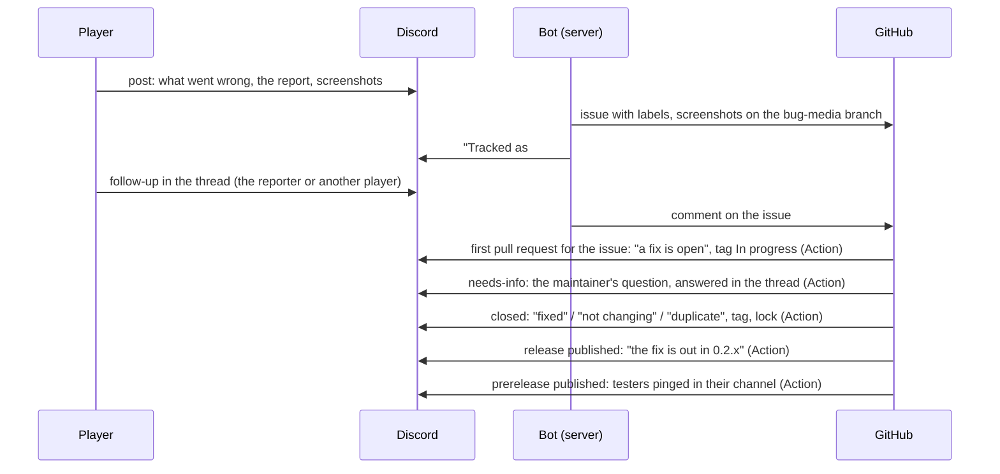

# The bug bot

Files every post in the Polestar Discord's #bugs forum as a GitHub issue,
and tells the player in their thread when the issue is fixed, dropped or
shipped. Node 24, no npm dependencies, no database.



| What happens | Who does it | What the player sees |
|---|---|---|
| A new post | the bot, at once | "Tracked as fitzforge/polestar#N. Replies in this thread, from anyone, are copied to the issue.", tag **Tracked** |
| Anyone writes in the thread (text, screenshots, a new report) | the bot | nothing; it becomes a comment on the issue, the reporter's marked "(the reporter)". The bot's own messages are not copied. Only the reporter's screenshots are copied to GitHub; other players' are linked on Discord. Each Discord user gets 3 new reports and 20 follow-ups (edits included) an hour; past that, the bot logs and skips them (a skipped post is filed by the next start's backfill) |
| The reporter edits the post's first message | the bot | nothing; the issue body is written again |
| A pull request addresses the issue for the first time (its title names `#N`, or it says `closes`/`fixes`/`resolves #N`) | `pr-links.yml` | ping: "A fix for this is open (#M). It still has to be reviewed; we'll tell you here when it's fixed.", tag **In progress**. Once per issue: more pull requests, edits and closes tell the thread nothing. On GitHub the issue gets one comment listing its pull requests, kept up to date, and the label `has-pr` (CONTRIBUTING.md, "Before you start") |
| Issue labelled **needs-info** | `discord-issue-sync.yml` | ping: "We need a little more to go on with this one", quoting the maintainer's last comment on the issue, and "Please answer here in the thread". The answer comes back to the issue as a follow-up. Tags unchanged |
| Issue closed as **completed** (button, or `Fixes #N` in a commit) | `discord-issue-sync.yml` | ping: "This is fixed and will ship in the next Polestar update", tag **Fixed**, thread locked |
| Issue closed as **not planned** | the same | ping: "We've decided not to change this one" (or, from `/close`, "No change is needed here", "We couldn't reproduce this one", "We're closing this one without a fix for now"), quoting your last comment on the issue as the reason; tag **Won't fix**, locked |
| Issue closed as **duplicate** of #M (`gh issue close N --duplicate-of M`, GitHub's "Close as duplicate", or `/close`), or closed as **not planned** with a maintainer's `Duplicate of #M` comment (what GitHub's website and older `gh` leave) and no other `resolution:` label | the same | ping: where #M stands, read from GitHub: labelled `released:vX` "It's the same bug as #M, and the fix is out in Polestar X"; labelled `fix-merged` or closed as completed "It's the same bug as #M, and that's already fixed: it ships in the next Polestar update"; closed as not planned "It's the same as #M, and we've decided not to change it" (or its `resolution:` label's words), quoting #M's last maintainer comment when it is 300 characters or less; open "we're tracking it in #M", with "A fix is in progress." when #M has `has-pr`. Then the maintainer's explanation on this issue: their latest comment that is more than the bare `Duplicate of #M` line. Tag **Duplicate**, locked |
| Issue reopened | the same | "We've reopened this", tag **Tracked**, unlocked |
| A release published | `discord-release-notify.yml` | ping: "The fix is out in **Polestar 0.2.x**", for every issue closed as completed that the release ships; the issue gets `released:v0.2.x` so it is never told twice. An issue closed by a commit (`Fixes #N`, a merged pull request) ships in the first full release whose tag holds that commit, so a fix merged into `next` waits for the feature release, however many patches go out first. One closed by hand (a patch's fix) ships in the first full release published after it closed. Prereleases do not count as the release before. Each issue from Discord closed as a duplicate of one the release ships (filed from Discord or not; found by GitHub's search for `reason:duplicate` and for a `Duplicate of` comment) gets "The fix for #M, the same bug as yours, is out in **Polestar 0.2.x**" and the same `released:` label, so it too is told once |
| A prerelease published (`v0.3.0-rc.1`: GitHub's prerelease flag, or a tag with a `-` part) | the same | nothing in the threads, and no `released:` label. The testers channel gets one message pinging the tester role: the tag, the release's link, the player entries from the tag's `changes/` (as many as fit), and a request to report in #bugs. A re-run finds that message (a bot message with the tag in bold, among the channel's last 50) and pings no one again |

## What an issue holds

The post's title, then "Reported by *name* on Discord" with a link to the
thread and the post's forum tags, the player's words (with the lines the
report sets under them, the right spot and the other addons), a table read
from the report's details (version, client and locale, character, guide,
step and the step the guide is really at, zone and map, errors), the details
folded under "Full report", and the screenshots.

Labels: `discord`, `triage` and `bug` on every one, then from the report
`v0.2.3`, `guide:01-elwynn-forest`, `locale:enUS` and `lua-error` when it
lists errors, then the forum tags (`questing`, `item`, `character`). The bot
creates any label the repository lacks, but a version, guide id or locale
only when it has a real one's shape (`0.2.5` or `0.2.5-test.1`, a lowercase
guide file name, a game locale); anything else gets no label.

Screenshots are copied only when their bytes are a PNG, JPEG, WebP or GIF
image of 5 MiB or less; anything else stays a link to Discord.

The report is read by its shape, not its words (the addon translates them),
so a German or French report fills the same table. A post without a report
is filed with its text alone.

The repository is public: the issue shows the player's server name and
words, never their Discord id. Their text cannot mention GitHub users, link
other issues or carry HTML. Say so in the #bugs guidelines, for example:
"Posts here are copied to our public GitHub issues so we can track them."

## Setting it up

### 1. Discord

1. In the [Developer Portal](https://discord.com/developers/applications),
   New Application, "Polestar Bot". Under **Bot**: Reset Token (that is
   `DISCORD_TOKEN`), turn off Public Bot, and turn on **Message Content
   Intent**.
2. Invite it, with your application id in place of `APP_ID`:
   `https://discord.com/oauth2/authorize?client_id=APP_ID&scope=bot+applications.commands&permissions=292057844736`
   (View Channels, Send Messages, Send Messages in Threads, Manage Threads,
   Read Message History; `applications.commands` for `/close` and
   `/reopen`). Should the log ever say "slash commands not registered"
   with a 403, open the link again; there is no need to remove the bot.
3. On #bugs, add five tags: **Tracked**, **In progress**, **Fixed**,
   **Won't fix** and **Duplicate**, each with "Only allow moderators to
   apply this tag". A missing one is skipped. A post tagged with any of
   them by hand is never filed.
4. Copy #bugs' channel id (User Settings, Advanced, Developer Mode; then
   right-click #bugs, Copy Channel ID): that is `DISCORD_FORUM_ID`.
5. For release candidates: a testers channel where the bot has View
   Channel, Send Messages and Read Message History, and a tester role it
   can ping (the role's "Allow anyone to @mention this role", or Mention
   All Roles for the bot in that channel). Copy the channel's id, that is
   `DISCORD_TESTERS_CHANNEL_ID`, and the role's (Server Settings, Roles,
   right-click the role, Copy Role ID), that is `DISCORD_TESTER_ROLE_ID`.

### 2. GitHub

1. A [fine-grained token](https://github.com/settings/personal-access-tokens/new)
   (or a GitHub App installation), repository `fitzforge/polestar` only,
   permission **Issues: Read and write** and nothing else. That is the bot's
   `GITHUB_TOKEN`. Give it no Contents permission: Contents write on this
   repository can push branches and replace release assets.

   Screenshots go to a separate public repository, `fitzforge/polestar-bug-media`
   (create it empty). Make a second fine-grained token with **Contents: Read
   and write** on that repository alone and set `MEDIA_REPO` and
   `MEDIA_TOKEN`. Without them the bot falls back to `GITHUB_REPO` and
   `GITHUB_TOKEN` (which then needs Contents on the main repository) and logs
   a warning on every start.

   Set `BOT_GITHUB_LOGIN` to the account the token acts as (an App's is
   `name[bot]`), in `.env` and as an Actions variable: only issues that
   account opened are then tied to a Discord thread.
2. In the repository's Settings, Secrets and variables, Actions: the secret
   `DISCORD_TOKEN` (the same bot token) and the variable `DISCORD_FORUM_ID`;
   for release candidates, the variables `DISCORD_TESTERS_CHANNEL_ID` and
   `DISCORD_TESTER_ROLE_ID`. Without both, a prerelease's run logs that no
   one is told and succeeds.
   The issue workflow runs from the repository's default branch (`next`),
   so it works once this folder and `.github/workflows/discord-*.yml` are
   there. A release runs the tagged commit's copy of the release workflow,
   which checks out the bot from `next`: a patch tag cut from an older
   release still gets the current bot. To announce a release again, run
   Discord release notes from the Actions tab on `next` with its tag.

### 3. The server

On any Linux host with Docker, apart from whatever else runs there (its own
Compose project and network, no ports, read-only, 256 MB):

```sh
git clone --depth 1 --filter=blob:none --sparse https://github.com/fitzforge/polestar.git ~/polestar-bot
cd ~/polestar-bot && git sparse-checkout set tools/discord-bot
cd tools/discord-bot && cp .env.example .env && chmod 600 .env
$EDITOR .env                       # the tokens and the forum id
docker compose up -d --build
docker compose logs -f             # "connected as ...", "backfill: N open posts, M filed"
```

`SYNC_SINCE` in `.env` keeps older posts out: the first start files every
open post made after it (all open posts when it is empty), skipping locked
ones and ones already carrying a status tag.

Update: `git -C ~/polestar-bot pull && docker compose up -d --build` in
`tools/discord-bot`.

After a change to how posts are read, `docker compose run --rm bot node
bot.js refresh` writes every filed issue again from its post (title, body,
the labels the report gives), then exits.

A restart loses nothing: the bot reads back which posts it filed (a hidden
marker in each issue body, and its "Tracked as" reply in each thread), files
the posts made while it was away, and Discord replays what a short drop
missed. Edits and follow-ups made during a long outage are not carried over.

## Closing from Discord

Server administrators can close or reopen a report from its #bugs thread.
The bot changes the issue on GitHub; `discord-issue-sync.yml` then tells
the thread, as when it is closed there. Only you see the bot's answer.

| Command | The issue | The reporter is told |
|---|---|---|
| `/close reason:Fixed` | closed as completed | "This is fixed and will ship in the next Polestar update", **Fixed** |
| `/close reason:Won't fix` | not planned, `resolution:wontfix` | "We've decided not to change this one", **Won't fix** |
| `/close reason:No action needed` | not planned, `resolution:no-action` | "No change is needed here", **Won't fix** |
| `/close reason:Can't reproduce` | not planned, `resolution:cannot-reproduce` | "We couldn't reproduce this one", **Won't fix** |
| `/close reason:Not resolved` | not planned, `resolution:not-resolved` | "We're closing this one without a fix for now", **Won't fix** |
| `/close reason:Duplicate duplicate_of:N` | duplicate, a `Duplicate of #N` comment | where #N stands, as above, **Duplicate** |
| `/reopen` | reopened, its `resolution:` label removed | "We've reopened this", **Tracked**, unlocked |

`note:` is posted on the issue as your comment; for the four not-planned
reasons it is quoted to the reporter under the first line, and for Duplicate
it follows the `Duplicate of #N` line and is quoted as the explanation. `issue:N` acts
on another issue, for use outside its thread. The commands are registered
in the forum's server for Administrators only, and each use is checked
again, so loosening them under Server Settings, Integrations lets others
see them but not use them.

## Working on it

`npm test` runs `tests/discord-bot.test.js` and `tests/discord-links.test.js`
over in-memory Discord and GitHub. To run the bot, `notify.js` or `links.js`
against something else, `DISCORD_API` and `GITHUB_API_URL` point the
clients elsewhere.

| File | What it does |
|---|---|
| `bot.js` | The service: settings, the gateway, the sync |
| `notify.js` | The Actions' entry: `issue` (closed, reopened), `pathing` (opened, labelled `navigation`) and `release` |
| `links.js` | The Actions' entry for pull requests: `event`, and `sweep` for every open one (`--dry-run`) |
| `lib/report.js` | The addon's report (`addon/Polestar/UI/Report.lua`) read back into fields |
| `lib/issue.js` | Issue title, body, labels and comments; the marker; making player text inert |
| `lib/sync.js` | Posts, follow-ups and edits to issues; the index and the backfill |
| `lib/notify.js` | Close, reopen and release messages, tags and locks; the testers' ping for a prerelease |
| `lib/pathing.js` | Pathing complaints (a new player issue about the walk or path, or one labelled `navigation`): `navigation` + `on-hold` and a note that the pathing overhaul should fix it, on the issue and in the thread, once (`.github/workflows/pathing-notice.yml`) |
| `lib/links.js` | Which issues a pull request addresses; the issue's pull requests comment, the overlap warning and their labels |
| `lib/gateway.js`, `lib/discord.js`, `lib/github.js` | The Discord gateway and the two REST APIs; the media branch |

A change to the report's layout in `Report.lua` needs `lib/report.js` and
its tests to follow.
