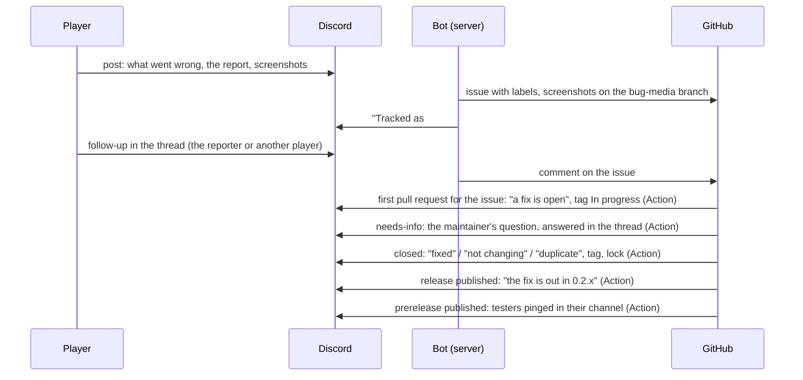

# The bug bot

Files every post in the Polestar Discord's #bugs forum as a GitHub issue,
and tells the player in their thread when the issue is fixed, dropped or
shipped. Node 24, no npm dependencies, no database.



| What happens | Who does it | What the player sees |
|---|---|---|
| A new post | the bot, at once | "Tracked as fitzforge/polestar#N. Replies in this thread, from anyone, are copied to the issue.", tag **Tracked** |
| A new post whose report is from an older Polestar than the latest full release (GitHub's latest release; drafts, prereleases, other releases such as the Client's, and `dev` builds never count; read at most every 10 minutes) | the bot, at once, after "Tracked as" | "You're on 0.3.6, 0.3.7 is out. Please update and tell us if it still happens. Download it from CurseForge: <link>", and the same as a comment on the issue (marked `polestar-bot:update`: never relayed back to the thread, never quoted as a maintainer's word). Once per issue: only as the post is filed |
| An issue opened on GitHub with a bug form whose **Polestar version** is older than the latest full release | `discord-issue-sync.yml` | the same reply as a comment on the issue, once (a re-run finds the mark). Issues filed from Discord are left to the bot |
| Anyone writes in the thread (text, screenshots, a new report) | the bot | nothing; it becomes a comment on the issue, the reporter's marked "(the reporter)". What is said before the post is filed (while it waits for the hourly limit) is copied, in order, once it is. The bot's own messages, pins, renames and a sticker or embed alone are not copied. Only the reporter's screenshots are copied to GitHub; other players' are linked on Discord. Each Discord user gets 5 new reports and 20 follow-ups (edits included) an hour; past that, the bot logs them and files them a second after the hour allows (up to 100 waiting; a restart drops the wait, and its backfill and catch-up file skipped posts and copy skipped follow-ups). A held post gets one reply, "Thanks! You've sent a few reports this hour; this one will be filed automatically in about N minutes.", which becomes the "Tracked as" reply once it is filed. Server staff (the owner, and roles with Administrator, Manage Server, Manage Messages or Manage Threads) and the users in `RATE_EXEMPT_IDS` have no limits |
| The reporter edits the post's first message | the bot | nothing; the issue body is written again |
| Anyone edits a later message | the bot | nothing; its comment is written again |
| A pull request addresses the issue for the first time (its title names `#N`, or it says `closes`/`fixes`/`resolves #N`) | `pr-links.yml` | ping: "A fix for this is open (#M). It still has to be reviewed; we'll tell you here when it's fixed.", tag **In progress**. Once per issue: more pull requests, edits and closes tell the thread nothing. On GitHub the issue gets one comment listing its pull requests, kept up to date, and the label `has-pr` (CONTRIBUTING.md, "Before you start") |
| A maintainer (owner, member or collaborator) comments on the issue | `discord-issue-replies.yml` | ping: "Reply on GitHub (#N):" and the comment as Discord shows Markdown (bold, bullets, quotes and code kept; headings bold; HTML comments and tags dropped; images and links as links, #N linked), cut under 2000 characters with "… full reply: <link>". Editing the comment edits that message; a re-run posts nothing twice. Never anyone else's comment, a bot's, the bot's copies of Discord follow-ups (`polestar-bot:followup`), the pull request lists, or a bare `Duplicate of #M` |
| Issue labelled **needs-info** | `discord-issue-sync.yml` | ping: "We need a little more to go on with this one", quoting the maintainer's last comment on the issue, and "Please answer here in the thread" ("please answer the question above" when that comment is in the thread already as a reply). The answer comes back to the issue as a follow-up. Tags unchanged. A not-planned or duplicate close likewise leaves out a quote the thread has already. Closed or labelled with a comment (the same action, or within 2 minutes): the notice waits 20 seconds for the comment's relay; if it came, no quote, else the notice quotes the comment and links it, and the relay then posts nothing (and leaves the notice alone on an edit). Either way the thread hears the comment once |
| Issue closed as **completed** (button, or `Fixes #N` in a commit) | `discord-issue-sync.yml` | ping: "This is fixed and will ship in the next Polestar update", tag **Fixed**, thread locked. When the fix is out already, "This is fixed, and the fix is out in **Polestar X**: update Polestar to get it", with the release notes: the issue is labelled `released:vX` (a sweep after a release), or its milestone is a full release published before it closed (a tidy-up after the release); the latter then gets `released:vX`, so the next release does not tell it again |
| Issue closed as **not planned** | the same | ping: "We've decided not to change this one" (or, from `/close`, "No change is needed here", "We couldn't reproduce this one", "We're closing this one without a fix for now"), quoting your last comment on the issue as the reason; tag **Won't fix**, locked |
| Issue closed as **duplicate** of #M (`gh issue close N --duplicate-of M`, GitHub's "Close as duplicate", or `/close`), or closed as **not planned** with a maintainer's `Duplicate of #M` comment (what GitHub's website and older `gh` leave) and no other `resolution:` label | the same | ping: where #M stands, read from GitHub: labelled `released:vX` "It's the same bug as #M, and the fix is out in Polestar X"; labelled `fix-merged` or closed as completed "It's the same bug as #M, and that's already fixed: it ships in the next Polestar update"; closed as not planned "It's the same as #M, and we've decided not to change it" (or its `resolution:` label's words), quoting #M's last maintainer comment when it is 300 characters or less; open "we're tracking it in #M", with "A fix is in progress." when #M has `has-pr`. Then the maintainer's explanation on this issue: their latest comment that is more than the bare `Duplicate of #M` line. Tag **Duplicate**, locked |
| Issue reopened | the same | "We've reopened this", tag **Tracked**, unlocked |
| A release published | `discord-release-notify.yml` | ping: "The fix is out in **Polestar 0.2.x**", for every issue closed as completed that the release ships; the issue gets `released:v0.2.x` so it is never told twice. An issue closed by a commit (`Fixes #N`, a merged pull request) ships in the first full release whose tag holds that commit, so a fix merged into `next` waits for the feature release, however many patches go out first. One closed by hand (a patch's fix) ships in the first full release published after it closed. Prereleases do not count as the release before. Each issue from Discord closed as a duplicate of one the release ships (filed from Discord or not; found by GitHub's search for `reason:duplicate` and for a `Duplicate of` comment) gets "The fix for #M, the same bug as yours, is out in **Polestar 0.2.x**" and the same `released:` label, so it too is told once. Issues closed after the run (a close even a minute after publishing misses it): Actions, Discord release notes, Run workflow with the tag and `issues` (e.g. `1390 1402`) tells exactly those, closed as completed and without a `released:` label, whatever their close time, and their duplicates |
| A prerelease published (`v0.3.0-rc.1`: GitHub's prerelease flag, or a tag with a `-` part) | the same | nothing in the threads, and no `released:` label. The testers channel gets one message pinging the tester role: the tag, the release's link, the player entries from the tag's `changes/` (as many as fit), and a request to report in #bugs. A re-run finds that message (a bot message with the tag in bold, among the channel's last 50) and pings no one again |
| An issue labelled `known-issue` changes, or a maintainer comments `Known issue:`/`Workaround:` on one; a release; daily; by hand | `discord-known-issues.yml` | the #known-issues board, edited in place (below) |

## What an issue holds

The post's whole title (a link in it kept as text), then "Reported by *name* on Discord" with a link to the
thread and the post's forum tags, the player's words (with the lines the
report sets under them, the right spot and the other addons), a table read
from the report's details (version, client and locale, character, guide,
step and the step the guide is really at, zone and map, routes, settings,
errors), the settings the player changed folded under "Settings", the
details folded under "Full report", and the screenshots.

The settings come from the report's Settings section (Report.lua,
`settingsSection`), found by its first line's English words under the
translated label. The table's row says how many changed and the profile
("23 changed · profile Raid (character)", or "all defaults"); the fold lists
one setting a line, `key = value (default d)`, as the report ranks them. A
report past the section's cap shows the settings that rank first and ends
its list with `+N more #<Adler-32 of them all>` and a packed line
(`!PSR1!<Adler-32>!<base64 of zlib>`: the settings the list left out, then
every look, one a line); the bot unfolds that and adds it to the list, which
then must match the Adler-32 after "+N more" (the packed line's own checksum
too; at most 64 KB unfolded). A packed line that is cut off, damaged or too
large, or a list that no longer matches, leaves
the list as the report shows it, the looks line and "+N more" under it, and
a note saying it did not unfold.

Labels: `discord`, `triage` and `bug` on every one, then from the report
`v0.2.3`, `guide:01-elwynn-forest`, `locale:enUS` and `lua-error` when it
lists errors, then the forum tags (`questing`, `item`, `character`). The bot
creates any label the repository lacks, but a version, guide id or locale
only when it has a real one's shape (`0.2.5` or `0.2.5-test.1`, a lowercase
guide file name, a game locale); anything else gets no label.

Screenshots are copied only when their bytes are a PNG, JPEG, WebP or GIF
image of 5 MiB or less; anything else stays a link to Discord. An image
bigger than that (a full-size PNG screenshot often is) is copied as the WebP
Discord's media proxy makes of it (`.webp`, about a tenth of the size), when
that fits.

The report is read by its shape, not its words (the addon translates them),
so a German or French report fills the same table. A post without a report
is filed with its text alone.

The repository is public: the issue shows the player's server name and
words, never their Discord id. Their text cannot mention GitHub users, link
other issues or carry HTML. Say so in the #bugs guidelines, for example:
"Posts here are copied to our public GitHub issues so we can track them."

## The #known-issues board

One post in #known-issues lists the problems players are likely to hit,
each with what to do meanwhile. It is written again from GitHub on every
run, so it never drifts and a run can be repeated at will.

```
**Known issues in Polestar 0.3.6**
-# Last updated <date, in the reader's time zone>
Problems we know about and are fixing, with what to do meanwhile. Something else wrong? Report it in #bugs.

**Westfall**
- #1234 The guide skips "Bounty on Murlocs" after a hearth. → Click the step back once.

**Fixed in the next update**
- #1201 ...

**Fixed in 0.3.6 (update to get the fix)**
- #1188 ...
```

- **What is listed**: issues labelled `known-issue`. Triage adds the label
  when an issue is confirmed and players are likely to run into it; it
  stays on when the issue closes.
- **The words**: a maintainer's (owner, member, collaborator) comment, or
  issue body, with the lines `Known issue: <one line for players>` and
  `Workaround: <one line>` (bold and list markers allowed); the newest of
  each counts, so a later comment corrects an earlier one. Without a
  `Known issue:` line the title is used (without `[Bug]`-style prefixes);
  without a `Workaround:` line the entry has no arrow. Players' comments
  are never read for these. All text is made inert: no mentions (`@everyone`
  and `@here` lose their `@`, user, role and channel mentions are dropped),
  no links (a link to one of this repository's issues becomes `#N`), Markdown
  escaped, one line, at most 140 characters (160 for the workaround).
- **Where it goes**: grouped by area: the guide (the first `guide:` label,
  `guide:02-westfall` as "Westfall"), else Arrow and travel (`navigation`),
  Guide engine (`engine`), Errors (`lua-error`), Polestar Client
  (`client`), else Addon. Groups by their newest issue, issues newest first.
  At most 20; past that a line says how many more and links the label's
  list on GitHub.
- **When it leaves**: open with `fix-merged`, or closed as completed after
  the latest release, it moves to "Fixed in the next update" (it keeps its
  workaround). Once the latest full release ships it (its `released:` label,
  or the release notes' rule above for what a release ships), it shows under
  "Fixed in X" for 7 days after X was published, then drops off. Closed as
  not planned or duplicate, it drops off at once. At most 10 per fixed
  section.
- **The post**: plain messages of under 2000 characters (a bot's limit),
  embeds suppressed, mentions disabled; a long board takes two or three,
  split between lines, never after a heading (past three, fewer known issues
  are shown). The bot's own messages in the channel, oldest first, are the
  board: each is edited when its text changes (not when only the date
  would), a new one is posted when the board grows and surplus ones are
  deleted when it shrinks. Nothing is stored anywhere else. Other people's
  messages in the channel are left alone; anything the bot itself posts
  there becomes part of the board.
- **When it runs**: `discord-known-issues.yml`, on a `known-issue` issue
  being labelled, unlabelled, closed, reopened or edited (and when the
  label is removed); a maintainer's comment with either line on one; a
  release published; daily at 06:17 UTC (drops week-old fixes, catches
  label changes made by other workflows, which start no runs); and by hand
  (Actions, Discord known issues, Run workflow). It does nothing while
  `KNOWN_ISSUES_CHANNEL_ID` is unset. `node tools/discord-bot/known.js
  --dry-run` prints the board with only `GITHUB_TOKEN` and
  `GITHUB_REPOSITORY` set.

## Setting it up

### 1. Discord

1. In the [Developer Portal](https://discord.com/developers/applications),
   New Application, "Polestar Bot". Under **Bot**: Reset Token (that is
   `DISCORD_TOKEN`), turn off Public Bot, and turn on **Message Content
   Intent**.
2. Invite it, with your application id in place of `APP_ID`:
   `https://discord.com/oauth2/authorize?client_id=APP_ID&scope=bot+applications.commands&permissions=292057844736`
   (View Channels, Send Messages, Send Messages in Threads, Manage Threads,
   Read Message History; `applications.commands` for `/close` and
   `/reopen`). Should the log ever say "slash commands not registered"
   with a 403, open the link again; there is no need to remove the bot.
3. On #bugs, add five tags: **Tracked**, **In progress**, **Fixed**,
   **Won't fix** and **Duplicate**, each with "Only allow moderators to
   apply this tag". A missing one is skipped. A post tagged with any of
   them by hand is never filed.
4. Copy #bugs' channel id (User Settings, Advanced, Developer Mode; then
   right-click #bugs, Copy Channel ID): that is `DISCORD_FORUM_ID`.
5. For release candidates: a testers channel where the bot has View
   Channel, Send Messages and Read Message History, and a tester role it
   can ping (the role's "Allow anyone to @mention this role", or Mention
   All Roles for the bot in that channel). Copy the channel's id, that is
   `DISCORD_TESTERS_CHANNEL_ID`, and the role's (Server Settings, Roles,
   right-click the role, Copy Role ID), that is `DISCORD_TESTER_ROLE_ID`.
6. For the known-issues board: in #known-issues (read-only for players),
   give the bot View Channel, Send Messages and Read Message History (a
   permission override for the bot's role or the bot). Copy the channel's
   id: that is `KNOWN_ISSUES_CHANNEL_ID`.

### 2. GitHub

1. A [fine-grained token](https://github.com/settings/personal-access-tokens/new)
   (or a GitHub App installation), repository `fitzforge/polestar` only,
   permission **Issues: Read and write** and nothing else. That is the bot's
   `GITHUB_TOKEN`. Give it no Contents permission: Contents write on this
   repository can push branches and replace release assets.

   Screenshots go to a separate public repository, `fitzforge/polestar-bug-media`
   (create it empty). Make a second fine-grained token with **Contents: Read
   and write** on that repository alone and set `MEDIA_REPO` and
   `MEDIA_TOKEN`. Without them the bot falls back to `GITHUB_REPO` and
   `GITHUB_TOKEN` (which then needs Contents on the main repository) and logs
   a warning on every start.

   Set `BOT_GITHUB_LOGIN` to the account the token acts as (an App's is
   `name[bot]`), in `.env` and as an Actions variable: only issues that
   account opened are then tied to a Discord thread.
2. In the repository's Settings, Secrets and variables, Actions: the secret
   `DISCORD_TOKEN` (the same bot token) and the variable `DISCORD_FORUM_ID`;
   for release candidates, the variables `DISCORD_TESTERS_CHANNEL_ID` and
   `DISCORD_TESTER_ROLE_ID`. Without both, a prerelease's run logs that no
   one is told and succeeds. For the known-issues board, the variable
   `KNOWN_ISSUES_CHANNEL_ID`, and the label `known-issue`.
   The issue workflow runs from the repository's default branch (`next`),
   so it works once this folder and `.github/workflows/discord-*.yml` are
   there. A release runs the tagged commit's copy of the release workflow,
   which checks out the bot from `next`: a patch tag cut from an older
   release still gets the current bot. To announce a release again, run
   Discord release notes from the Actions tab on `next` with its tag.

### 3. The server

On any Linux host with Docker, apart from whatever else runs there (its own
Compose project and network, no ports, read-only, 256 MB):

```sh
git clone --depth 1 --filter=blob:none --sparse https://github.com/fitzforge/polestar.git ~/polestar-bot
cd ~/polestar-bot && git sparse-checkout set tools/discord-bot
cd tools/discord-bot && cp .env.example .env && chmod 600 .env
$EDITOR .env                       # the tokens and the forum id
docker compose up -d --build
docker compose logs -f             # "connected as ...", "backfill: N open posts, M filed"
```

`SYNC_SINCE` in `.env` keeps older posts out: the first start files every
open post made after it (all open posts when it is empty), skipping locked
ones and ones already carrying a status tag.

Update: `git -C ~/polestar-bot pull && docker compose up -d --build` in
`tools/discord-bot`.

After a change to how posts are read, `docker compose run --rm bot node
bot.js refresh` writes every filed issue again from its post (title, body,
the labels the report gives), then exits.

A restart loses nothing: the bot reads back which posts it filed (a hidden
marker in each issue body, and its "Tracked as" reply in each thread) and
which messages each issue has (each comment links its message). On every
new gateway session (a start, or a drop Discord can't resume) it files the
open posts made while it was away and copies, oldest first, every message of
the last week in an open post's thread that its issue lacks (older ones need
a one-off backfill); Discord replays what a resumed drop missed. A comment
GitHub fails to take is tried again by the same catch-up 5 minutes later,
backing off to an hour. A post a player tagged In progress is filed like any
other: only the status tags moderators set mean a post was handled.

## Closing from Discord

Server administrators can close or reopen a report from its #bugs thread.
The bot changes the issue on GitHub; `discord-issue-sync.yml` then tells
the thread, as when it is closed there. Only you see the bot's answer.

| Command | The issue | The reporter is told |
|---|---|---|
| `/close reason:Fixed` | closed as completed | "This is fixed and will ship in the next Polestar update", **Fixed** |
| `/close reason:Won't fix` | not planned, `resolution:wontfix` | "We've decided not to change this one", **Won't fix** |
| `/close reason:No action needed` | not planned, `resolution:no-action` | "No change is needed here", **Won't fix** |
| `/close reason:Can't reproduce` | not planned, `resolution:cannot-reproduce` | "We couldn't reproduce this one", **Won't fix** |
| `/close reason:Not resolved` | not planned, `resolution:not-resolved` | "We're closing this one without a fix for now", **Won't fix** |
| `/close reason:Duplicate duplicate_of:N` | duplicate, a `Duplicate of #N` comment | where #N stands, as above, **Duplicate** |
| `/reopen` | reopened, its `resolution:` label removed | "We've reopened this", **Tracked**, unlocked |

`note:` is posted on the issue as your comment; for the four not-planned
reasons it is quoted to the reporter under the first line, and for Duplicate
it follows the `Duplicate of #N` line and is quoted as the explanation. `issue:N` acts
on another issue, for use outside its thread. The commands are registered
in the forum's server for Administrators only, and each use is checked
again, so loosening them under Server Settings, Integrations lets others
see them but not use them.

## Working on it

`npm test` runs `tests/discord-bot.test.js`, `tests/discord-links.test.js`
and `tests/discord-known.test.js` over in-memory Discord and GitHub. To run
the bot, `notify.js`, `links.js` or `known.js` against something else,
`DISCORD_API` and `GITHUB_API_URL` point the clients elsewhere.

| File | What it does |
|---|---|
| `bot.js` | The service: settings, the gateway, the sync |
| `notify.js` | The Actions' entry: `issue` (closed, reopened), `comment`, `release`, and `update` (an issue opened on GitHub) |
| `links.js` | The Actions' entry for pull requests: `event`, and `sweep` for every open one (`--dry-run`) |
| `known.js` | The Actions' entry for the #known-issues board (`--dry-run` prints it) |
| `lib/report.js` | The addon's report (`addon/Polestar/UI/Report.lua`) read back into fields |
| `lib/issue.js` | Issue title, body, labels and comments; the marker; making player text inert |
| `lib/sync.js` | Posts, follow-ups and edits to issues; the index and the backfill |
| `lib/notify.js` | Close, reopen and release messages, tags and locks; the testers' ping for a prerelease |
| `lib/update.js` | The update reply: versions compared, the latest full release (kept 10 minutes), the reply's words, the bug form's version |
| `lib/links.js` | Which issues a pull request addresses; the issue's pull requests comment, the overlap warning and their labels |
| `lib/known.js` | The #known-issues board: which issues, their words made inert, grouping, the fixed sections, splitting and writing in place |
| `lib/gateway.js`, `lib/discord.js`, `lib/github.js` | The Discord gateway and the two REST APIs; the media branch |

A change to the report's layout in `Report.lua` needs `lib/report.js` and
its tests to follow.
