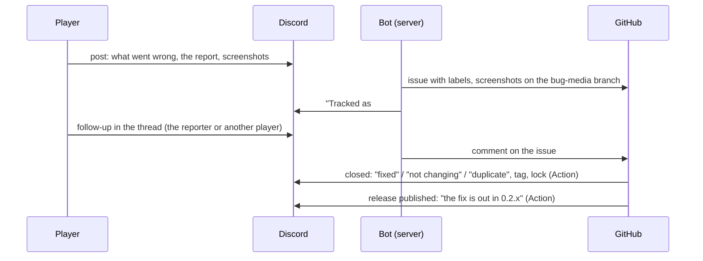

# The bug bot

Files every post in the Polestar Discord's #bugs forum as a GitHub issue,
and tells the player in their thread when the issue is fixed, dropped or
shipped. Node 24, no npm dependencies, no database.



| What happens | Who does it | What the player sees |
|---|---|---|
| A new post | the bot, at once | "Tracked as fitzforge/polestar#N", tag **Tracked** |
| Anyone writes in the thread (text, screenshots, a new report) | the bot | nothing; it becomes a comment on the issue, the reporter's marked "(the reporter)". The bot's own messages are not copied |
| The reporter edits the post's first message | the bot | nothing; the issue body is written again |
| Issue closed as **completed** (button, or `Fixes #N` in a commit) | `discord-issue-sync.yml` | ping: "This is fixed and will ship in the next Polestar update", tag **Fixed**, thread locked |
| Issue closed as **not planned** | the same | ping: "We've decided not to change this one" (or, from `/close`, "No change is needed here", "We couldn't reproduce this one", "We're closing this one without a fix for now"), quoting your last comment on the issue as the reason; tag **Won't fix**, locked |
| Issue closed as **duplicate** | the same | ping: "already reported, tracked in #M" (from a `Duplicate of #M` comment); tag **Duplicate**, locked |
| Issue reopened | the same | "We've reopened this", tag **Tracked**, unlocked |
| A release published | `discord-release-notify.yml` | ping: "The fix is out in **Polestar 0.2.x**", for every issue closed as completed since the full release before; the issue gets `released:v0.2.x` so it is never told twice. A pre-release (a test build) tells no one and is never "the release before" |

## What an issue holds

The post's title, then "Reported by *name* on Discord" with a link to the
thread and the post's forum tags, the player's words, a table read from the
report (version, client and locale, character, guide, step and the step the
guide is really at, zone and map, errors), the whole report folded under
"Full report", and the screenshots.

Labels: `discord`, `triage` and `bug` on every one, then from the report
`v0.2.3`, `guide:01-elwynn-forest`, `locale:enUS` and `lua-error` when it
lists errors, then the forum tags (`questing`, `item`, `character`). The bot
creates any label the repository lacks.

The report is read by its shape, not its words (the addon translates them),
so a German or French report fills the same table. A post without a report
is filed with its text alone.

The repository is public: the issue shows the player's server name and
words, never their Discord id. Their text cannot mention GitHub users, link
other issues or carry HTML. Say so in the #bugs guidelines, for example:
"Posts here are copied to our public GitHub issues so we can track them."

## Setting it up

### 1. Discord

1. In the [Developer Portal](https://discord.com/developers/applications),
   New Application, "Polestar Bot". Under **Bot**: Reset Token (that is
   `DISCORD_TOKEN`), turn off Public Bot, and turn on **Message Content
   Intent**.
2. Invite it, with your application id in place of `APP_ID`:
   `https://discord.com/oauth2/authorize?client_id=APP_ID&scope=bot+applications.commands&permissions=292057844736`
   (View Channels, Send Messages, Send Messages in Threads, Manage Threads,
   Read Message History; `applications.commands` for `/close` and
   `/reopen`). Should the log ever say "slash commands not registered"
   with a 403, open the link again; there is no need to remove the bot.
3. On #bugs, add four tags: **Tracked**, **Fixed**, **Won't fix** and
   **Duplicate**, each with "Only allow moderators to apply this tag". A
   missing one is skipped. A post tagged with any of them by hand is never
   filed.
4. Copy #bugs' channel id (User Settings, Advanced, Developer Mode; then
   right-click #bugs, Copy Channel ID): that is `DISCORD_FORUM_ID`.

### 2. GitHub

1. A [fine-grained token](https://github.com/settings/personal-access-tokens/new),
   repository `fitzforge/polestar` only, permissions **Issues: Read and
   write** and **Contents: Read and write** (the screenshots branch). That is
   the bot's `GITHUB_TOKEN`.

   Contents write on this repository can push to any branch, `main`
   included, and `main` has no protection. To keep that out of the bot's
   hands, make a public `fitzforge/polestar-bug-media` repository, give the
   bot a second token with Contents on that one alone, and set `MEDIA_REPO`
   and `MEDIA_TOKEN`; the first token then needs Issues only.
2. In the repository's Settings, Secrets and variables, Actions: the secret
   `DISCORD_TOKEN` (the same bot token) and the variable `DISCORD_FORUM_ID`.
   The workflows run from the repository's default branch (`next`), so they
   work once this folder and `.github/workflows/discord-*.yml` are there.

### 3. The server

On any Linux host with Docker, apart from whatever else runs there (its own
Compose project and network, no ports, read-only, 256 MB):

```sh
git clone --depth 1 --filter=blob:none --sparse https://github.com/fitzforge/polestar.git ~/polestar-bot
cd ~/polestar-bot && git sparse-checkout set tools/discord-bot
cd tools/discord-bot && cp .env.example .env && chmod 600 .env
$EDITOR .env                       # the tokens and the forum id
docker compose up -d --build
docker compose logs -f             # "connected as ...", "backfill: N open posts, M filed"
```

`SYNC_SINCE` in `.env` keeps older posts out: the first start files every
open post made after it (all open posts when it is empty), skipping locked
ones and ones already carrying a status tag.

Update: `git -C ~/polestar-bot pull && docker compose up -d --build` in
`tools/discord-bot`.

After a change to how posts are read, `docker compose run --rm bot node
bot.js refresh` writes every filed issue again from its post (title, body,
the labels the report gives), then exits.

A restart loses nothing: the bot reads back which posts it filed (a hidden
marker in each issue body, and its "Tracked as" reply in each thread), files
the posts made while it was away, and Discord replays what a short drop
missed. Edits and follow-ups made during a long outage are not carried over.

## Closing from Discord

Server administrators can close or reopen a report from its #bugs thread.
The bot changes the issue on GitHub; `discord-issue-sync.yml` then tells
the thread, as when it is closed there. Only you see the bot's answer.

| Command | The issue | The reporter is told |
|---|---|---|
| `/close reason:Fixed` | closed as completed | "This is fixed and will ship in the next Polestar update", **Fixed** |
| `/close reason:Won't fix` | not planned, `resolution:wontfix` | "We've decided not to change this one", **Won't fix** |
| `/close reason:No action needed` | not planned, `resolution:no-action` | "No change is needed here", **Won't fix** |
| `/close reason:Can't reproduce` | not planned, `resolution:cannot-reproduce` | "We couldn't reproduce this one", **Won't fix** |
| `/close reason:Not resolved` | not planned, `resolution:not-resolved` | "We're closing this one without a fix for now", **Won't fix** |
| `/close reason:Duplicate duplicate_of:N` | duplicate, a `Duplicate of #N` comment | "already reported, tracked in #N", **Duplicate** |
| `/reopen` | reopened, its `resolution:` label removed | "We've reopened this", **Tracked**, unlocked |

`note:` is posted on the issue as your comment; for the four not-planned
reasons it is quoted to the reporter under the first line. `issue:N` acts
on another issue, for use outside its thread. The commands are registered
in the forum's server for Administrators only, and each use is checked
again, so loosening them under Server Settings, Integrations lets others
see them but not use them.

## Working on it

`npm test` runs `tests/discord-bot.test.js` over in-memory Discord and
GitHub. To run the bot or `notify.js` against something else,
`DISCORD_API` and `GITHUB_API_URL` point the clients elsewhere.

| File | What it does |
|---|---|
| `bot.js` | The service: settings, the gateway, the sync |
| `notify.js` | The Actions' entry: `issue` (closed, reopened) and `release` |
| `lib/report.js` | The addon's report (`addon/Polestar/UI/Report.lua`) read back into fields |
| `lib/issue.js` | Issue title, body, labels and comments; the marker; making player text inert |
| `lib/sync.js` | Posts, follow-ups and edits to issues; the index and the backfill |
| `lib/notify.js` | Close, reopen and release messages, tags and locks |
| `lib/gateway.js`, `lib/discord.js`, `lib/github.js` | The Discord gateway and the two REST APIs; the media branch |

A change to the report's layout in `Report.lua` needs `lib/report.js` and
its tests to follow.
